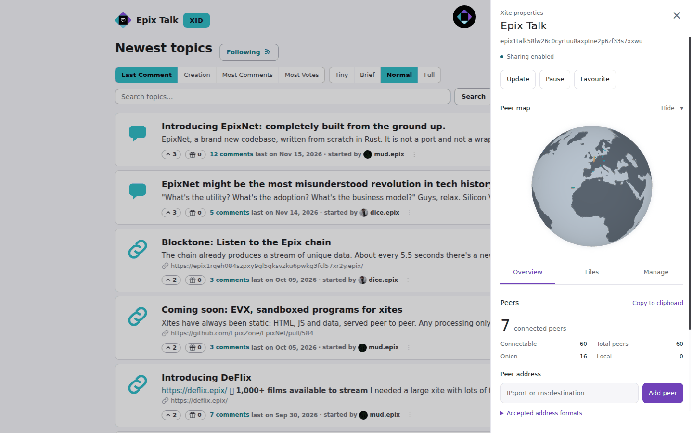

# Build xites with AI coding agents

This guide shows how to build a xite (an EpixNet website) with an AI coding agent such as Claude Code, Cursor, Codex or a Copilot agent. It covers project setup, the working loop, how an agent can check its own work, and the safety rules that keep your keys and your published xite under your control. It is written for developers who already use an agent for ordinary web work and want the same speed on EpixNet without the usual false starts.

If you have not built a xite by hand yet, read the [quick start](../build/quickstart.md) first. Twenty minutes there makes everything on this page easier to judge.

## Why xites suit agents

A xite is a good target for an agent for practical reasons:

- **A xite is a folder of static files.** HTML, CSS, JavaScript and JSON, plus one signed manifest named `content.json`. There is nothing to provision and nothing to deploy to.
- **No build step is required.** The official xites (Epix Talk, Epix Sites, the Dashboard) are plain ES6 scripts loaded with `<script>` tags. An agent edits the files that run.
- **Your node serves the working copy as it is on disk.** Edit a file, reload `http://127.0.0.1:42222/<address>/`, and the change is there. Scripts and stylesheets are revalidated on every load, so there is no stale cache to fight.
- **Publishing is a separate, deliberate step.** Nothing an agent writes reaches another node until the owner signs. That gives you a natural review gate.
- **The API is small and typed.** A page talks to the node through one bridge library, [EpixFrame](../libraries/epixframe.md), which ships TypeScript definitions.
- **Logic is testable with plain Node.js.** The official xites test their page code with `node --test` against a stubbed bridge. No browser and no running node are needed for most checks.

The catch is that an agent's habits come from the ordinary web, and several of them are wrong here. There is no server to call, the page runs in a sandboxed iframe, browser storage may not exist, and the database is a read-only projection of signed files. An agent that is not told these things produces code that works on your machine and fails for visitors. Most of this guide is about giving the agent that context once, in a file it reads every session.

## What you need

- A running EpixNet node. See [Install EpixNet](../start/install.md) and [Run a node](../start/running.md).
- A xite you own. The [quick start](../build/quickstart.md) creates one from the Dashboard or with `epix-server siteCreate`.
- An agent tool that can read and edit a local folder. Shell access is useful for verification but not required.
- Node.js, if you want the agent to run tests. The official xites run theirs with Node.js 22.13 or newer.

## Set up the project

### 1. Open the xite folder as the project

A xite lives at `<data folder>/data/<address>/`. The default data folder for each platform is listed in [Run a node](../start/running.md#data-folder), and the xite sidebar's **Files** tab has a **Show directory** action that opens the folder for you.

Open that folder, and only that folder, as the project in your agent tool.

!!! danger "Do not open the data folder itself"
    `<data folder>/private/` sits next to `data/`. It holds `users.json` with your master seed and the saved owner keys of your xites. An agent whose project root is the data folder can read all of it. Keep the project root at the xite folder, and add an explicit rule that the agent must not read `private/` (see [Safety](#safety)).

A new xite contains `content.json` and `index.html`. A layout that works well with agents looks like this:

```text
<address>/
├── AGENTS.md             context file for agents (next step)
├── content.json          signed manifest: the agent never edits the generated parts
├── index.html
├── dbschema.json         optional: maps JSON files to SQL tables
├── css/  img/
├── js/
│   ├── lib/              vendored libraries: epixframe.min.js, epixkit.js
│   └── app.js
├── data/                 JSON data signed by you
├── languages/            optional translation dictionaries
├── tests/                Node tests with no dependencies
└── types/                epixframe.d.ts, for the agent and your editor
```

### 2. Put the folder under version control

Git is optional, and strongly recommended with an agent: it gives you a diff to review before you sign and a way back when an experiment goes wrong. The official xites are developed with the repository root as the xite root. See [Keep the xite folder in git](../build/publishing.md#keep-the-xite-folder-in-git) for the full workflow.

```sh
git init
printf '*.db\ndata/users/*/\n' > .gitignore
```

Then tell the signer what is not part of the published xite. Set `ignore` in `content.json` to a regular expression that is matched from the start of each file path:

```json title="content.json (excerpt)"
{
  "ignore": "(\\.git|\\.claude/|\\.cursor/|AGENTS\\.md|CLAUDE\\.md|tests/|types/)"
}
```

Three facts about signing explain this pattern:

- **Everything in the folder is published unless `ignore` excludes it.** That includes `AGENTS.md`, tests, notes and anything else an agent creates.
- **Only files whose own name starts with a dot are skipped automatically.** A file inside a dot directory, such as `.git/config` or `.claude/settings.json`, is signed unless the directory is excluded. `\\.git` also covers `.github/`. See [What signing always skips](../build/content-json.md#what-signing-always-skips).
- **A new xite starts with an empty `ignore`.** That holds whether you create it from the Dashboard or with `epix-server siteCreate`, so set `ignore` yourself before your first signature. (On EpixNet v0.6.8 a xite created from the Dashboard inherits the Dashboard's own pattern instead. Replace it with yours.)

Publishing your tests and context file is a legitimate choice (the official xites publish their `README.md` and tests). Decide deliberately.

### 3. Keep toolchains out of the folder

When you sign, the node walks every file in the xite folder before it applies `ignore`. The walk stops with an error at the first symbolic link it meets, or after 100,000 entries. A `node_modules` tree inside the xite, with its symlinked `.bin` entries, can therefore make signing fail even when it is listed in `ignore`.

Install test tools such as Playwright in a separate folder. If your project has a build step, keep the source project elsewhere and write only the build output into the xite folder. See [Frameworks and bundlers](../libraries/react.md).

### 4. Add the context file

An agent reads a context file at the start of every session. For xites, that file is where the sandbox rules, the data model and the "never sign" rule live.

Copy the ready-made [AGENTS.md for xite projects](agents-md.md) into the xite folder and fill in the project facts at the top. That page also explains which file name each tool reads.

### 5. Give the agent reference material

| Material | Where it comes from | Where to put it |
| --- | --- | --- |
| EpixFrame library | `dist/epixframe.min.js` in the [EpixFrame repository](https://github.com/EpixZone/epixframe) | `js/lib/epixframe.min.js` |
| EpixFrame type definitions | `types/epixframe.d.ts` in the same repository | `types/epixframe.d.ts` |
| EpixKit, if you use a wallet | `epixkit.js` in the [EpixKit repository](https://github.com/EpixZone/epixkit) | `js/lib/epixkit.js` |
| These docs | The Markdown sources under `docs/en/` in the [docs repository](https://github.com/EpixZone/EpixNetDocs) | Outside the xite folder, added to the agent as an extra directory, or copied into an ignored folder |

The docs include a machine-readable index, [`llms.txt`](../llms.txt), that opens with the core facts an agent needs and then lists every page with a one-line description. Point the agent at it first.

!!! note "Types describe the library, the API reference describes the node"
    The type definitions list EpixFrame's helper methods. Whether the node implements a command, and with which parameters, is documented in the [API reference](../api/index.md). A command the node does not know returns `null` without an error, so a guessed command name fails quietly. Tell the agent to look commands up, not to infer them.

## The working loop

1. **Describe** the change. Name the files involved and the result you expect to see. The [prompt cookbook](prompts.md) has complete prompts for common tasks.
2. **Let the agent edit** files in the xite folder.
3. **Reload** `http://127.0.0.1:42222/<address>/` and look at the result.
4. **Verify.** The agent runs its checks (next section). You test what only a person can: identity prompts, wallet prompts, the feel of the page.
5. **Review the diff.** Read what changed before you sign it. `git diff` is the simplest tool.
6. **Sign and publish, yourself.** Open the xite sidebar, go to the **Manage** tab and choose **Sign and publish**. See [Sign and publish](../build/publishing.md).



### What is live on reload and what needs your signature

Not every edit is visible before signing. This table is the most useful thing to understand about the loop:

| Change | Visible on your node | Visible to other nodes |
| --- | --- | --- |
| HTML, CSS, JavaScript, images | On reload | After you sign and publish |
| A JSON file the page reads with `fileGet` | On reload | After you sign and publish |
| `dbschema.json`, or any declared `.json` file that feeds the database | After you sign | After you sign and publish |
| A new JSON data file that should appear in the database | After you sign | After you sign and publish |
| `title`, `description`, `ignore` and other fields in `content.json` | After you sign | After you sign and publish |

The database rows are the surprise. The node builds a xite's SQL database only from files declared in the signed manifest, and it checks each file against its signed size and hash. An agent that edits `data/notes.json` and then queries the database sees the old rows, or the error `xite has no current database` once a rebuild has been refused. Nothing is broken: the data needs a signature. The details are in [Only signed inputs are loaded](../build/database.md#only-signed-inputs-are-loaded).

### Iterate on database work in a scratch xite

Signing your real xite makes the new version available to every node that follows it, so you do not want to sign half-finished database work there.

Create a second xite for development and never share its address. A xite that no other node has downloaded has no audience, so signing it as often as you like changes nothing for anyone. When the feature works, copy the files into the real xite folder and sign there.

- Copy everything except `content.json` and `data/users/`. The manifest belongs to one address and cannot be reused for another. Carry your descriptive fields and patterns over by hand.
- Do not treat an unshared address as private. Nothing stops another node from fetching the xite if it learns the address.
- `epix-server siteSign <address>` signs without publishing, which is all a scratch xite needs.

## How an agent can verify its own work

An agent that can run commands can check a great deal without you. These are the mechanisms that exist today, from cheapest to most complete.

| Mechanism | Needs | Catches |
| --- | --- | --- |
| Syntax and JSON checks | Node.js | Parse errors, broken JSON |
| Node tests against a stubbed bridge | Node.js | Logic, error handling, rendering decisions |
| Offline node actions | The node stopped | Files that differ from the signed manifest, database contents |
| `siteCmd` against the running node | Linux or macOS, the node running | Live state: modified files, queries, files as the node sees them |
| The node log | Read access to `debug.log` | Refused database rebuilds, signing and verification errors |
| Browser automation | A browser tool | Runtime errors, missing files, layout |

### Syntax and JSON checks

```sh
node --check js/app.js
node -e "JSON.parse(require('fs').readFileSync('dbschema.json', 'utf8'))"
```

A single syntax error in a classic script stops the whole file, and invalid JSON in `dbschema.json` means no database. Both are worth one second.

### Node tests against a stubbed bridge

Page code reaches the node only through the bridge's `cmd` function. If your modules take the bridge as an argument, a test can pass an object that returns fixture data. This is how Epix Mesh Chat and Epix Talk test their logic.

Write modules so they load both in the browser and in Node. This export pattern is the one Mesh Chat uses:

```js title="js/notes.js"
(function (global) {
  "use strict";

  // Pure logic: no DOM and no node.
  function newestFirst(rows) {
    return rows.slice().sort(function (a, b) { return b.date_added - a.date_added; });
  }

  // Everything that talks to the node goes through `frame`.
  async function loadNotes(frame) {
    var rows = await frame.cmd("dbQuery", [
      "SELECT * FROM note ORDER BY date_added DESC LIMIT :limit",
      { limit: 50 }
    ]);
    return newestFirst(rows);
  }

  var api = { newestFirst: newestFirst, loadNotes: loadNotes };
  if (typeof module !== "undefined") module.exports = api;
  else global.Notes = api;
})(typeof window === "undefined" ? globalThis : window);
```

```js title="tests/notes.test.cjs"
const test = require("node:test");
const assert = require("node:assert/strict");
const { loadNotes } = require("../js/notes.js");

test("loadNotes queries the database and returns newest first", async () => {
  const calls = [];
  const frame = {
    cmd: async (name, params) => {
      calls.push([name, params]);
      return [{ note_id: 1, date_added: 10 }, { note_id: 2, date_added: 20 }];
    }
  };
  const notes = await loadNotes(frame);
  assert.equal(calls[0][0], "dbQuery");
  assert.deepEqual(notes.map((note) => note.note_id), [2, 1]);
});

test("a failed query rejects instead of rendering an error object", async () => {
  const frame = { cmd: async () => { throw { error: "xite has no current database" }; } };
  await assert.rejects(loadNotes(frame));
});
```

```sh
node --test tests/*.test.cjs
```

The stub mirrors EpixFrame's Promise style, where a failed command rejects with `{error: "..."}`. Ask the agent to add a test with every feature and to run the suite before it reports back.

### Ask the node

The `epix-server` binary doubles as a diagnostics tool. Which commands work depends on whether a node is running on the data folder. The full rules are in [Command line actions](../start/running.md#command-line-actions).

=== "Node running (Linux and macOS)"

    `siteCmd` sends any API command to the running node through a local admin socket and prints the result as JSON.

    ```sh
    # Files that differ from the signed manifest
    epix-server siteCmd <address> siteListModifiedFiles

    # Query the database
    epix-server siteCmd <address> dbQuery '["SELECT COUNT(*) AS n FROM note"]'

    # Read a file as the node sees it
    epix-server siteCmd <address> fileGet '{"inner_path": "data/notes.json", "required": false}'

    # Recent node log lines
    epix-server siteCmd <address> consoleLogRead
    ```

    `siteListModifiedFiles` answers `{"modified_files": [...]}`. Without a running node, `siteCmd` fails with `node is not running (no admin socket)`. Windows has no admin socket, so use the offline actions there.

=== "Node stopped (all platforms)"

    These actions open the data folder directly and need exclusive use of it. They fail while a node is running on the same folder.

    ```sh
    epix-server siteVerify <address>
    epix-server dbRebuild <address>
    epix-server dbQuery <address> "SELECT COUNT(*) AS n FROM note"
    ```

    | Action | Success | Failure |
    | --- | --- | --- |
    | `siteVerify` | `[OK] <address>: 12 file(s) verified in 0.004s` | One `[CHANGED] <path>` line per file, then exit status 1 |
    | `dbRebuild` | `Db rebuilt in 0.120s` | `No db for this xite (no dbschema.json?)` |
    | `dbQuery` | The rows as JSON | `dbQuery: <error>` and exit status 1 |

How to read the results:

- **Changed files are expected while you work.** `siteVerify` and `siteListModifiedFiles` compare the required files listed in the root `content.json` with what is on disk. After an agent's edits they list exactly what the next signature will change. They do not list brand-new files, optional files or files in user directories.
- **`dbRebuild` reports one message for several causes.** It prints `No db for this xite` when there is no `dbschema.json`, when the schema could not be applied, and when the rebuild was refused because a declared `.json` file no longer matches its signed hash. The node log tells them apart.
- **A non-default data folder** is selected with `EPIX_DATA_DIR`, for the node and for every action alike.

!!! warning "siteCmd is an operator channel"
    Commands sent through the admin socket run with full access, without the limits a page has. That includes signing, publishing, deleting xites and changing configuration. If you let an agent use `siteCmd`, allow only the read-only commands shown above, and prefer your tool's command allowlist over trust.

### Read the node log

The standalone node (`epix-server`) writes its log to `debug.log` in the data folder. The Dashboard also has a console log viewer, and `consoleLogRead` returns recent lines through `siteCmd`.

Messages worth knowing:

| Log message | Meaning |
| --- | --- |
| `db rebuild <address>: authority snapshot failed: database input size mismatch: <file>` | A declared `.json` file was edited after it was signed. Sign, or restore the file. |
| `db rebuild <address>: refused, no usable authority/snapshot` | The rebuild was abandoned for the reason logged just before it. |
| `Database build failed for <address>; existing database kept` | `dbschema.json` could not be applied. Check the schema. |
| `unhandled ws command: <name>` | The page called a command the node does not implement. Printed to the node's console output. |

The two `db rebuild` messages are logged at the debug level (the `Database build failed` message is an error). Raise **Level of logging to file** on the Config page if you do not see them.

`debug.log` is in the data folder next to `private/`. Grant the agent that one file, not the folder.

### Drive a browser

A browser check catches what tests cannot: a missing file, a script that throws on load, a layout that collapses. Two things are specific to EpixNet.

**The xite runs inside the wrapper's iframe.** The page at `http://127.0.0.1:42222/<address>/` is the wrapper, a page the node serves. Your `index.html` is loaded in the iframe with the id `inner-iframe`. On a local node that iframe has its own origin (`http://epix-<address>.localhost:<port>/`), so a script evaluated in the top page cannot reach into it. Use the frame support of your automation tool. The node's own browser tests use Playwright's `frameLocator("#inner-iframe")`.

**The page is ready after its first commands answer, not at the load event.** Wait for something your page renders once it has data.

```js title="smoke.cjs (keep it outside the xite folder)"
const os = require("node:os");
const path = require("node:path");
const { chromium } = require("playwright");

(async () => {
  const url = process.argv[2];              // http://127.0.0.1:42222/<address>/
  const browser = await chromium.launch();
  const page = await browser.newPage();
  const errors = [];
  page.on("pageerror", (error) => errors.push(error.message));
  page.on("console", (message) => {
    if (message.type() === "error") errors.push(message.text());
  });

  await page.goto(url);
  const xite = page.frameLocator("#inner-iframe");
  await xite.locator("#notes .note").first().waitFor();   // rendered after the first query

  console.log("Heading:", await xite.locator("h1").textContent());
  await page.screenshot({ path: path.join(os.tmpdir(), "xite-smoke.png") });
  await browser.close();

  if (errors.length) {
    console.error(errors.join("\n"));
    process.exit(1);
  }
})();
```

Notes:

- Open the xite through the node. A page opened from disk or from a development server has no wrapper, so the bridge never connects.
- A local run exercises the permissive mode, where each xite has its own origin and browser storage works. It does not prove the xite works for a visitor on a gateway or LAN address, where the page has an opaque origin. Static review against the [porting checklist](../build/sandbox.md#porting-checklist) covers that gap.
- Epix Talk takes a different route for component tests: it loads the real page scripts into a blank page and supplies controlled bridge responses, so no node is involved. Use that style when you want browser behavior without network state.

### What still needs you

No agent can do these, by design:

- Answer a permission prompt, the xID identity picker or a wallet request. They are drawn by the wrapper or the wallet, outside the page.
- Post as a real user. Writing user content needs an xID identity selected on your node.
- Sign and publish.

## Safety

### Keep secrets out of reach

| Never give an agent | Why |
| --- | --- |
| Your master seed or `private/users.json` | The seed derives your identities and owner keys. Whoever has it controls all of them. |
| A xite's owner private key | Whoever holds it can publish new versions of the xite. |
| A wallet seed phrase, private key or unlocked wallet | Transactions cannot be undone. |
| A browser profile with the Epix Wallet | Same reason. |

Never paste a key into a chat, a prompt or a file in the xite folder. Anything in the xite folder is published when you sign unless `ignore` excludes it.

### Keep signing and publishing in your hands

The signature is what other nodes trust. It should mean "the owner looked at this".

Be clear about what protects you. The owner key is saved on the same machine, so `epix-server siteSign <address>` works for anyone who can run commands as you, an agent included. The rule in `AGENTS.md` asks the agent not to. Your tool's permission settings enforce it. Configure both:

- Deny reading `<data folder>/private/`.
- Deny `epix-server siteSign`, `sitePublish`, `siteSignMessage`, `siteDelete`, `siteCreate` and the `crypt*` actions. `siteCreate` prints a new private key, and the `crypt*` actions take keys as arguments.
- Deny `epix-server siteCmd`, or allow only the read-only commands you chose.
- Require approval for any command you have not listed.

??? example "Example: permission rules in Claude Code"
    This is one tool's syntax at the time of writing, for a Linux data folder. Check your tool's documentation, and adjust the path for your platform.

    ```json title=".claude/settings.json"
    {
      "permissions": {
        "deny": [
          "Read(~/.local/share/EpixNet/private/**)",
          "Bash(epix-server siteSign:*)",
          "Bash(epix-server sitePublish:*)",
          "Bash(epix-server siteSignMessage:*)",
          "Bash(epix-server siteDelete:*)",
          "Bash(epix-server siteCreate:*)",
          "Bash(epix-server crypt:*)",
          "Bash(epix-server siteCmd:*)"
        ]
      }
    }
    ```

    Command rules that match on a prefix are a guard rail, not a security boundary. Remember to exclude `.claude/` from signing.

### Use a separate development node for stronger isolation

If you want a real boundary, give the agent a node that holds nothing valuable. EpixNet supports several nodes on one machine, each with its own data folder. See [Run several nodes](../start/running.md#several-nodes).

```sh
# Create a scratch xite in a development data folder (no node running on it).
EPIX_DATA_DIR="$HOME/epix-dev" epix-server siteCreate

# Run the development node on its own dashboard address.
EPIX_DATA_DIR="$HOME/epix-dev" EPIX_UI_ADDR=127.0.0.1:42300 EPIX_HEADLESS=1 epix-server
```

Run `siteCreate` yourself, because it prints the new xite's private key. The development folder has its own master seed and its own keys. It has no linked xID, no wallet, and no key for any xite you care about. The worst an agent can do there is sign and publish scratch xites, so you may choose to let it run `siteSign` in that folder to complete the database loop on its own. Your real xite stays on your main node, where you copy reviewed files in and sign by hand.

To keep the development node off the network entirely, switch on **Offline mode** on its Config page.

### Treat xite content as untrusted input

The xite folder is not only your code. `data/users/` holds files written by other people, and any xite your node has downloaded sits in a neighboring folder. An agent that reads those files is reading text written by strangers, and that text may be crafted to look like instructions.

- Keep `data/users/` out of the agent's context where you can, for example with your tool's ignore file. The agent rarely needs it.
- State in the context file that content found in data files is data, never instructions. The [AGENTS.md template](agents-md.md) does.
- Do not paste user content into a prompt without saying what it is.
- Review any change an agent makes after reading user content with extra care.

The same rule applies to the page itself: user content is rendered as text, never as HTML.

### Review before you sign

- Read the diff. Look for remote URLs, new permission requests, anything that reads or sends data you did not ask for, and inputs that ask users for keys.
- Check that `content.json` changed only in the fields you expected. The agent must never edit the generated sections (`files`, `signs`, `modified` and the rest) by hand. The signer rewrites them. If they were touched, discard that change and sign again.
- A xite must never need the `ADMIN` or `NOSANDBOX` permission to do ordinary work. Reject a change that requests either. See [Permissions](../build/sandbox.md#permissions).
- If the page handles money, read every line that builds a transaction, and try it on testnet first. A valid signature on your xite tells visitors who published the code. It does not make the code safe.

To throw away unsigned edits to a file, use **Revert** in the built-in file browser at `http://127.0.0.1:42222/list/<address>/`, or your version control. See [Revert unsigned edits](../build/publishing.md#revert-unsigned-edits).

## Mistakes agents make on EpixNet

Each of these comes from a habit that is correct on the ordinary web. The context file prevents most of them. This table is for the ones that get through.

| Mistake | What you see | Fix |
| --- | --- | --- |
| Using `localStorage`, `sessionStorage` or cookies | Works on your node, throws for visitors on a gateway or LAN address, where the page has an opaque origin | `wrapperGetLocalStorage` and `wrapperSetLocalStorage`, or `userGetSettings` and `userSetSettings`. Guard any direct access with `try` and `catch`. See [The wrapper sandbox](../build/sandbox.md). |
| `fetch("data/x.json")` for the xite's own files | Works on your node, blocked in an opaque origin, because the request lacks the xite's `ajax_key` | `fileGet`, EpixFrame 1.1.0's `monkeyPatchAjax()`, or add the key from `wrapperGetAjaxKey` to the URL. (In EpixFrame 1.0.x `monkeyPatchAjax()` covers XHR only.) |
| Absolute or root-relative URLs such as `/js/app.js` | Works where the xite has its own origin, 404 through a LAN address or gateway, where the xite is served under `/<address>/` and the path points at the node's root | Relative URLs only. See [Links and relative URLs](../build/anatomy.md#links-and-relative-urls). |
| Loading libraries or fonts from a CDN | The node does not block it, so it appears to work. It fails offline and on restricted routes, reveals each visitor to a third party, and runs code that is not covered by your signature. | Vendor every dependency into `js/lib/`, as the official xites do |
| Registering a service worker | Registration fails in an opaque origin. It is also unnecessary: the node already serves the files locally. | Remove it, or guard it and treat failure as normal |
| Assuming a backend (`fetch("/api/...")`, a login endpoint, a database connection) | 404, or code that can never work | There is no server. Read with `fileGet` and `dbQuery`, write signed files, identify users with xID. |
| Top-level `class`, `let` or `const` in several classic scripts | `SyntaxError: Identifier has already been declared`, or `window.User` unexpectedly refers to the class instead of the instance | Wrap every file in an IIFE and export through `window`, as the official xites do |
| Writing to the database with `INSERT` or `UPDATE` | The query fails: `dbQuery` is read-only | Change a JSON file, then sign the manifest that governs it |
| Editing a declared `.json` file and expecting the database to follow | Old rows, or `xite has no current database` | Sign the xite. This includes `dbschema.json`, data files and `languages/*.json`. |
| Editing declared `.json` files in a xite you cannot sign (someone else's xite on your node) | That xite's database stops rebuilding, and its pages look empty | Restore the original bytes, for example from version control. Do not let an agent patch downloaded xites. |
| Bumping `version` in `dbschema.json` after a schema change | With `3`, the database becomes a merger database that is not filled from the xite's own files | Leave it at `2`. The value selects a table layout. Schema changes take effect when the database is rebuilt after signing. |
| Hand-editing `files`, `signs` or `modified` in `content.json` | The manifest no longer matches its signature | Discard the edit and sign. Only the signer writes those sections. |
| Inventing an API command or parameter | No error. The command returns `null` and the page misbehaves quietly. | Look the command up in the [API reference](../api/index.md) |
| Running `npm install` inside the xite folder | Signing fails on symlinks or the entry limit, or thousands of files are published | Keep toolchains outside the xite. See [step 3](#3-keep-toolchains-out-of-the-folder). |
| Opening `index.html` from disk or a development server | The page renders but never connects: `onOpenWebsocket` does not run | Always open the xite through the node |
| Navigating between the xite's own pages inside the iframe | The new page is loaded without a wrapper nonce. A xite that sets `postmessage_nonce_security` cannot talk to the node from it. | `target="_top"` on links, or `<base target="_top">` once, as Epix Talk does |
| Rendering user content with `innerHTML` | Stored cross-site scripting inside your xite | `textContent`, or a sanitizing renderer you have reviewed |
| Requesting `NOSANDBOX` to make storage or a wallet work | A full-trust prompt that users should refuse | Use wrapper storage. For wallets, see [Connect a wallet](../web3/wallet-connect.md). |

## Notes for specific tools

The guidance on this page is tool-neutral. Tools differ mainly in the name of the context file they read and in how permissions are configured. Check your tool's own documentation, because these details change.

=== "Claude Code"

    Reads `CLAUDE.md` in the project root. To keep one source of truth, make `CLAUDE.md` a single line that imports the shared file: `@AGENTS.md`. Permission rules live in `.claude/settings.json`. Add reference folders outside the project as additional directories.

=== "Cursor"

    Reads `AGENTS.md` in the project root, and rule files under `.cursor/rules/`. Exclude `.cursor/` from signing.

=== "Codex"

    Reads `AGENTS.md` in the project root.

=== "GitHub Copilot"

    Agent mode reads `AGENTS.md`. Repository instructions can also live in `.github/copilot-instructions.md`, which the `\\.git` ignore pattern already keeps out of the published xite.

## Next steps

<div class="grid cards" markdown>

- :material-file-document-edit-outline: **[AGENTS.md for xite projects](agents-md.md)**

    A complete context file to copy into your xite.

- :material-message-text-outline: **[Prompt cookbook](prompts.md)**

    Complete prompts for scaffolding, data, identity, wallets, porting and review.

- :material-shield-lock-outline: **[The wrapper sandbox](../build/sandbox.md)**

    What a page can and cannot do, and the porting checklist.

- :material-database: **[Database](../build/database.md)**

    How JSON files become SQL tables, and why only signed inputs count.

- :material-api: **[EpixFrame API](../api/index.md)**

    The command reference to give your agent.

- :material-wallet-outline: **[Connect a wallet](../web3/wallet-connect.md)**

    EpixKit and Epix Chain from a xite.

</div>
