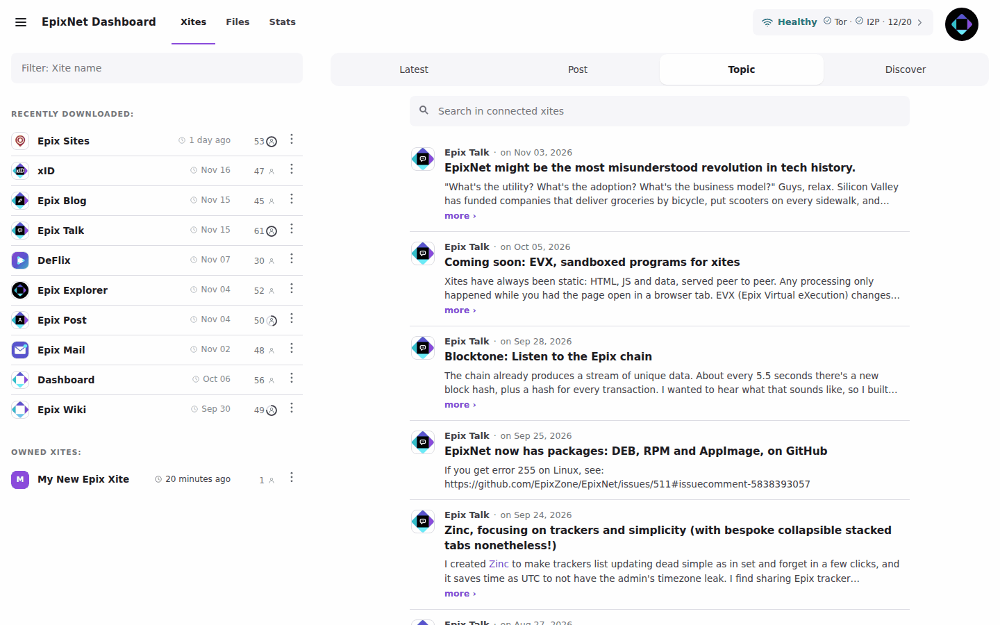

# Feeds, notifications and search

This page explains how activity inside your xite reaches people who are not looking at it: the news feed on the Dashboard, the unread badge, and search. It is for xite developers who already have data in the xite database (see [database](database.md)).

There is no central index on EpixNet. Everything here runs on the visitor's own node, over data that node has already downloaded and verified. A feed or a search can only cover xites the visitor holds.

## Three mechanisms

| Mechanism | You declare | Who runs it | Typical use |
| --- | --- | --- | --- |
| SQL news feed | Named queries in `dbschema.json`, and follows saved by the page | The Dashboard, through `feedQuery` and `feedSearch` | "New topics", "Replies to you", free-text search across xites |
| Notifications | Count queries saved by the page | The wrapper and Dashboard, through `notificationQuery` | The unread badge |
| Derived feeds | Feed descriptors in `content.json` | Your own page, through `feedItemQuery`, `feedGalleryRollup` and `feedSegmentSearch` | Per-item comment lists, counts and term search over signed records |

The first two are SQL over the xite database. SQL feeds are what the official xites use for their news feeds today. The third is a newer layer built on [signed merge files](files.md#signed-merge-files). Its formats are fixed, and its commands work, but the official xites do not depend on it yet.



## The shape of a feed row

A feed is a `SELECT` statement that returns one row per event. The Dashboard relies on these column names:

| Column | Needed by | Meaning |
| --- | --- | --- |
| `date_added` | The node | Unix time of the event. Seconds are expected. Millisecond values are converted. Rows without a numeric value, and rows dated more than two minutes in the future, are dropped. |
| `title` | Search, Dashboard | A heading for the row. `feedSearch` matches against it. |
| `body` | Search, Dashboard | The text. `feedSearch` matches against it. |
| `type` | Dashboard | A short label such as `topic`, `comment`, `post` or `mention`. The Dashboard groups and filters by it. |
| `url` | Dashboard | A link relative to your xite, usually a query string such as `?Topic:12_alice.epix`. |
| `permalink` | Optional | A more specific link. The Dashboard prefers it over `url` when present. |

The node adds `site` (the xite address) and `feed_name` to every row it returns.

Feed text is user content. Escape it wherever you render it.

## Declare feeds in dbschema.json

List your feeds under `feeds` in `dbschema.json`. The first query below is Epix Talk's topic feed and the second is Epix Post's comment feed:

```json title="dbschema.json (excerpt)"
{
  "feeds": {
    "Topics": "SELECT title AS title, body AS body, added AS date_added, 'topic' AS type, '?Topic:' || topic.topic_id || '_' || topic_creator_json.directory AS url FROM topic LEFT JOIN json AS topic_creator_json ON (topic_creator_json.json_id = topic.json_id)",
    "Comments": "SELECT 'comment' AS type, comment.date_added AS date_added, 'a post' AS title, '@' || user_name || ': ' || comment.body AS body, '?Post/' || json.site || '/' || REPLACE(post_uri, '_', '/') AS url FROM comment LEFT JOIN json USING (json_id)"
  }
}
```

Feeds declared here are what the Dashboard's search sweeps. They are the main way a xite makes its content searchable.

Write each feed as a plain `SELECT`. It does not need an `ORDER BY` or `LIMIT` of its own: the node wraps it in an outer query that adds the date filter, ordering and limit, which also keeps `UNION` feeds intact.

!!! warning "Do not leak what your interface hides"
    A feed query runs outside your page, so any filtering your JavaScript applies (blocked authors, removed listings, age gates) does not apply to it. Epix Sites disabled its SQL feed for this reason: it could surface addresses that the application's removal policy would have hidden. Only declare a feed whose every row is fit to show without further checks.

## Let visitors follow

A follow is a named query saved on the visitor's node for your xite. The Dashboard runs every saved follow from every followed xite and merges the results.

| Command | Parameters | Result |
| --- | --- | --- |
| `feedListFollow` | none | The current follows: `{"<name>": [query, params], ...}`. |
| `feedFollow` | `[feeds]` | `"ok"`. Replaces the whole set for this xite. |

Each follow is `[query, params]`. If the query contains the placeholder `:params`, the node replaces it with the `params` list, quoted as SQL literals. That is how one query follows a changing set of items:

```js title="js/follow.js"
const POST_FOLLOW = `
  SELECT 'comment' AS type, comment.date_added AS date_added,
         'a followed post' AS title, comment.body AS body,
         '?Post/' || json.site || '/' || REPLACE(post_uri, '_', '/') AS url
  FROM comment
  LEFT JOIN json USING (json_id)
  WHERE post_uri IN (:params)`;

async function followPost(postUri) {
  const follows = await Page.cmd("feedListFollow", []);
  if (!follows["Post follow"]) follows["Post follow"] = [POST_FOLLOW, []];
  follows["Post follow"][1].push(postUri);
  await Page.cmd("feedFollow", [follows]);     // send the whole set back
}

async function unfollowPost(postUri) {
  const follows = await Page.cmd("feedListFollow", []);
  if (!follows["Post follow"]) return;
  follows["Post follow"][1] = follows["Post follow"][1].filter((uri) => uri !== postUri);
  if (follows["Post follow"][1].length === 0) delete follows["Post follow"];
  await Page.cmd("feedFollow", [follows]);
}
```

Practical rules, all taken from how Epix Talk and Epix Post use the commands:

- **Always read, modify, write.** `feedFollow` replaces everything. Sending only the new follow deletes the others.
- **Follow defaults once.** `siteInfo.feed_follow_num` is `null` when the visitor has never followed anything on this xite, and a number afterwards (including `0`). Use the `null` to register default follows on first visit, and never again, so an explicit unfollow sticks.
- **Refresh stored SQL.** A follow stores a copy of the query text. If you change the query in a later release, compare what `feedListFollow` returns with your current text and resend it. Otherwise existing visitors keep running the old query.
- **Personal feeds are built in the page.** Feeds such as "mentions of me" embed the visitor's name or address in the query text. Build the string carefully and escape any value you interpolate.

### How the Dashboard runs them

`feedQuery` and `feedSearch` are ADMIN commands. The Dashboard holds that permission. An ordinary xite page cannot call them, and does not need to: your job is to declare feeds and save follows.

For reference, this is what `feedQuery` does:

- Parameters are `limit` (default 10) and `day_limit` (default 3). An explicit `null` day limit means no date filter.
- Each follow is wrapped as `SELECT * FROM (<query>) WHERE date_added > <cutoff> ORDER BY date_added DESC LIMIT <limit>`. The limit applies per follow, so one busy feed cannot crowd out the others.
- All follows run concurrently, each with a 10 second deadline. A feed that fails or times out is skipped, and the rest still answer.
- The result is `{"rows": [...], "num": <row count>, "sites": <number of followed xites>}`, newest first.

`feedSearch` takes `search`, `limit` (default 30) and `day_limit` (default 30). It runs against the `feeds` declared in the `dbschema.json` of every xite the node serves, not against saved follows. The search text becomes a `LIKE` match on the `body` and `title` columns, with spaces treated as wildcards. Two filters can follow the text:

| Filter | Example | Effect |
| --- | --- | --- |
| `site:` | `release notes site:Epix Talk` | Only the xite with that address or exact title. |
| `type:` | `wallet type:comment` | Only feeds whose query text contains that word. |

### SQL the node will run

Feed and search queries are checked before they run. A query is skipped if it:

- contains `;`, `--`, `/*` or `*/`, or
- contains any of these words as a token: `insert`, `update`, `delete`, `drop`, `attach`, `detach`, `pragma`, `begin`, `commit`, `rollback`, `create`, `alter`, `vacuum`, `reindex`.

The check is on tokens, so avoid column or alias names that are one of those words.

## Notifications

Notifications drive the unread count shown on the wrapper's navigation icon, in the tab title, and on the Dashboard. A xite registers count queries, and the node evaluates them.

| Command | Permission | Purpose |
| --- | --- | --- |
| `notificationSubscribe(subscriptions)` | none | Save this xite's notification queries, replacing the previous set. |
| `notificationList()` | none | The saved subscriptions for this xite. |
| `notificationDismissSelf(name)` | none | Record that the visitor has now seen notification `name`. |
| `notificationQuery()` | ADMIN | Every subscribed xite's counts: `{results, num, sites, muted}`. |
| `notificationCount()` | ADMIN | The total as `{"count": <n>}`. |
| `notificationDismiss(site_address, name)` | ADMIN | Dismiss on behalf of a xite (the Dashboard's clear button). |
| `notificationMute(muted, site_address?)` | ADMIN | Mute everything, or one xite. |

A subscription maps a name to `[query, params]`. The query must be a `SELECT` whose first row has a `count` column.

```js title="js/notifications.js"
// The node fills in {xid_directory} and {last_seen} when it runs the query.
const REPLIES = `
  SELECT COUNT(*) AS count
  FROM reply
  WHERE reply.to_directory = '{xid_directory}'
    AND reply.date_added * 1000 > {last_seen}`;

function registerNotifications() {
  return Page.cmd("notificationSubscribe", [{ replies: [REPLIES, []] }]);
}

// Call when the visitor opens the view that shows the replies.
function markRepliesSeen() {
  return Page.cmd("notificationDismissSelf", ["replies"]);
}
```

The `reply` table and its columns are placeholders for your own schema: a table with one row per event, a column naming the directory of the person the event is addressed to, and a creation time in seconds.

How the node evaluates a subscription:

| Feature | Behavior |
| --- | --- |
| `:params` | Replaced with the `params` list as quoted SQL literals, as in feeds. |
| `{xid_directory}` | Replaced with the visitor's directory name for this xite, such as `alice.epix`. If the visitor has no identity here, the query is skipped. |
| `{last_seen}` | Replaced with the time, in milliseconds, at which this notification was last dismissed, or `0`. |
| Seen baseline | If the xite's per-user settings contain `notification_seen["<name>"]`, that number is subtracted from the count. A page can keep the badge in step with its own unread state by storing that baseline through `userGetSettings` and `userSetSettings`. |
| Icon | If the root `content.json` has `"notification_icons": {"<name>": "img/icon.svg"}`, the path is returned with the result so the Dashboard can show it. |
| Scope | Only xites that have a database are evaluated, and a query that does not start with `SELECT` is skipped. A failing query returns an `error` on its entry and a count of `0`. |

Each result entry has `site`, `title`, `name`, `count` and `last_seen`, plus `icon` when one is declared.

Keep notification queries cheap. They run whenever the badge refreshes, for every subscribed xite.

!!! note "Private sources"
    Some counts cannot come from a shared database. Epix Mail's unread count is computed on the node from the decrypted mailbox and added to the same badge, so nothing about it is published. This is a node plugin feature, not something a xite page can register.

## Derived feeds over signed records

SQL feeds need every author's files on disk and a database built from them. The derived feed layer organizes the signed records themselves, so the same answers can be computed and checked by any node that holds the same records. It works on [merge files](files.md#signed-merge-files) of class `epix-orset-1`.

### Declare a feed descriptor

Descriptors live under `feeds` in the **root `content.json`** of the xite that holds the records. This is separate from the `feeds` key in `dbschema.json`. The example is from the Epix Post hub:

```json title="content.json (excerpt)"
{
  "feeds": {
    "posts": {
      "record_format": "epix-orset-1",
      "files": "data/users/*/posts.json",
      "record_key": "post",
      "clock_unit": "s",
      "map": { "id": "post_id", "author": "author", "clock": "date_added", "target": null },
      "kind": { "default": "post" }
    },
    "comments": {
      "record_format": "epix-orset-1",
      "files": "data/users/*/comments.json",
      "record_key": "post",
      "clock_unit": "s",
      "map": { "id": "comment_id", "author": "author", "clock": "date_added", "target": "post_uri" },
      "kind": { "default": "comment" }
    },
    "comment_likes": {
      "record_format": "epix-orset-1",
      "files": "data/users/*/comment_likes.json",
      "record_key": "post",
      "clock_unit": "s",
      "map": { "id": "key", "author": "author", "clock": "date_added", "target": "comment_uri" },
      "kind": { "default": "reaction", "reaction_kind_field": "reaction" }
    }
  }
}
```

| Field | Required | Meaning |
| --- | --- | --- |
| `files` | Yes | Glob of the merge files that carry the feed. `*` matches within one path segment, `**` across segments. |
| `record_key` | Yes | The array inside each file that holds the records. Merge files written through the node use `post`. |
| `map.id` | Yes | Record field that identifies the item. |
| `map.author` | Yes | Record field holding the author address. |
| `map.clock` | Yes | Record field used for ordering and for grouping into daily segments. |
| `map.target` | No | Record field naming the item this record attaches to. `null` or absent marks a top-level item, whose own id is what others attach to. |
| `kind.default` | Yes | `post`, `reaction`, or anything else for a comment. |
| `kind.reaction_kind_field` | For reactions | Record field holding the reaction type, for example `like`. |
| `kind.active_field` | No | Record field whose `false` value withdraws a reaction. |
| `clock_unit` | No | `ms` (default) or `s`. An unrecognized value disables the feed. |
| `record_format` | No | Defaults to `epix-orset-1`. Files with a different marker are ignored. |

An optional `_common` entry beside the feeds can rename the delete marker (`deleted_field`, default `deleted`) and the moderation marker (`moderated_field`, default `moderated`).

A descriptor with a missing or mistyped required field is ignored. The other feeds keep working. A record missing a mapped field is skipped on its own.

Set `clock_unit` to match the field you map. If a seconds value is read as milliseconds, years of records fall into the same day and the feed collapses into one segment.

### Query it from the page

All three commands are read-only, need no permission, and answer for the xite the page belongs to, using the descriptors in that xite's own root `content.json`. A page cannot point them at another xite, so descriptors declared on a hub are reachable only from a page served by that hub. If the feed name is not declared, they fail with `no feed '<name>' declared for this xite`.

=== "feedItemQuery"

    The live records attached to one target, newest first, plus its reaction counts.

    | Parameter | Meaning |
    | --- | --- |
    | `feed` | Feed name. |
    | `target` | The item id to look up. For a top-level feed, the item's own id. |
    | `limit` | Maximum records. Default and ceiling are 500. |
    | `before_clock` | Only records with a clock below this value, in milliseconds. Use it to page backward. |

    ```js
    const res = await Page.cmd("feedItemQuery", {
      feed: "comments",
      target: postUri,
      limit: 50
    });
    // res.records    live records (edits folded, deleted items removed)
    // res.reactions  { "<kind>": <count> } for the target
    // res.checkpoint_root, res.segment_roots  hashes a verifier can recompute
    ```

=== "feedGalleryRollup"

    Counts for many items in one call, for a listing page.

    | Parameter | Meaning |
    | --- | --- |
    | `feed` | Feed name. |
    | `items` | Array of item ids, at most 500. |

    ```js
    const res = await Page.cmd("feedGalleryRollup", { feed: "comments", items: postUris });
    // res.items["<id>"] = { comment_count, reactions: { "<kind>": n }, newest_clock }
    // res.rollup_root
    ```

=== "feedSegmentSearch"

    Term search over the feed's records.

    | Parameter | Meaning |
    | --- | --- |
    | `feed` | Feed name. |
    | `terms` | A query string or an array of strings. At most 16 strings of 256 bytes each. |
    | `limit` | Maximum hits. Default and ceiling are 200. |

    ```js
    const res = await Page.cmd("feedSegmentSearch", { feed: "posts", terms: "light client" });
    // res.pointers = [{ record, segment_root, offset, len, id, target, clock }, ...]
    // res.terms, res.segments_total, res.segments_skipped, res.segments_scanned, res.spine_head
    // res.unindexable_query === true when no term could be searched
    ```

### How the layer is built

- **Segments.** Records are grouped by day according to their clock. Each day with records becomes one sealed segment whose hash depends only on those records. No wall clock is involved, so two nodes with the same records compute the same hash.
- **Checkpoint.** A summary of the current state: the live version of every item, reaction counts, and tombstones. Deleted items stay deleted. A later record cannot bring one back.
- **Index and rollup.** Lookups from a target to its records, and per-item counts.
- **Filters.** Each segment gets a small filter over its terms. A search skips any segment whose filter shows a query term is absent. The filters have no false negatives, so skipping never loses a real match.

Sealed segments are stored as content-addressed objects in the node's object store. All of it is a cache that can be rebuilt from the records at any time.

### What search does and does not find

- **Matching is exact on terms.** Text is lowercased and split on anything that is not an ASCII letter or digit. Terms shorter than 2 or longer than 40 bytes are dropped. A record matches when it contains every term in the query.
- **Only string values are indexed**, not field names.
- **Non-ASCII text is not searchable in this version.** Characters outside ASCII act as separators. A query made only of such text returns no hits and sets `unindexable_query`.
- **Results are pointers, not bodies.** Each hit identifies a record by its hash and its position in a segment, so that the bytes can be checked against the segment hash before they are trusted.
- **No ranking, stemming or fuzzy matching.** Ranked or cross-xite search is left to optional indexing services and applications.

### Trust and status

Every answer from this layer can be verified against hashes derived from signed records, so an untrusted source cannot invent a match. Completeness is weaker: a result set is only as complete as the record set the owner publishes, which is the same trust a reader already places in the owner's `content.json`.

What exists today, stated plainly:

- The node derives these artifacts for any xite that declares descriptors and answers the three commands from its local cache.
- Search is local. A node filters using data derived from records it already holds. Fetching another node's filter for a segment you do not have is not available yet, because the mapping from a segment to its filter is not published.
- The formats for an inverted index (term to record pointers, in 256 shards) are fixed, but no page command exposes one.
- The official xites still read merge files through the SQL database. Treat the derived commands as an addition to SQL feeds, not a replacement.

The frozen formats are specified in [`docs/edx-feed-search.md`](https://github.com/EpixZone/EpixNet/blob/main/docs/edx-feed-search.md) in the node repository and summarized in [EDX internals](../internals/edx.md).

## Make your content findable

A short checklist:

1. **Map your data into the database** so it can be queried at all. See [database](database.md).
2. **Declare `feeds` in `dbschema.json`** with `type`, `date_added`, `title`, `body` and `url`. This makes the content appear in the Dashboard's search for anyone who has your xite.
3. **Offer follows** with sensible defaults on first visit, and a control to change them.
4. **Give every item a stable URL** inside your xite, and handle it on load. Feed rows and search results link straight to it.
5. **Add notification queries** only for events addressed to the visitor.
6. **Declare feed descriptors in `content.json`** if your records are in merge files and you want per-item queries or term search without SQL.
7. **List the xite in a directory.** Search covers only xites a node already holds. To be discovered by people who do not have your xite, submit it to Epix Sites, the community directory described in [featured xites](../start/apps.md).

## Privacy notes

- Follows and notification subscriptions are stored locally on the visitor's node. They are not published.
- Feed and search queries run locally. No search term leaves the node.
- What a visitor's node downloads in order to have something to search is visible to the peers it downloads from. See [privacy](../start/privacy.md).

## Related pages

- [Database](database.md) for `dbschema.json`.
- [Files](files.md#signed-merge-files) for the signed records that derived feeds are built on.
- [Merger, feed and search commands](../api/merger.md) for the command reference.
- [The Dashboard](../start/dashboard.md) for the user's view of feeds and notifications.
