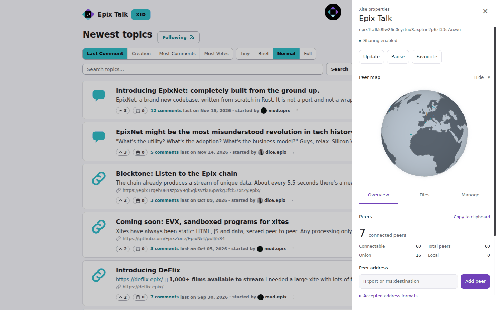
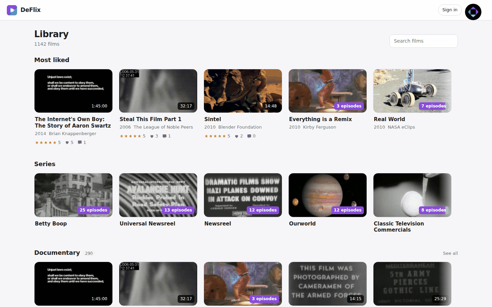

# Files: optional, big, streamed and merged

This page covers everything beyond ordinary required files: files that download only when needed, large uploads, how media streams while it downloads, how to change a shared settings file safely, and how to store lists that many people append to. It is for xite developers who have already read [xite anatomy](anatomy.md) and the [content.json reference](content-json.md).

## File classes at a glance

Every file a xite publishes is declared in a signed `content.json`. The section it is declared in decides how nodes fetch and verify it.

| Class | Declared in | Fetched | Verified by |
| --- | --- | --- | --- |
| Required | `files` | Always, as part of the xite | Whole-file hash in the manifest |
| Optional | `files_optional` | On demand, or in the background when the visitor allows it | Whole-file hash, in verified ranges while streaming |
| Merge file | `files_merged` | Record by record, alongside manifest updates | A signature on every record |
| Self-encrypted | `files_shard` | As encrypted pieces | Hashes in the signed data map |
| Ignored | Nowhere (matches `ignore`) | Never | Not published |

You do not edit these sections by hand. You set patterns (`ignore`, `optional`, `shard`) or rules (`merge_files`), and the signer fills the sections in.

## Optional files

Optional files are for content a visitor may never open: images in a long feed, video, downloads, archives. They keep the first load small. A node holds only the optional files it has fetched, and serves those to others.

### Declare them

Set the `optional` field of a `content.json` to a regular expression. Paths are relative to that manifest's directory and the pattern is matched from the start of the path. When you sign, every matching file on disk is recorded under `files_optional` instead of `files`.

```json title="content.json (excerpt, from DeFlix)"
{
  "optional": "video/.*"
}
```

User directories can carry optional files too. The pattern goes in the user's own `content.json`, and the owner's rules bound it with `max_size_optional` and `files_allowed_optional` (see [user content](user-content.md)). Epix Post sets the pattern from the page before the first image upload:

```js
// dir is the visitor's directory, for example "data/users/alice.epix".
const raw = await Page.cmd("fileGet", { inner_path: dir + "/content.json", required: false });
const content = raw ? JSON.parse(raw) : {};

if (!content.optional) {
  // Everything ending in jpg is optional, except the avatar.
  content.optional = "(?!avatar).*jpg";
  await Page.cmd("fileWrite", [dir + "/content.json", toBase64(JSON.stringify(content, null, 1))]);
}
await Page.cmd("fileWrite", [dir + "/" + fileName, imageBase64]);
await Page.cmd("sitePublish", { inner_path: dir + "/content.json" });
```

`toBase64` in the examples on this page is the small helper from [user content](user-content.md): `btoa(unescape(encodeURIComponent(text)))`.

!!! note "Deleted optional files leave the manifest"
    When you sign, an optional entry whose file is no longer on disk is dropped, so a deletion really is published. If you deliberately do not hold every optional file of your own xite, sign with the keep-missing option: `epix-server siteSign <address> --keep-missing`, or `"keep_missing": true` in the `siteSign` parameters.

### How they download

An optional file is fetched in one of three ways:

1. **The page requests its URL.** A request for a declared optional file, for example from an `` or `<video>` element, makes the node fetch that one file from peers and then answer the request.
2. **The page calls `fileNeed`.** The command resolves with `"ok"` once the file is on disk and verified.
3. **A background pass** fetches files the visitor has agreed to hold. See [retention](#retention-and-background-downloads) below.

```js
// Fetch first, then show. Retry later if peers were unreachable.
async function showImage(img, innerPath) {
  try {
    await Page.cmd("fileNeed", innerPath);
    img.src = innerPath;
  } catch (res) {
    img.alt = "Not available yet";
  }
}
```

A direct request waits for the file for up to 45 seconds, or up to 180 seconds when the node routes all traffic through an overlay network such as Tor. After that it answers 404, and a later request tries again. Availability depends on reachable peers that hold the file.

### The visitor decides

Fetching optional files is opt-in per xite. When a xite declares optional files, the xite sidebar shows two switches under **Optional files**:



| Switch | Meaning | Default for a newly added xite |
| --- | --- | --- |
| Download files I open | Optional files may be fetched when a page asks for them. | On |
| Pre-download everything | Also fetch optional files nobody has opened yet. | Off |

The sidebar also has **Auto-download maximum file size** (in MB, where 0 means no limit) for automatic downloads, and **Download previous files** for a one-time catch-up.

When "Download files I open" is off and a page asks for an optional file that is not on disk:

- the HTTP request answers 404 with the text `optional file (downloads disabled)`,
- `fileNeed` fails with `Optional file downloads are disabled for this xite`, and
- the node asks the visitor once per xite per session whether to enable optional downloads. If they accept, the file that triggered the question is fetched.

Design for the declined case: show a placeholder with a way to retry, not a broken image.

Node operators set the defaults for newly added xites on the Config page (`download_optional_default`, `autodownloadoptional_default`) and can choose to keep a full copy of every xite (`full_retention`). See [the Config page](../start/dashboard.md).

### Inspect and manage

| Command | Purpose |
| --- | --- |
| `optionalFileInfo(inner_path)` | One file: `inner_path`, `size`, `sha512`, `is_downloaded`, `is_pinned`, and piece details for a big file. `null` when the path is not a declared optional file. |
| `optionalFileList({filter, orderby, limit, filter_inner_path})` | The xite's optional files. `filter` defaults to `"downloaded"`. Rows also carry `uploaded`, `peer` and `time_downloaded`. |
| `optionalFilePin(inner_path)` / `optionalFileUnpin(inner_path)` | Protect a file from automatic cleanup, or release it. Accepts one path or a list. |
| `optionalFileDelete(inner_path)` | Delete this node's copy of an optional file. Refused for required files. |
| `optionalHelp(directory, title)` | Opt in to helping distribute a directory: optional files under it are downloaded automatically from then on. Returns `{num, size}` for the files it currently covers. |
| `optionalHelpList()` / `optionalHelpRemove(directory)` | List or stop the directories being helped. |
| `fileTransferStats({inner_path, offset})` | Live per-peer transfer figures for one file, for a player's status display. |

These accept `merged-<Type>/...` paths in a [merger xite](merger-hubs.md). Parameters and return shapes are in [file commands](../api/files.md).

### Retention and background downloads

Two manifest fields let the owner say how a xite should be held. Both are plain fields in the root `content.json`, covered by the owner's signature.

```json title="content.json (excerpt, from DeFlix)"
{
  "distribution": {
    "default": { "unit": "package", "retention": "complete" },
    "paths": {
      "video/": { "unit": "file-refs", "retention": "partial" }
    }
  }
}
```

`distribution` assigns each path, by longest matching prefix, a `unit` (`package`, `file-refs` or `feed`) and a `retention` (`complete` or `partial`).

- **`complete`** means a node that opens the xite may finish downloading that path in the background after the page has rendered, so readers converge on the same full copy.
- **`partial`** means nodes hold only what was opened.

A xite that declares nothing is treated as `package` with `complete` retention for every path, optional files included. The background pass stays inside the xite's size limit, 1000 MB unless the visitor changed it. If finishing would exceed the limit, the node asks the visitor first, stating the file count and total size.

This matters when you publish large optional media. Without a `partial` rule, a visitor's node may complete as much of your library as fits inside its size limit, and ask about the rest. DeFlix declares `video/` as `partial`, so its films are held only by the nodes that played them.

You can also set `"autodownloadoptional_default": false` in the root `content.json`. It tells nodes not to bulk-download your optional files by default, and it also stops the background completion pass described above. A visitor who turns on "Pre-download everything", or an operator who enabled full retention, still overrides it. The field can only lower the default, never raise it.

### The storage cap

Each node has one cap for cached optional files across all xites. The default is 10% of free disk space. `optionalLimitStats` returns `{limit, used, free}`, and the operator changes the cap with `optionalLimitSet`, as a percentage such as `"10%"` or a number of gigabytes. Both commands need the ADMIN permission.

When the cap is exceeded, the node deletes the oldest unpinned cached files until it is back under. It does not touch:

- pinned files,
- xites the node owns,
- xites with "Pre-download everything" on, and
- files under a `complete` retention path. Those are bounded by the xite's size limit instead.

Because a xite that declares no `distribution` is `complete` everywhere, only optional files under a `partial` path count as evictable cache. So a file under a `partial` path can disappear from a visitor's node later. Pin what the visitor explicitly saves, and always handle a file that needs fetching again.

## Big files

"Big" here means a file too large to bundle with the page: video, audio, archives, datasets. There are two ways to publish one, and one way to read it.

### Publish from the xite folder

This is how the official media xites are maintained, and it has no size ceiling other than disk space and the limits visitors set.

1. Copy the file into the xite's folder, under a path that matches the `optional` pattern.
2. Sign and publish the root manifest.

```sh
epix-server siteSign <address>
epix-server sitePublish <address>
```

The signer hashes the file and records it in `files_optional` with its size and hashes. Nothing else is needed for it to stream.

### Upload from the page

A page can hand a file to the node over HTTP instead of base64 through `fileWrite`.

1. Call `bigfileUploadInit` with the target path and size. It returns `{url, piece_size, inner_path, file_relative_path}`.
2. `POST` the file's bytes to `url`, either as the raw body or as a single multipart form part.
3. The node hashes the bytes in 1 MiB pieces, writes the file, and adds an entry for it to `files_optional` in the root `content.json` on disk. A file of more than one piece also gets a `<name>.piecemap.msgpack` file and `piecemap` and `piece_size` fields on its entry.
4. Sign and publish the root `content.json`. Until you do, the upload is a local draft.

```js title="js/upload.js"
async function uploadFile(file) {
  const init = await Page.cmd("bigfileUploadInit", ["media/" + file.name, file.size]);

  const response = await fetch(init.url, { method: "POST", body: file });
  const result = await response.json();
  if (!response.ok) throw new Error(result.error);
  // result: { merkle_root, piece_num, piece_size, inner_path }

  await Page.cmd("sitePublish", { privatekey: "stored", inner_path: "content.json" });
  return result.inner_path;
}
```

Constraints:

- **Owner or signer only.** The upload is accepted when the node owns the xite, or when the visitor's signing address is the xite address or is listed in the root `signers`. Anyone else gets `Forbidden, you can only modify your own files`. It is not a way for ordinary visitors to upload into their user directory. Use `fileWrite` with an optional pattern for that, as Epix Post does for images.
- **Root manifest.** The entry is written to the root `content.json`.
- **One use.** The upload URL contains a one-time token tied to the xite.
- **Exact size.** The body must be the size declared to `bigfileUploadInit`. A larger body is refused with 413 and a shorter one with 400. A refused body leaves the upload URL usable for a retry.
- **Can be switched off.** The feature is the node's `Bigfile` plugin. When the operator disables it, the upload endpoint answers 403.

!!! note "Request size on EpixNet v0.6.8"
    The upload is received as a single request body of up to the declared size. EpixNet v0.6.8 refuses any upload body over 2 MB with 413, so on that release treat the upload command as suitable for small files only, and publish large files from the xite folder.

### Read

Reading a big file needs no special command. A visitor's browser uses ordinary HTTP range requests, and the node fetches and verifies only the ranges asked for. That is described next.

## EDX: verified transfer and streaming

EDX is the node's content distribution layer. Files are addressed by a BLAKE3 hash and can be fetched in ranges that are verified as they arrive. As a xite developer you get this without doing anything, but it helps to know what the signer adds and what the page can rely on.

### What signing adds

When the Rust node signs a manifest, it stamps EDX fields next to the classic ones:

| Field | Where | Meaning |
| --- | --- | --- |
| `edx` | Manifest root | Format version, currently `1`. |
| `b3` | Each `files` and `files_optional` entry | BLAKE3 hash of that file's bytes. |
| `bundle`, `off` | Small required files | The bundle object that carries the file, and the file's offset inside it. |
| `bundles` | Manifest root | Every bundle the manifest refers to, with its size. |
| `files_merkle_root` | Manifest root | A commitment to the whole file set. |

Required files smaller than 128 KiB are packed into bundles of roughly 256 KiB, so a xite with hundreds of small files is not hundreds of separate transfers. Bundle membership is stable: editing one file re-creates only the bundle that holds it. Optional files are never bundled, so each stays individually fetchable. Merge files carry no `b3`, because they are verified record by record.

These are generated fields. Do not write them yourself. The formats are specified in [EDX internals](../internals/edx.md).

### Load order

An owner can tell nodes what to fetch first with `order_policy` in the root `content.json`:

```json title="content.json (excerpt)"
{
  "order_policy": {
    "first_paint": ["index.html", "css/all.css", "js/lib/epixframe.js", "js/app.js"],
    "feed_order": "newest-first",
    "prefetch": ["dbschema.json"]
  }
}
```

- `first_paint` lists the files the page needs before it can draw. They are fetched first.
- `prefetch` lists files to fetch last, at background priority, after the first-paint files and everything you left out of both lists.
- `feed_order` is `newest-first`, `oldest-first`, `pinned-first` or `custom`, and orders how record files stream in. Only `oldest-first` changes scheduling; the other three schedule newest first.

Paths are exact file paths, not patterns. If you declare nothing, files are ordered by type: markup, styles, scripts, JSON, fonts and images first, then everything else, then media, documents and archives. Once you declare a policy, the paths you did not list form one middle tier and are not re-sorted by type. The policy only orders the downloading node's own fetching.

### Stream media as DeFlix does



Streaming needs no special API. Declare the media optional and point a media element at it:

```html
<video controls playsinline preload="metadata" poster="poster/my-film.jpg">
  <source src="video/my-film.mp4" type="video/mp4">
</video>
```

What the node does for that request:

- **Range requests fetch only what is asked for.** The browser sends `Range` headers. For a file with a `b3` entry the node fetches just the 16 KiB groups that cover the range, verifies each against the signed hash, and answers `206 Partial Content`. Bytes that fail verification are never handed to the page.
- **Responses are windowed.** One response carries at most 4 MiB, even when the player asks for `bytes=0-`. A shorter 206 than requested is normal. The player asks for the next window as it plays.
- **"Not yet" is not "gone".** If the range is valid but its bytes have not arrived, the node answers `503` with `Retry-After: 1`, and the player should request the same range again. A range past the end of the file answers `416` with the real length.
- **The start and end are warmed.** On first touch the node also fetches the head and tail of a large file, where container metadata usually sits, so playback can begin without the whole file.
- **Large files complete in the background.** Once playback has started on a file of 4 MiB or more, the node keeps downloading the whole file at low priority, so pausing or seeking does not leave it permanently partial. An operator can turn this off, and a file larger than the node's object store quota is never completed this way.

Things the page has to get right:

- **Do not set `crossorigin` on the media element.** The page runs in a sandboxed frame with an opaque origin, and a CORS-mode media request is refused. A plain media load works. This also means you cannot read pixels back from the video into a canvas.
- **Expect the opt-in.** If optional downloads are off for the xite, the first request answers 404 and the visitor is asked. Show a "tap to load" state and retry after they accept.
- **Show progress honestly.** `fileTransferStats` reports per-peer rates and how many peers are known, so a player can tell "no peers" from "slow peers". DeFlix polls it for its status pill.
- **Keep the page playable without the media.** Posters and captions should be small required files. In DeFlix only `video/` is optional.

```js
// Feed a transfer panel while a film plays.
setInterval(async () => {
  const stats = await Page.cmd("fileTransferStats", { inner_path: "video/my-film.mp4" });
  panel.textContent = stats.peers.length + " peers in this transfer, "
    + stats.peers_known + " known for the xite";
}, 2000);
```

DeFlix ships a standalone player in `js/lib/EpixPlayer.js` that leaves `crossorigin` off and accepts a transfer-stats callback for its status display. See [DeFlix on GitHub](https://github.com/EpixZone/DeFlix-Xite).

## Signed file writes

`fileWrite` followed by `siteSign` is two steps. Between them the file on disk is an unsigned draft, and if two admins edit the same settings file, the later write silently replaces the earlier one. `fileWriteSign` does both steps as one transaction and refuses stale edits.

```js title="js/admin.js (pattern from Epix Talk)"
async function updateSettings(change) {
  const innerPath = "data/admin/admin-settings.json";
  const raw = await Page.cmd("fileGet", { inner_path: innerPath, required: false });

  const settings = JSON.parse(raw);
  change(settings);

  const params = {
    inner_path: innerPath,
    content_base64: toBase64(JSON.stringify(settings, null, "\t")),
    expected_base64: toBase64(raw)          // exactly what was read
  };
  // The owner signs with the saved xite key. A delegated admin signs as their xID.
  const info = await Page.cmd("siteInfo");
  if (info.privatekey) params.privatekey = "stored";

  await Page.cmd("fileWriteSign", params);

  // Publication is a separate step.
  await Page.cmd("sitePublish", { inner_path: "data/admin/content.json", sign: false });
}
```

| Parameter | Required | Meaning |
| --- | --- | --- |
| `inner_path` | Yes | The file to replace. |
| `content_base64` | Yes | The new bytes. |
| `expected_base64` | Yes | The exact bytes you read. If the file changed since, the command fails with `File changed since it was read. Reload and retry the update.` |
| `privatekey` | No | `"stored"` uses the saved xite key. Omit it to sign as the selected identity. |

Rules and guarantees:

- The target must already exist as a required, hashed file declared by a **child** `content.json`, such as `data/admin/content.json` included from the root. The command does not create files and does not edit root-governed, optional, self-encrypted or merge files.
- The signer must be allowed by that child manifest's rules.
- A rejected signature or a stale edit leaves the live file, the accepted manifest and the database untouched.
- `"ok"` means the signed change is committed locally. Publishing can still fail, and a publishing failure does not undo the edit. Tell the user "saved locally, not yet published" in that case.
- If the connection drops and you cannot tell whether the command completed, read the file again before retrying. Do not resend a stale replacement.
- A node that predates the command answers `null` or an unknown-command error. Report that EpixNet needs updating. Do not fall back to `fileWrite` plus `siteSign`.

To set this up, include a child manifest from the root and name its signers:

```json title="content.json (excerpt)"
"includes": {
  "data/admin/content.json": { "signers": ["admin.epix"], "signers_required": 1 }
}
```

## Signed merge files

A merge file is a JSON file that holds individually signed records. Nodes never replace it. They take the union of the records they have and the records they receive, after verifying each one. A blank or outdated copy merges to no change, so one device can never wipe what another wrote. Use merge files for anything list-shaped that visitors write.

### Allow them

The owner lists the permitted merge files in the rules for user directories:

```json title="data/users/content.json (excerpt)"
"permission_rules": {
  ".*": {
    "files_allowed": "data.json",
    "max_size": 200000,
    "merge_files": {
      "comments.json": { "class": "epix-orset-1", "max_size": 3000000 },
      "votes.json":    { "class": "epix-orset-1", "max_size": 3000000 }
    }
  }
}
```

`class` is the merge rule. `epix-orset-1`, a grow-only set of signed records, is the class the node implements. Each merge file has its own `max_size`, separate from the directory's `max_size`. When the node signs a user's `content.json`, it declares every allowed merge file that exists in the directory under `files_merged`. A file can never be both hashed and merged, and a user cannot declare a merge file the owner did not allow.

### The file and its records

```json title="data/users/alice.epix/comments.json"
{
  "record_format": "epix-orset-1",
  "post": [
    {
      "author": "<auth address>",
      "post_id": 2751773985207637,
      "nonce": "b873298054c9adf960f9ecf5de97dbda",
      "date_added": 1790537912,
      "clock": 1790537912045,
      "supersedes": 0,
      "deleted": false,
      "body": "First!",
      "sign": "<signature>"
    }
  ]
}
```

The records array is always named `post`, whatever it holds.

| Field | Set by | Meaning |
| --- | --- | --- |
| `nonce` or `key` | Page | Identity of the item. A random `nonce` makes a new unique item. A `key` (a slug, a vote target) makes one item per author and key. |
| `date_added` | Page | Creation time in whole seconds. Never changes for an item. |
| `clock` | Page | Version time in milliseconds. Rejected if more than 5 minutes in the future. |
| `supersedes` | Page | The highest `clock` this author had seen for the item, or `0` for a new item. |
| `deleted` | Page | `true` makes the record a tombstone. A tombstone must have an empty `body`. |
| `moderated` | Page | With `deleted: true`, marks a moderator's tombstone. |
| `author` | Node | The signing address. The node always sets it, so a page cannot claim another author. |
| `post_id` | Node | The item's stable id, derived from the author and the nonce or key. |
| `sign` | Node | Signature over the record without `sign`. |
| anything else | Page | Your own columns: `body`, `title`, `topic_uri` and so on. |

All versions of an item stay in the file. For display, for the database and for feed views, the node folds each `post_id` to one winner: only the item's creating author can supply its content (any other allowed signer can only add a tombstone), versions that a later one supersedes drop out, a tombstone beats a concurrent edit, then the highest `clock` wins.

### Create, edit and delete

Every write is the same three calls: `recordSign`, `fileWrite` with a container that holds just the new record, and `sitePublish` for the user's `content.json`. The node merges the record into the file on disk.

```js title="js/records.js"
const dirOf = (info) => "data/users/" + info.xid_directory;

function randomNonce() {
  const bytes = crypto.getRandomValues(new Uint8Array(16));
  return Array.from(bytes, (b) => b.toString(16).padStart(2, "0")).join("");
}

async function saveRecord(info, file, record) {
  const signed = await Page.cmd("recordSign", [record]);
  const container = { record_format: "epix-orset-1", post: [signed] };
  await Page.cmd("fileWrite", [dirOf(info) + "/" + file, toBase64(JSON.stringify(container))]);
  await Page.cmd("sitePublish", { inner_path: dirOf(info) + "/content.json" });
  return signed;
}

// A new comment.
function addComment(info, topicUri, body) {
  return saveRecord(info, "comments.json", {
    nonce: randomNonce(),
    clock: Date.now(),
    supersedes: 0,
    deleted: false,
    date_added: Math.floor(Date.now() / 1000),
    topic_uri: topicUri,
    body: body
  });
}

// Edit or delete: a new version of the same item.
async function reviseComment(info, previous, changes, remove) {
  const record = Object.assign({}, previous, changes);
  delete record.sign;                        // post_id, nonce and date_added carry over
  record.clock = Math.max(previous.clock + 1, Date.now());
  record.supersedes = previous.clock;
  record.deleted = remove === true;
  if (remove) record.body = "";
  return saveRecord(info, "comments.json", record);
}

// A like: one record per author and target. Toggling writes a new version.
async function setLike(info, targetUri, liked, previous) {
  return saveRecord(info, "votes.json", {
    key: targetUri,
    nonce: previous ? previous.nonce : randomNonce(),
    clock: Math.max((previous ? previous.clock : 0) + 1, Date.now()),
    supersedes: previous ? previous.clock : 0,
    deleted: !liked,
    date_added: previous ? previous.date_added : Math.floor(Date.now() / 1000),
    target_uri: targetUri
  });
}
```

To find `previous`, read the merge file with `fileGet` and pick the version of the item with the highest `clock`.

The node merges a `fileWrite` into the file on disk only once the file is declared under `files_merged`, which happens the first time the user's `content.json` is signed while the file exists. Until then a `fileWrite` replaces the file, so a first write must hold every record you want kept. In the flow above each write is followed by a signing publish, so only the very first write is affected.

!!! tip "Create the files before the first publish"
    Epix Talk writes an empty container (`{"record_format": "epix-orset-1", "post": []}`) for each of its collections before a user's first publish, so the first signature declares all of them together.

### Moderation tombstones

A record with `deleted: true` and `moderated: true` may be signed by any allowed signer of the directory, for example an admin named in the rules' `signers`. It carries the target item's own `post_id`, `nonce` or `key`, and `date_added`, and is written into the target user's file. It can only hide an item, in the database and in feed views. The node shows a content version only from the item's creating author, so a moderator or hub owner can delete another person's item but not replace it. (On EpixNet v0.6.8 a content version from another allowed signer that reuses the item's `post_id` can replace it, and a moderator's tombstone hides the item in the database but not in feed views.) The full flow is `moderateDelete` in [Epix Talk's `js/User.js`](https://github.com/EpixZone/EpixTalk-Xite/blob/main/js/User.js).

### Read them

Map the file into the database with `fold_crdt`, and query the table. Only live records are inserted.

```json title="dbschema.json (excerpt)"
".+/comments.json": {
  "to_table": [{ "node": "post", "table": "comment" }],
  "file_name": "data.json",
  "fold_crdt": "post"
}
```

See [database](database.md) for the rest of the mapping syntax.

### How they travel

Merge files are not part of whole-file hash sync. A publish carries the new records along with the updated manifest, so a post usually arrives with the push. Nodes also reconcile merge files with their peers periodically, and a manual update of the xite pulls them at once. Because records are only ever added, convergence does not depend on the order in which nodes hear about them.

Deleting is a tombstone, not an erasure: every version stays in the file and on every node that has it. Do not put anything in a record that must be removable later.

## Self-encrypted files

The `shard` field of a root `content.json` is a regular expression for files to self-encrypt. At signing time, matching files leave `files` and `files_optional` and are published as content-addressed encrypted pieces. The data needed to decrypt them is in the signed manifest.

Be clear about what this does. A node that holds only the pieces, without the manifest, cannot read them. Anyone who has the xite's `content.json` can. It is not access control, and it does not make a file private from the xite's readers. See the [content.json reference](content-json.md) and [EDX internals](../internals/edx.md).

## Related pages

- [User content](user-content.md) for the rules that govern user directories.
- [Merger xites and hubs](merger-hubs.md) for using these files across hubs.
- [Feeds and search](feeds-search.md) for building feeds on top of merge files.
- [File commands](../api/files.md) and [xite commands](../api/xite.md) for full parameters.
- [The sandbox](sandbox.md) for how the page's origin affects media and `fetch`.
