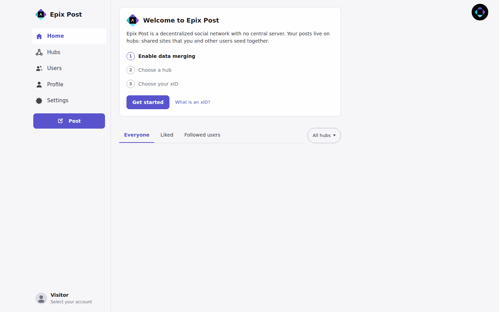

# Merger xites and hubs

This page explains how one xite can read and write the data of other xites. It is for developers whose application data should live apart from the application code, so that communities can run their own data sets, or so the data can grow without the code xite growing with it. Epix Post and its hub are the worked example throughout.

## The idea

A **merger xite** is the application: HTML, scripts, styles and a database schema. A **hub** (also called a merged xite) holds data only. A hub declares a type name, and a merger xite that the visitor has allowed to read that type sees every hub of the type that the visitor's node holds.



| Piece | Where it is declared | What it does |
| --- | --- | --- |
| `merged_type` | The hub's root `content.json` | Names the type the hub belongs to, for example `EpixPost`. |
| `Merger:<Type>` permission | Granted to the merger xite by the visitor | Lets the merger xite list, read and write hubs of that type. |
| `merged-<Type>/<hub address>/<path>` | Used by the merger xite's page | A virtual path that addresses a file inside a hub. |
| Merged database | The merger xite's `dbschema.json`, version 3 | One SQL database built from the data files of every hub of the type. |

The split has practical benefits. The application can be updated without touching user data. A visitor downloads only the hubs they choose. Anyone can create a new hub and moderate it by their own rules, and the same frontend works with all of them.

!!! note "Separation is not isolation"
    The `Merger:<Type>` permission covers every xite of that type on the visitor's node, including hubs added by a different merger xite of the same type. Choose a type name specific to your application, and treat hub content as untrusted input like any other user content.

## Step 1: define the hub

A hub is an ordinary xite whose root `content.json` carries `merged_type`. It usually has no interface of its own. The Epix Post hub ships a single `index.html` that sends people back to the application.

The example below is trimmed from the hub template in the Epix Post repository (`hub-xite/content.json-default`):

```json title="content.json (hub)"
{
  "title": "Epix Post Hub",
  "description": "",
  "merged_type": "EpixPost",
  "cloneable": true,
  "includes": {
    "data/users/content.json": { "signers_required": 1 }
  },
  "postmessage_nonce_security": true,
  "signs_required": 1
}
```

The hub's `data/users/content.json` holds the `user_contents` rules that say who may write and how much. That part is identical to a single xite and is covered in [user content](user-content.md).

Keep the type name short and stable. A grantable merger type may contain ASCII letters, digits, `_`, `.` and `-`, must start with a letter or digit, and can be at most 128 characters.

## Step 2: ask for the Merger permission

The permission is the visitor's decision. Your page asks through the wrapper, the wrapper shows a prompt, and only the wrapper can record the grant. If a page sends `permissionAdd` directly, the wrapper turns it into the same prompt; the node refuses a grant that does not come from the wrapper.

```js title="js/app.js"
const MERGER = "Merger:EpixPost";

function hasMergerPermission(siteInfo) {
  return siteInfo.settings.permissions.indexOf(MERGER) >= 0;
}

function requestMergerPermission(onGranted) {
  Page.cmd("wrapperPermissionAdd", MERGER, () => {
    // Re-read state: the page now sees its hubs.
    Page.cmd("siteInfo", {}, (siteInfo) => {
      if (hasMergerPermission(siteInfo)) onGranted(siteInfo);
    });
  });
}
```

Three things to know:

- **Check before you ask.** If the permission is already granted, the wrapper does not answer the request at all, so a callback that waits for it never runs. Read `siteInfo.settings.permissions` first, as the example does.
- **Explain the prompt.** The dialog text is generic: "Allow this xite to read and list other xites of a given type". Tell the visitor why you need it before you trigger it. Epix Post introduces the request on its onboarding card.
- **Public gateways refuse.** A node running as a read-only gateway grants no permissions. Your page receives an error and should fall back to a read-only message.

Until the grant exists, merger commands return the error `Not a merger xite`.

## Step 3: add and list hubs

Three commands manage which hubs the node holds. All of them require the `Merger:<Type>` permission.

| Command | Parameters | Result |
| --- | --- | --- |
| `mergerSiteList` | `query_site_info` (boolean, default `false`) | An object keyed by hub address. Values are the hub's `merged_type`, or the hub's full `siteInfo` when the argument is `true`. |
| `mergerSiteAdd` | One address, or a list of addresses | `"ok"` at once. The download continues in the background. |
| `mergerSiteDelete` | One address, or a list | `"ok"`. The hub is removed from this node and its local files are deleted. |

```js
// Which hubs are here, with titles and peer counts?
Page.cmd("mergerSiteList", true, (hubs) => {
  for (const address in hubs) {
    console.log(address, hubs[address].content.title, hubs[address].peers);
  }
});

// Download a hub the visitor chose.
Page.cmd("mergerSiteAdd", "<hub address>", (res) => {
  if (res !== "ok") console.warn("Could not add hub", res);
});
```

Behavior worth designing around:

- Adding one address does not prompt. Adding several asks the visitor to confirm first.
- Commands take `epix1...` addresses, not `.epix` names.
- `mergerSiteAdd` answers before the hub has arrived. When the add is over, successful or not, the node pushes a `setSiteInfo` event for the hub with `event: ["site_done", "<address>"]`, after the merged database has been rebuilt. Use that event rather than a timeout to decide the hub is ready.
- Right after an add, a merged path may not resolve yet. Epix Post retries its first `fileGet` a few times.
- An operator can lock the node's xite set. `mergerSiteAdd` then fails with `Adding new xites is disabled on this node`, and `mergerSiteDelete` with `Deleting xites is disabled on this node`.

!!! tip "Let the visitor choose"
    Epix Post lists suggested hubs in its `content.json` under `settings.default_hubs`, but downloads one only after an explicit action. A hub can be large, and its content is the responsibility of whoever runs it. Do not add hubs silently.

### Events from hubs

A merger page receives the `setSiteInfo` events of its hubs as well as its own. Check `params.address` against your own address (EpixFrame does not store it for you; save it from your first `siteInfo` response, as the [quickstart](quickstart.md) does) to tell them apart:

```js
onRequest(cmd, message) {
  if (cmd !== "setSiteInfo") return;
  const info = message.params;
  const event = info.event || [];
  // this.address was saved from the first siteInfo response.
  if (info.address !== this.address && event[0] === "file_done") {
    // A file changed in a hub: event[1] is its inner path inside that hub.
    this.refreshSoon();
  }
}
```

## Step 4: read and write through merged paths

Inside a merger xite, a path of the form `merged-<Type>/<hub address>/<inner path>` refers to a file in a hub. The file and signing commands accept these paths: `fileGet`, `fileWrite`, `fileWriteSign`, `fileDelete`, `fileRules`, `fileNeed`, `dirList`, `fileList`, `siteSign`, `sitePublish`, `optionalFileInfo` and `optionalFileDelete`. The same prefix works in ordinary URLs, so an image in a hub can be shown with a plain `` tag.

```js
const hub = "<hub address>";
const dir = "merged-EpixPost/" + hub + "/data/users/" + siteInfo.xid_directory;

// Read
const raw = await Page.cmd("fileGet", { inner_path: dir + "/data.json", required: false });

// Write and publish as the visitor's identity
await Page.cmd("fileWrite", [dir + "/data.json", toBase64(JSON.stringify(profile))]);
await Page.cmd("sitePublish", { inner_path: dir + "/content.json" });
```

```html
/data/users/alice.epix/avatar.jpg" alt="Avatar">
```

The hub's own rules still decide whether a write is accepted. The merged path only routes the command to the right xite. Identity, quotas and signatures work exactly as described in [user content](user-content.md), with the hub as the xite being written to.

A merged path is refused when:

| Error | Meaning |
| --- | --- |
| `No merger permission to load: ... holds no Merger:<Type>` | The visitor has not granted the permission for that type. |
| `Merged xite not found: <address>` | The hub is not on this node. Add it first. |
| `Merger xite (<Type>) does not have permission for merged xite: <address>` | The target xite declares a different `merged_type`, or none. |

## Step 5: query the merged database

A merger xite declares a version 3 schema. The node builds one database from the data files of every hub of the granted types.

```json title="dbschema.json (trimmed from Epix Post)"
{
  "db_name": "EpixPost",
  "db_file": "merged-EpixPost/EpixPost.db",
  "version": 3,
  "maps": {
    ".+/data/users/.+/data.json": {
      "to_json_table": ["hub", "user_name", "avatar", "intro"]
    },
    ".+/data/users/.+/posts.json": {
      "to_table": [{ "node": "post", "table": "post" }],
      "file_name": "data.json",
      "fold_crdt": "post"
    }
  },
  "tables": {
    "post": {
      "cols": [
        ["post_id", "INTEGER"],
        ["body", "TEXT"],
        ["date_added", "INTEGER"],
        ["json_id", "INTEGER REFERENCES json (json_id)"]
      ],
      "indexes": ["CREATE UNIQUE INDEX post_key ON post(json_id, post_id)"],
      "schema_changed": 5
    }
  }
}
```

What changes compared with a single-xite schema:

- **Map patterns start with the hub.** Each data file is matched as `<hub address>/<inner path>`, which is why the patterns above begin with `.+/`.
- **The `json` table gains a `site` column.** A file's row is split into `site` (the hub address), `directory` (for example `data/users/alice.epix`, without the hub address) and `file_name`, plus one text column per `to_json_table` key (`hub`, `user_name`, `avatar` and `intro` above). The node creates this table itself. Epix Post's real schema still declares a `json` entry under `tables`, carried over from the Python era; the node skips it, so you do not need one.
- **`file_name` on a map** attaches the rows to a sibling file's `json` row. In the example, records from `posts.json` join the `json` row of the same user's `data.json`, where `user_name` lives.
- **`fold_crdt`** tells the node the file is a [signed merge file](files.md#signed-merge-files) and names the array to fold. Only the live version of each record reaches the table.

Query it with `dbQuery` as usual:

```js
const rows = await Page.cmd("dbQuery", [
  `SELECT post.post_id, post.body, post.date_added,
          json.site AS hub, json.directory, json.user_name
   FROM post
   LEFT JOIN json USING (json_id)
   WHERE json.site = :hub
   ORDER BY post.date_added DESC
   LIMIT 20`,
  { hub: "<hub address>" }
]);
```

The rest of the schema format is described in [database](database.md).

### The persistent merger index

A merged database can cover many hubs, so the node does not rebuild it from nothing on every start. Version 3 merger databases are kept as a derived cache in the node's private data area. The cache location is chosen by the node. The `db_file` value in your schema does not select it.

What this means for you as a developer:

- **The files remain the source of truth.** The cache is disposable. The node can discard and rebuild it from verified hub files, and it never deletes signed source files or optional media to do so.
- **Updates are incremental.** When one accepted data file changes, the node replays that file (and the files that share its `json` row) instead of rebuilding every hub. An unchanged file is not rewritten.
- **Rows follow verification.** Rows come only from files whose manifests the node has verified. If a hub's authority changes, the affected rows are withdrawn before new ones are installed. A query that cannot get a stable, valid view returns an error instead of stale rows. Retry it.
- **Startup still verifies.** The cache saves rebuild work, not signature checks. A node with many large hubs still takes time to start.
- **Repair is explicit.** The sidebar's database controls (`dbReload` and `dbRebuild`) clear and rebuild the projection for the xite.
- **Reserved names.** Table names beginning with `__epix_` belong to the node and are refused in schemas and queries.

Generic SQL limits are unchanged, and the index does not add full-text search or a pagination protocol. Keep queries selective and add the indexes your queries need. The design notes are in the node repository under [`docs/persistent-merger-index.md`](https://github.com/EpixZone/EpixNet/blob/main/docs/persistent-merger-index.md).

## Creating a hub from the application

Epix Post lets a signed-in user create a hub without leaving the application. The flow uses only page commands:

1. **Clone a template.** `siteClone` copies a hub that this node already serves into a new xite that the visitor owns, and returns `{"address": "<new address>"}`. It fails with `Site still in sync` while the source still has files missing. In the source, any path containing `-default` is the clean starting state: it is copied with the suffix removed, and the live counterpart (for example `data/` next to `data-default/`) is not copied. The new hub therefore starts empty.
2. **Register it.** `mergerSiteAdd` with the new address links the hub into the merged database. The call is safe to repeat.
3. **Configure it.** Read the hub's `content.json` through the merged path, set `title` and `description`, write it back with `fileWrite`, sign it with `siteSign` and `"privatekey": "stored"` (the node holds the new hub's key), then `sitePublish`.
4. **Join it.** Create the user's profile in the new hub like any other user write.

```js
Page.cmd("siteClone", ["<template hub address>"], (res) => {
  if (!res || res.error || !res.address) return fail(res);
  const manifest = "merged-EpixPost/" + res.address + "/content.json";

  Page.cmd("mergerSiteAdd", [res.address], () => {
    Page.cmd("fileGet", { inner_path: manifest, required: false }, (raw) => {
      const content = JSON.parse(raw);
      content.title = "My hub";
      Page.cmd("fileWrite", [manifest, toBase64(JSON.stringify(content, null, 1))], () => {
        Page.cmd("siteSign", { inner_path: manifest, privatekey: "stored" }, () => {
          Page.cmd("sitePublish", { inner_path: manifest });
        });
      });
    });
  });
});
```

!!! warning "The clone navigates the browser"
    After a successful clone of a new xite, the node sends the wrapper to the new xite's address. Your page may be unloaded before the `siteClone` callback runs. Epix Post saves its intent first, gives the hub an `index.html` that returns to the application, and resumes the remaining steps when it loads again. Build your flow so each step can be repeated safely.

The person who creates a hub holds its private key and is responsible for it. Losing the key means the hub's rules can never be changed again. See [publishing](publishing.md) for key backup.

## How Epix Post fits together

| Part | Role |
| --- | --- |
| Epix Post (merger xite) | Interface, `dbschema.json` version 3, suggested hubs in `settings.default_hubs`. Holds no user data. |
| Epix Post Hub (`merged_type: EpixPost`) | `data/users/<xid>/` directories with a profile in `data.json`, posts in `posts.json`, comments in `comments.json`, likes in `comment_likes.json`, and images as optional files. |
| Permission | `Merger:EpixPost`, requested from the onboarding card and again before account selection. |
| Reads | `dbQuery` against the merged database, plus `fileGet` and image URLs through `merged-EpixPost/<hub>/...`. |
| Writes | `recordSign`, then `fileWrite` and `sitePublish` on merged paths. |
| Hub creation | `siteClone` of the default hub, then the configuration steps above. |

## Limits and cautions

- A visitor sees only the hubs on their own node. Two people using the same merger xite can see different content.
- Hub availability depends on reachable peers, like any xite. A hub nobody seeds cannot be downloaded.
- Removing a hub with `mergerSiteDelete` deletes this node's copy. It does not remove the hub from the network or from other nodes.
- Each hub has its own owner, rules and size limit. Your application cannot override a hub's `user_contents`.
- The merged database is rebuilt from verified files. Do not treat it as storage: write files, and let the node derive rows.

## Related pages

- [User content](user-content.md) for rules, identity and the write sequence.
- [Database](database.md) for the full `dbschema.json` format.
- [Files](files.md) for merge files and optional files inside hubs.
- [Merger, feed and search commands](../api/merger.md) for the command reference.
- [The sandbox](sandbox.md) for the permission model.
