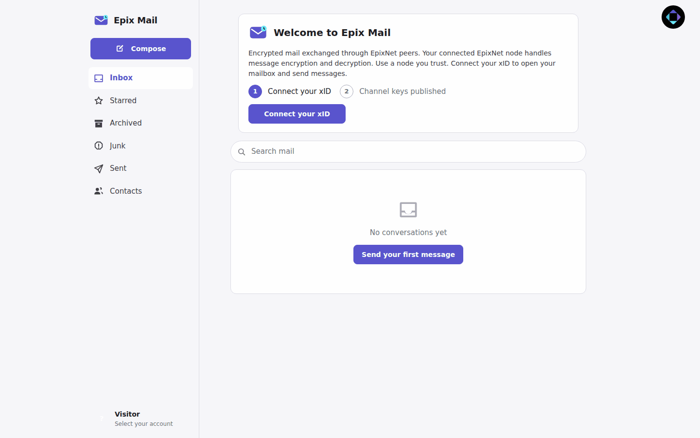
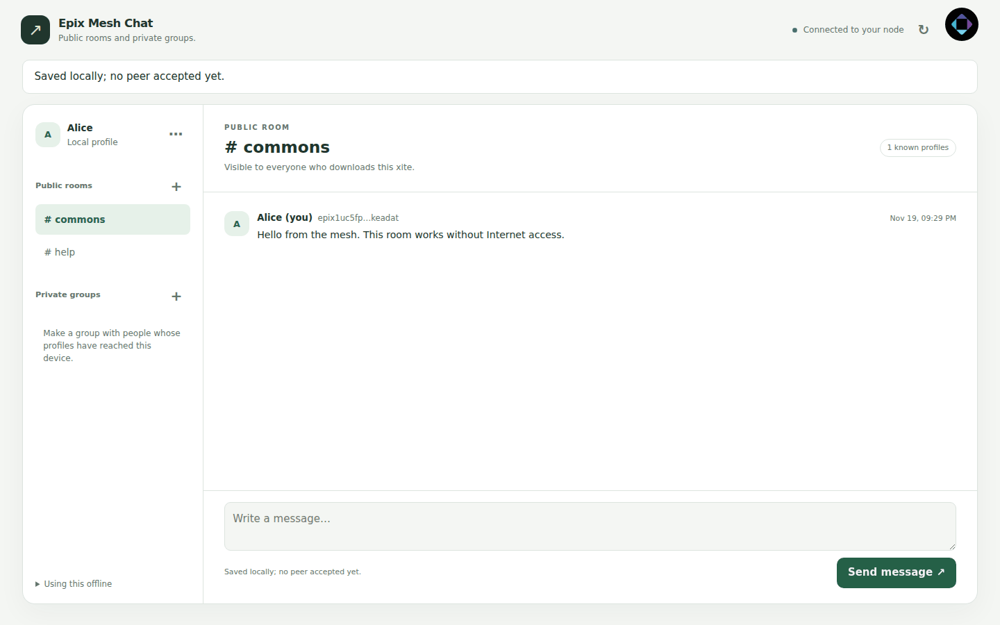

# Channels and local profiles

EpixNet gives a xite two messaging systems that the node runs on the page's behalf. **Channels** carry end-to-end encrypted messages between xID identities over an anonymous, rate-limited record pool, and are what Epix Mail is built on. **Local profiles** let a xite create a per-xite identity and exchange signed public messages and small encrypted groups without an xID or any chain access, which is what Epix Mesh Chat uses. This page is for xite authors who want to add private messaging and need to choose between the two, request the right permission, and call the API correctly.

In both systems the keys stay inside the node. A page never sees a private key, a ratchet state or another user's ciphertext: it calls commands through [EpixFrame](../libraries/epixframe.md) and gets decrypted results back.

!!! info "About the examples"
    The JavaScript on this page assumes the EpixFrame library is loaded and uses `epixFrame`, its ready-made instance. Called without a callback, `epixFrame.cmd()` returns a promise that rejects when the node answers with `{error: "..."}`. Helper names such as `showStatus` and `renderThreadList` stand for your own interface code.

## Choose a messaging model

| | Channels | Local profiles | Signed user content |
| --- | --- | --- | --- |
| Identity | A linked [xID](../start/xid.md) (for example `alice.epix`) | A per-xite key pair derived inside the node, no xID needed | The user's xID certificate |
| Who can read | Only the addressed identities | Public rooms: anyone with the xite. Groups: up to eight members | Anyone with the xite |
| Visible to observers | Total pool volume, size bucket and day of each record | Sender, timestamp, message ID, ciphertext sizes, number of copies | Everything |
| Forward secrecy | Yes, after the first message of a session | No | Not applicable |
| Works without the chain | No, sending needs a linked xID | Yes | No |
| Storage | Decrypted index outside every xite directory | Signed `data/users/<author>/data.json` inside the xite | Signed files inside the xite |
| Permission | `CHANNELS` or `Channels:<app>` | `LOCAL_PROFILE` | None beyond the xite's own rules |
| Reference app | Epix Mail | Epix Mesh Chat | Epix Talk, Epix Post |

Use channels for private conversations between named people. Use local profiles for offline or mesh communities where nobody should need a registered name. Use ordinary [user content](user-content.md) for anything meant to be public and searchable.

!!! warning "Privacy has limits"
    Neither system promises anonymity against every observer. A peer that is directly connected to your node can see that your node published something at a given moment unless you route through Tor. A recipient can always copy or disclose what they read. Read [Privacy and routing](../start/privacy.md) before describing your xite to users as private or anonymous.

## Channels

### How channels work

A channel is the encrypted audience a message is addressed to. A direct message is a channel with two members, and a small group is a channel with more. The same machinery carries mail, direct messages and any other private conversation a xite defines.

Four pieces work together:

Envelope
:   A sealed, size-padded, day-bucketed, anonymous record. Each envelope is posted under a fresh throwaway key, so nothing in it names its author or its recipients.

Pool
:   The fully replicated set of envelopes. Every node that carries the hub xite holds the whole pool, sharded by week, so fetching a shard reveals nothing about which messages a node cares about.

Hub
:   The xite that hosts the pool and every identity's public key bundle. By default it is the xID manager xite. The node adds it automatically when channels are enabled, so channels work for a user who has never opened Epix Mail.

Private index
:   A database under the node's private data folder that holds your decrypted threads and messages, the full-text search index and the ratchet sessions. It lives outside every xite directory, so peers cannot fetch it.

When a page sends a message, the node seals it with a pairwise session for each recipient device (X3DH key agreement followed by a Double Ratchet), solves the pool's proof of work, and appends one record to the pool. Every other node receives the record through normal xite synchronization and tries to open it locally. Only nodes that hold a matching key succeed, and they add the message to their private index and notify subscribed pages.

One channel identity exists per linked xID. A node can hold several linked identities, and each has its own keys, its own published bundle and its own inbox. A page's `channel*` commands act as the identity that xite currently uses. Setup is automatic: linking an identity derives its channel keys and publishes its bundle into the hub, retrying while the hub is not synced or the chain is unreachable.

!!! note
    Because setup is automatic, every linked identity has a public channel bundle unless its channels are turned off on the node's Config page. The existence of that bundle, its identity key and the number of linked devices are public.

### What is and is not hidden

| Property | Status |
| --- | --- |
| Message content | Encrypted with ChaCha20-Poly1305 under ratcheted keys. Forward secrecy and post-compromise security apply after the first message of a session. |
| Sender | Each record is posted under a throwaway key. The sender's own copy is written straight to the private index and never posted. |
| Recipient | Detection is local trial decryption. Recipient names, conversation IDs and subjects never appear in the pool. |
| Recipient and device count | Every send packs its destinations into one fixed-width record with eight slots, padded with random dummies. A send to more than eight destinations spans several records, which reveals only that there were more than eight. |
| Account existence | Public. A linked identity's bundle is published in the hub. |
| Volume and timing | Total pool volume, each record's size bucket and its day are visible to anyone with the pool. |
| Send origin | A directly connected peer can see that your node pushed a record. Routing through Tor closes this. A node setting can also add a random send delay. |
| First message of a session | Protected by the recipient's published prekey only, with no one-time prekeys. A later seed compromise exposes that first message but not the ones after it. |

The node's design document lists where this construction departs from the reference designs (for example, it has no one-time prekeys) and calls for external cryptographic review. Do not describe channels to your users as audited. The construction is summarized in [Channel cryptography](../internals/channels-crypto.md).

### Permissions

A xite must hold a channel grant before any `channel*` command works. There are two forms:

| Permission | Scope | Typical holder |
| --- | --- | --- |
| `CHANNELS` | The whole private inbox, every app | A mail-type client. Epix Mail holds it implicitly. |
| `Channels:<app>` | Only the threads tagged with `<app>` | Any xite that carries its own private conversations |

`<app>` is a short lowercase token of at most 32 characters, made of `a` to `z`, digits, `_` and `-`, such as `talk`. The app name travels inside the sealed message body, never in the public record, and the recipient's node stores it with the thread. A conversation keeps the app of its first message.

!!! warning "App names are a shared namespace"
    Every xite granted the same `Channels:<app>` name can read and send in that app's threads. The permission prompt says so. Pick a name specific to your application, and do not rely on the app name as a security boundary between xites.

A xite that holds `ADMIN` also passes the channel gate with full scope. Do not request `ADMIN` for this purpose.

Only the wrapper's prompt can grant a permission. A page asks with `wrapperPermissionAdd`, and the user decides in trusted node UI. See [The wrapper sandbox](sandbox.md) for the full permission model.

### Request a grant

Check the current permissions first. The wrapper does not answer a string request for a permission that is already granted. EpixNet v0.6.8 also sends no answer when the user dismisses the prompt (later releases answer `{error: "cancelled"}`), so a naive `await` can wait forever. The helper below works with both.

```js title="js/permissions.js"
// Resolves true once the permission is held, false if the user does not grant it.
async function ensurePermission(permission, timeoutMs = 60000) {
  const info = await epixFrame.siteInfo();
  if (info.settings.permissions.includes(permission)) return true;

  return new Promise((resolve) => {
    const timer = setTimeout(() => resolve(false), timeoutMs);
    // Pass the permission as a plain string.
    epixFrame.cmd("wrapperPermissionAdd", permission, (result) => {
      clearTimeout(timer);
      resolve(result === "ok");
    });
  });
}
```

Ask in response to a user action, such as a button labeled "Enable private messages", and explain what the grant allows before the prompt appears. On a public gateway the wrapper answers with an error and shows no prompt, because grants are impossible there.

### Check the session

`channelSessionInfo` reports whether channels are ready and which identity the page acts as.

```js title="js/dm.js"
const APP = "talk";

async function loadSession() {
  if (!(await ensurePermission("Channels:" + APP))) return null;

  const session = await epixFrame.cmd("channelSessionInfo", [{ app: APP }]);
  if (!session.hub_ready) {
    showStatus("Private messages are still syncing.");
  }
  if (!session.identity) {
    showStatus("Select or link an xID to use private messages.");
    return session;
  }
  if (!session.identity.key_bundle_published) {
    showStatus("Your message keys are still being published.");
  }
  setUnreadBadge(session.identity.unread);
  return session;
}
```

The result contains:

| Field | Meaning |
| --- | --- |
| `enabled` | Channels are running on this node |
| `xite` | Address of the hub xite |
| `hub_ready` | The hub is present locally with its pool descriptor |
| `client_xite` | Address of the Epix Mail xite |
| `identity` | `null` while the xite is browsed without an identity, otherwise an object with `auth`, `xid`, `enabled`, `setup`, `key_bundle_published`, `unread`, `outbox_pending` and `outbox_error` |
| `identities` | Every held identity with its state and unread count. Empty for a `Channels:<app>` client, which learns nothing about the node's other identities |

With no identity, read commands answer with empty lists and send commands fail with `xID required: select or link an identity for this xite`. See [xID for developers](../web3/xid.md) for how a user selects or links one.

### Subscribe to events

Call `channelSubscribe` on every page load. The node keeps one registration per xite in memory: it survives a page reload but is lost when the node restarts, and a later call replaces the earlier one, scope included. (Epix Mail is registered automatically when the node starts.) Command details are in the [messaging API reference](../api/messaging.md).

```js title="js/dm.js"
async function subscribe() {
  await epixFrame.cmd("channelSubscribe", [{ app: APP }]);

  epixFrame.on("request", (cmd, message) => {
    if (cmd !== "channelEvent") return;
    const event = message.params;
    if (event.type === "new_message") {
      refreshThreads();
      notifyUser(event.from_xid, event.subject);
    } else if (event.type === "setup") {
      // This identity's keys just landed in the hub.
      loadSession();
    }
  });
}
```

Event types:

| `type` | Sent when | Fields |
| --- | --- | --- |
| `new_message` | A message was decrypted and indexed | `identity_id`, `xid`, `auth`, `app`, `conv_id`, `from_xid`, `subject`, `snippet`, `unread`, `pending` |
| `setup` | An identity's key bundle was published into the hub | `identity_id`, `xid`, `auth`, `state` |
| `migrated` | Legacy mail was imported into the private index | `imported`, `identity_id`, `xid`, `auth`, `app` |

An event reaches a xite only when the xite's app scope matches and the identity the message landed in is the one the xite currently acts as. A `pending` value above zero means earlier messages of the conversation are still arriving out of order.

### Look up recipients and send

Before sending, check that each recipient can receive channel messages. `channelKeyLookup` is a local read of data the node has already synced.

```js title="js/dm.js"
async function sendMessage(recipients, subject, body, convId) {
  const lookup = await epixFrame.cmd("channelKeyLookup", [recipients]);
  for (const [xid, state] of Object.entries(lookup)) {
    if (state.revoked) throw new Error(xid + " has been revoked.");
    if (!state.has_bundle) throw new Error(xid + " cannot receive private messages yet.");
  }

  const options = { app: APP };
  if (convId) options.conv_id = convId; // reply in an existing conversation

  const result = await epixFrame.cmd("channelSend", [recipients, subject, body, options]);
  // result: { ok, conv_id, recipients, envelopes, delivery }
  return result;
}
```

Recipient names are normalized, so `alice` and `alice.epix` are the same recipient. `conv_id` is a 32-character hexadecimal string. Omit it to start a new conversation and pass the one returned by an earlier send, or carried on a thread row, to reply.

The `delivery` field is `published` when the record was appended to the pool right away, or `queued` when it was accepted into the node's durable outbox and will be delivered in the background. Neither value means a person has read the message.

Sending can take a noticeable moment because the node computes the pool's proof of work for each record. Show progress in your interface and do not resend on a slow response.

### Read threads and conversations

```js title="js/dm.js"
async function refreshThreads() {
  const { threads } = await epixFrame.cmd("channelThreads", [
    { folder: "all", offset: 0, limit: 50, app: APP },
  ]);
  renderThreadList(threads);
}

async function openConversation(convId) {
  const { messages } = await epixFrame.cmd("channelConversation", [{ conv_id: convId }]);
  renderMessages(messages); // oldest first
  await epixFrame.cmd("channelMarkRead", [convId, true]);
}
```

Thread rows carry `thread_id`, `conv_id`, `peer_xid`, `members`, `subject`, `snippet`, `last_ms`, `msg_count`, `unread`, `starred`, `archived` and `app`. Message rows carry `msg_id`, `dir`, `sender_xid`, `subject`, `body`, `sent_ms`, `received_ms` and `read`.

Treat every subject, body and name as untrusted text. Insert it with `textContent`, never as HTML.

### Command summary

All commands are refused without a channel grant, and on a public gateway they are refused for every page (`Channels are unavailable on public gateways`). A `Channels:<app>` client is confined to its own app for thread lists, contacts, sent mail, search, sends and conversation commands, and asking for another app is an error. A full grant reads every app by default and sends as `mail` by default.

| Command | Parameters | Result |
| --- | --- | --- |
| `channelSessionInfo` | `[{app?}]` | Session object described above |
| `channelSubscribe` | `[{app?}]` | `{ok, app}` and registers the xite for `channelEvent` |
| `channelKeyLookup` | `[[xid, ...]]` | Map of xID to `{has_bundle, revoked, devices}` |
| `channelContacts` | `[{app?}]` | List of `{xid}` for peers in existing threads of the app in scope |
| `channelSend` | `[recipients, subject, body, {conv_id?, app?}]` | `{ok, conv_id, recipients, envelopes, delivery}` |
| `channelThreads` | `[{folder?, offset?, limit?, app?}]` | `{threads}`, newest first. `folder` is `all` (every unarchived conversation, the default), `starred` or `archived` |
| `channelSent` | `[{offset?, limit?, app?}]` | `{messages}`, your own sent messages, newest first |
| `channelConversation` | `[{conv_id}]` | `{messages}`, oldest first |
| `channelSearch` | `[query, limit?, {app?}]` | `{results}` from the local decrypted index |
| `channelMarkRead` | `[conv_id, read?]` | `{ok}` |
| `channelSetConvState` | `[conv_id, {starred?, archived?}]` | `{ok}` |
| `channelDeleteLocal` | `[conv_id]` | `{ok}`, removes the conversation from this node's index only |
| `channelRlnStatus` | `[]` | Admission and retention status, described below |
| `channelIdentitySetup` | `[{auth_address?}]` | Re-runs key setup for the identity in scope |
| `channelIdentityStatus` | `[{auth_address?}]` | Status object for the identity in scope, or `null` |
| `channelIdentitySetEnabled` | `[auth_address, enabled]` | Turns channels on or off for one held identity. Requires `ADMIN` |

Commands that take an identity act as the one the xite currently uses. With a full grant, an explicit `{auth_address}` or `{xid}` in the first object parameter names another identity the node holds. A `Channels:<app>` client can act only as its own xite's identity, and naming another one is an error. Full parameter and result details are in the [messaging API reference](../api/messaging.md).

Read state, stars, archives and local deletion are per node. They are not synchronized between a user's devices.

### Admission: proof of work and rate limit nullifiers

The pool has no list of permitted writers, because that would identify senders. Instead, every record must satisfy an anonymous admission rule declared in the hub's signed `content.json`.

Proof of work
:   Each record carries a nonce such that a double SHA-256 hash of its payload has a required number of leading zero bits (`pow_bits` in the pool descriptor). The node solves this for you when a page calls `channelSend`. The hub's current descriptor sets `pow_bits` to 20.

Rate limit nullifiers
:   A pool can also set `rln_required`. Each record must then carry a zero-knowledge proof that the sender is a member of an owner-signed roster and has not exceeded a per-epoch allowance, without revealing which member sent it. An epoch is one UTC day. A record's cost is its size bucket: the smallest padding bucket costs one unit, and a bucket `k` times larger costs `k` units. The node keeps a usage ledger and refuses to send once the allowance is spent, so an unmodified client cannot overspend by accident. The allowance is per node and shared by every identity the node holds, while membership is per identity.

`channelRlnStatus` tells a page which rule applies so it can show a usage bar:

```js
async function showSendAllowance() {
  const status = await epixFrame.cmd("channelRlnStatus", []);
  if (status.rln_required) {
    showAllowance(status.units_used, status.unit_limit, status.resets_in_secs);
  }
}
```

For a pool that only requires proof of work, the result is `{rln_required: false, retention_weeks}`. When `rln_required` is true it also carries `member`, `unit_limit`, `units_used`, `units_remaining`, `epoch` and `resets_in_secs`. Design for both cases, since the hub owner controls the descriptor.

### Limits

| Limit | Value |
| --- | --- |
| Destinations per record | 8 slots. Larger sends span several records. |
| Padding buckets in the hub descriptor | 8192, 32768 and 131072 bytes |
| Largest record in the hub descriptor | 200000 bytes |
| Fixed overhead per record | About 4.4 KB of slots, so the smallest record is about 8 KB |
| App name | 1 to 32 characters |
| Default history backfill | 4 weeks at start, extended automatically after a long absence |

A message that does not fit the largest padding bucket is refused. Channels carry text. To share a file, publish it through the xite (see [Files and media](files.md)) and send a reference.

### Multiple devices and identities

A name such as `alice.epix` can have more than one linked identity, typically one per device. Each device derives its own channel keys from its own node and publishes its own bundle. A send resolves every active device bundle for each recipient and seals a slot for each one in the same record, so the recipient can read and reply on whichever device they use.

Things to know when you design for this:

- A message from a device whose bundle has not yet synced to your node is deferred, not dropped. It is indexed once the bundle arrives.
- Revocation is applied per device and per name, using the chain's view of the identity. A send to a revoked name fails with an error.
- A node that holds two identities addressed by the same record delivers the message to both inboxes.
- Unread counts and conversation flags are per device.

### How Epix Mail uses channels



Epix Mail is a thin client. Its whole data layer is one file, `js/Channel.js`, that wraps the commands above in promises. All sealing, trial decryption, indexing and search happen in the node. The mail xite itself stores no messages.

Patterns worth copying from it:

- Call `channelSessionInfo` with `{app: "mail"}` on load and render an onboarding banner from `identity.setup` and `key_bundle_published` instead of asking the user to generate keys.
- Pass `app` on every read so another application's threads never appear in the mail view.
- Ignore a `channelEvent` whose `app` or `xid` does not match the current view, because an identity switch can race an event.
- On `new_message`, invalidate the thread list and raise a notification with `wrapperWebNotification`.
- Check `channelKeyLookup` while the user types a recipient, so an unreachable name is reported before they write the message.

### Node settings that affect channels

These are operator settings on the node's Config page, not something a xite can change. They explain behavior your users may report.

| Setting | Default | Effect |
| --- | --- | --- |
| `channel_enabled` | on | Turns channels off entirely. Every `channel*` command then fails with `channels are not enabled`. |
| `channel_backfill_weeks` | 4 | Weeks of pool history fetched at start. `0` means all. |
| `channel_send_jitter_max_secs` | 0 | Delays each send by a random time up to this many seconds, so `delivery` is always `queued`. |
| `channel_burst_jitter_max_secs` | 60 | Spreads the extra records of a send to more than eight destinations. |
| `channel_feed_snippets` | off | Shows message snippets in the Dashboard feed. |

## Local profiles

Local profiles let a xite create a signing identity and exchange public or private messages without registering an xID or contacting the chain. They are designed for offline and mesh use, where nodes reach each other over a LAN or a Reticulum bridge and there may be no Internet at all.

### How local profiles work

A local profile belongs to one xite address and one EpixNet user. Different xites get different identities and different encryption keys, and changing the selected xID does not change the local profile. The keys are derived from the user's master seed with separate signing and encryption domains and never leave the node.

The node writes only one file for the user, `data/users/<local-author>/data.json`, and signs that directory's `content.json`. Messages therefore travel with the xite through ordinary signed synchronization, and reads accept only verified manifest chains and exact file hashes. Unsigned files and invalid signatures never become chat records.

Public messages are signed and readable by anyone who has the xite. Private groups use the node's ECIES encryption: each member gets an independently encrypted copy of every message, including the sender for history.

### Prepare the xite

The xite needs an owner-signed `data/users/content.json`, included by the root, whose rules permit ordinary signed user data without a certificate requirement:

```json title="data/users/content.json"
{
  "address": "<address>",
  "inner_path": "data/users/content.json",
  "modified": 0,
  "files": {},
  "user_contents": {
    "cert_signers": {},
    "permissions": {},
    "permission_rules": {
      ".*": {
        "max_size": 1048576,
        "files_allowed": "data\\.json"
      }
    }
  }
}
```

Reference it from the root `content.json`:

```json title="content.json (excerpt)"
"includes": {
  "data/users/content.json": {
    "signers": ["<address>"],
    "signers_required": 1
  }
}
```

Keep the rule limited to `data.json` and keep a size limit. Sign the root and the user content rules, then publish. The commands are covered in [Publishing](publishing.md), and the rule format in [User content](user-content.md).

### Permission and availability

The xite must hold `LOCAL_PROFILE`. Request it only after the user chooses to create a profile:

```js
async function prepareLocalProfile() {
  // An older node answers an unknown command with null, not an error.
  let info = await epixFrame.cmd("localProfileInfo", {});
  if (!info) {
    showStatus("Update EpixNet to use this xite.");
    return null;
  }
  if (!info.granted) {
    await ensurePermission("LOCAL_PROFILE"); // helper from the channels section
    info = await epixFrame.cmd("localProfileInfo", {});
  }
  return info;
}
```

Rules to keep in mind:

- Pass a string to `wrapperPermissionAdd`. Every `localProfile*` command takes an object, including `{}` for commands with no arguments.
- Call `localProfileInfo` first. It answers without the grant (with `granted: false`), and an older node that does not implement it answers `null` (the node answers every unknown command with `null` rather than an error), so one call tells you both things. Check for `null` before reading fields.
- Public gateways do not offer local profiles. Every command fails there.
- The `as` command cannot rebind these commands to another xite.
- If the user switches accounts while the page is open, commands fail with `Local profile changed; reopen this xite`. Clear your state and ask the user to reopen.

### Commands

| Command | Parameters | Result |
| --- | --- | --- |
| `localProfileInfo` | `{}` | `available`, `granted`, own `profile`, `can_link_xid`, `limits` |
| `localProfileCreate` | `{display_name}` | Creates or renames the local profile |
| `localProfilePublicPost` | `{room, text}` | Appends a signed public message |
| `localProfileGroupCreate` | `{title, profiles}` | Creates a private group from verified `signed_profile` objects |
| `localProfileSeal` | `{group_id, text}` | Appends an encrypted message to a known group |
| `localProfileOpen` | `{envelope}` | Verifies and opens a private envelope for this identity |
| `localProfileVerify` | `{record}` | Verifies a profile or public record, or verifies and opens an envelope |
| `localProfileList` | `{}` | `profiles`, `public_messages`, `private_messages`, `groups`, `truncated`, `rejected` |
| `localProfileLinkXid` | `{}` | Adds a signed proof from the currently selected linked xID |

Commands that change state return `{record, publish}`. `publish.status` is `accepted_by_peers` when at least one peer accepted the signed update (with the count in `publish.peers`), or `local_only` when it is saved locally without an acknowledgement. Peer acceptance is not proof that a person read the message, and the API does not promise a durable delivery queue.

Result shapes:

| Object | Fields |
| --- | --- |
| Profile | `author`, `display_name`, `encryption_key`, `own`, `signed_profile`, `xid` (`{name, status}` or `null`) |
| Public message | `kind` (`"public"`), `id`, `author`, `display_name`, `room`, `text`, `sent_at`, `own` |
| Private message | The group fields (`group_id`, `title`, `members`, `own_member`) plus `kind` (`invitation` or `message`), `id`, `author`, `display_name`, `text`, `sent_at`, `own` |
| Group | `group_id`, `title`, `members` (profile objects), `own_member` |

Treat `signed_profile` as an opaque value. You pass it back unchanged when creating a group.

### Worked example: Epix Mesh Chat



Epix Mesh Chat is a complete local profile application with no build step: `index.html`, one stylesheet, a small frame bridge and `js/app.js`. The flows below are trimmed from it.

Create a profile, asking for the permission only at that point:

```js title="js/app.js"
async function createProfile(displayName) {
  let info = await epixFrame.cmd("localProfileInfo", {});
  if (!info.granted) {
    await ensurePermission("LOCAL_PROFILE");
    info = await epixFrame.cmd("localProfileInfo", {});
    if (!info.granted) throw new Error("Local profile permission was not granted.");
  }
  const result = await epixFrame.cmd("localProfileCreate", { display_name: displayName });
  showPublish(result.publish);
}
```

Post to a public room or to a private group, checking the length limit the node reported:

```js title="js/app.js"
const byteLength = (text) => new TextEncoder().encode(text).length;

async function send(selected, text, limits) {
  if (byteLength(text) > limits.text_bytes) {
    throw new Error("Use at most " + limits.text_bytes + " UTF-8 bytes.");
  }
  const result = selected.kind === "public"
    ? await epixFrame.cmd("localProfilePublicPost", { room: selected.id, text })
    : await epixFrame.cmd("localProfileSeal", { group_id: selected.id, text });
  showPublish(result.publish);
}
```

Create a private group from profiles that have reached this device:

```js title="js/app.js"
async function createGroup(title, chosenAuthors, data, limits) {
  if (!chosenAuthors.length || chosenAuthors.length >= limits.group_members) {
    throw new Error("Choose between 1 and " + (limits.group_members - 1) + " other people.");
  }
  const profiles = data.profiles
    .filter((profile) => chosenAuthors.includes(profile.author))
    .map((profile) => profile.signed_profile);
  const result = await epixFrame.cmd("localProfileGroupCreate", { title, profiles });
  return result.record.group_id;
}
```

Refresh by listing, and tell the user when history was cut or records were rejected:

```js title="js/app.js"
async function refresh() {
  const info = await epixFrame.cmd("localProfileInfo", {});
  if (!info.granted) return;
  const data = await epixFrame.cmd("localProfileList", {});
  render(info, data);
  if (data.truncated) showStatus("Some older messages or profiles are not shown.");
  else if (data.rejected) showStatus("Some stored records failed verification and were ignored.");
}

epixFrame.on("openWebsocket", refresh);
epixFrame.on("request", (cmd) => { if (cmd === "setSiteInfo") refresh(); });
```

Mesh Chat reports delivery honestly, and your interface should too:

```js title="js/app.js"
function publishLabel(publish) {
  if (publish && publish.status === "accepted_by_peers" && publish.peers > 0) {
    return "Saved locally; accepted by " + publish.peers + " peer(s). This does not confirm anyone read it.";
  }
  return "Saved locally; no peer accepted yet.";
}
```

Rooms are a convention of the application. The node accepts any room name of up to 80 bytes, and Mesh Chat restricts its own rooms to lowercase letters, digits, `_` and `-`.

### Link an xID

A link is optional. It binds the xite, the local signing identity and the encryption key to the currently selected linked xID, so other users can see a name next to the profile.

```js
async function linkXid() {
  await epixFrame.cmd("certXid", {});            // opens the node's account picker
  const result = await epixFrame.cmd("localProfileLinkXid", {});
  showPublish(result.publish);
}
```

A profile's `xid` object carries a `name` and a `status` of `verified`, `stale`, `revoked` or `unknown`, depending on the chain-backed resolution available to the node at that moment. A signed link alone is not proof of current name ownership, so show a verified label only for `verified`. A display name never proves ownership of an xID. Offline or unresolved links never prevent local profile messaging.

### Privacy and limits

Public profiles, public messages and signed user metadata are public xite data. Private message bodies, group titles and member lists are inside authenticated ciphertext. The outer envelope still exposes the sender, the timestamp, the message ID, the ciphertext sizes and the number of copies. It does not list recipient identities.

!!! warning "No forward secrecy"
    Local profile groups do not provide forward secrecy. A compromised master seed can decrypt retained history, and a recipient can copy or disclose plaintext. Group membership is immutable: create a new group to add or remove members, and note that this does not revoke copies that former members already hold.

| Limit | Value |
| --- | --- |
| Group members, including yourself | 8 |
| Message text | 4096 UTF-8 bytes |
| Display name and room name | 80 bytes |
| Group title | 120 bytes |
| Public records kept per user | 128 |
| Private records kept per user | 32 |
| User document size | 512 KiB |
| Documents attempted and accepted per list | 128 attempted, 64 accepted, 8 MiB read |
| Signature checks per list | 512 |
| Decrypt attempts per list | 256 |

When a history limit is reached, the oldest records are removed. This is bounded chat history, not an archive. Read the live values from `localProfileInfo().limits` (`group_members`, `text_bytes`, `document_bytes`, `public_history`, `private_history` and the list budgets) instead of hard-coding them.

Restoring the same user backup or master seed restores the keys. Recovering the saved profile and message history also needs the xite data, either from a backup or from peers. A seed alone cannot reconstruct messages that no peer or backup retains.

The API does not expose private keys, arbitrary signing, arbitrary decryption or a general file write.

## Common errors

| Error text | Cause | What to do |
| --- | --- | --- |
| `channels are not enabled` | The operator turned channels off | Explain that the node has private messages disabled |
| `channels: this xite has no channel permission` | No `CHANNELS` or `Channels:<app>` grant | Request the grant from a user action |
| `channels: this xite is scoped to app <app>` | A scoped client asked for another app | Use your own app name everywhere |
| `channels: this xite cannot act as identity <name>` | A scoped client named an identity other than its xite's own | Leave out `auth_address` and `xid` |
| `Channels are unavailable on public gateways` | The page is served by a gateway | Ask the user to open the xite on their own node |
| `xID required: select or link an identity for this xite` | No identity is selected | Send the user to pick or link an xID |
| `<name> has not published channel keys` | The recipient has no usable bundle on this node yet | Check with `channelKeyLookup` before sending |
| `<name>'s identity has been revoked` | The chain reports the name as revoked | Do not retry |
| `LOCAL_PROFILE permission required` | The grant is missing or was removed | Request it again from a user action |
| `Local profiles are unavailable on public gateways` | The page is served by a gateway | Ask the user to open the xite on their own node |
| `Create a local profile first` | A post was attempted before `localProfileCreate` | Run the create flow |
| `Unknown private group` | The `group_id` is not known to this identity | Refresh with `localProfileList` |

## Related pages

- [Messaging API reference](../api/messaging.md)
- [The wrapper sandbox and permissions](sandbox.md)
- [User content](user-content.md)
- [Channel cryptography](../internals/channels-crypto.md)
- [Privacy and routing](../start/privacy.md)
- [Featured xites](../start/apps.md)
