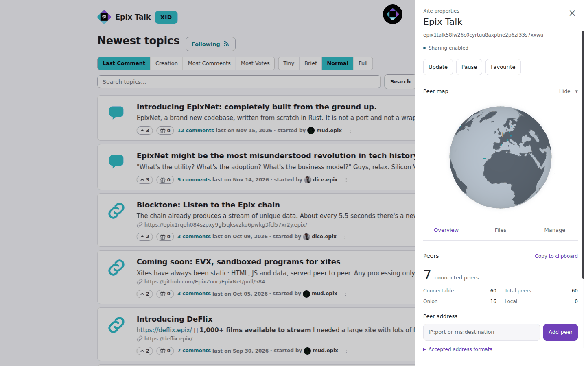
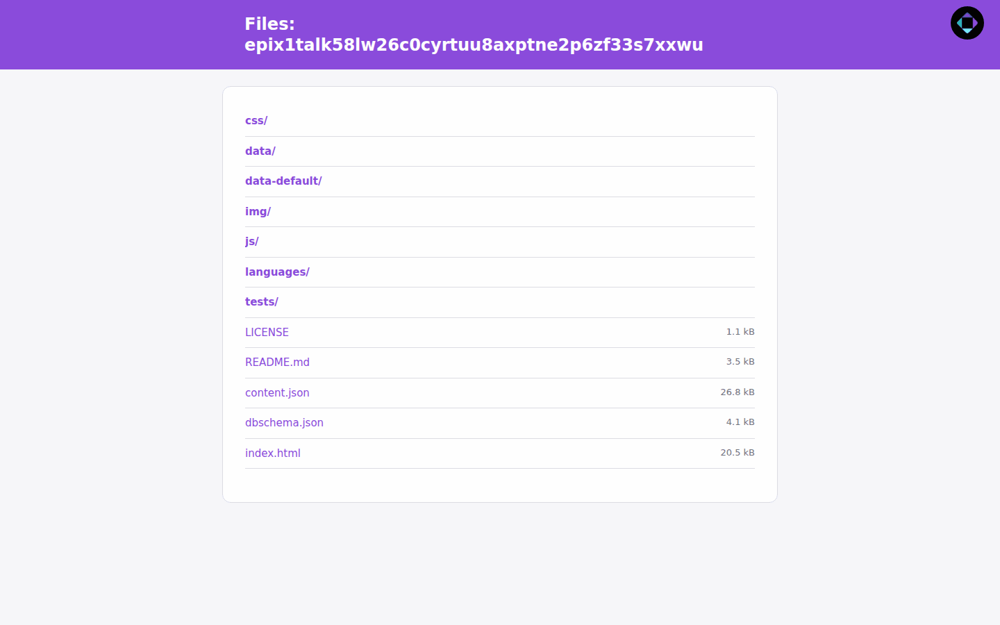

# Publishing

This page covers everything between "the files are ready" and "other people have them": signing, publishing, how updates spread, owner keys and their recovery, shared signing, `.epix` names, cloning, a git-based workflow, reverting and exporting. It is for xite owners. If you have not published a xite yet, start with the [quickstart](quickstart.md).

## Signing and publishing are two steps

**Signing** is local. The node reads `content.json` from the xite folder, hashes every file that belongs to the xite, records sizes and hashes, sets a new `modified` time and signs the result with the owner key. After signing, your node holds a new, self-consistent version. Nobody else has it yet.

**Publishing** is the network step. The node offers the freshly signed `content.json` to the peers it can reach. Each peer verifies it and downloads the files that changed.

Most of the time you do both with one button, but it helps to know they are separate: signing can succeed while publishing reaches nobody, and that is not an error.

## From the xite sidebar

Open the xite, then drag the round EpixNet button in the top right corner to the left. The sidebar has three tabs: **Overview**, **Files** and **Manage**. Publishing lives in **Manage**.



1. Switch on **This is my xite**. It reveals the owner controls. For a xite you created on this node it is already on.
2. Optionally edit **Xite title**, **Xite description** and **xID name**, then choose **Save xite settings**. This writes the values to `content.json` and, when the owner key is saved on this node, signs it.
3. Under **Content publishing**, check that **Content file** names the manifest you want to sign. `content.json` is the root. If the xite has child manifests declared in `includes`, they are listed below the field.
4. Choose **Sign and publish**.

The menu button next to it offers **Sign** and **Publish** as separate actions. Use **Sign** to produce a signed version without contacting peers, and **Publish** to push the already signed version again.

Below the heading, the sidebar shows whether a key is stored: **Private key saved.** with a **Forget** link, or **No saved private key** with **Add saved private key**. Without a saved key, signing asks for the key each time.

### The modified files panel

When files already listed in `content.json` differ from their signed hashes, the wrapper shows a panel at the bottom of the page: the number of modified files, their names and a **Sign & Publish** button. It signs and publishes the root manifest, the same as the sidebar.

The panel only notices changes to listed files. A file you have just added is not listed yet, so sign from the sidebar after adding files.

## From the command line

The node binary is also the authoring tool. The action name is the first argument.

```sh
epix-server siteSign <address> [privatekey] [inner_path] [--full] [--keep-missing]
epix-server sitePublish <address> [inner_path]
epix-server siteVerify <address>
```

| Action | What it does |
| --- | --- |
| `siteSign` | Signs the manifest that governs `inner_path` (default `content.json`). Uses the saved owner key when you do not pass one. |
| `sitePublish` | Publishes the already signed manifest. It does not sign. |
| `siteVerify` | Checks every file listed in the root manifest against its signed size and hash and prints `[CHANGED] <path>` for each mismatch. |

Options for `siteSign`:

| Option | Meaning |
| --- | --- |
| `--full` | Re-read and re-hash every file. By default the signer trusts a cache keyed on each file's size and modification time, stored in `.sign-cache.json` in the xite folder, so that large xites sign quickly. Use `--full` if a tool may have changed file content without changing those. |
| `--keep-missing` | Keep `files_optional` entries whose files are no longer on your disk. By default they are removed, so that deleting an optional file removes it from the xite. |

How these commands interact with a running node depends on the platform:

=== "Linux and macOS"

    When a node is running on the same data folder, `siteSign` and `sitePublish` are handed to it through its local admin socket. This is the preferred way: the running node already has peers and keeps its internal stores in step with the new version.

    When no node is running, the commands work on the data folder directly. An offline `sitePublish` can only reach peers on the ordinary internet, not onion or I2P peers, and fails if it reaches nobody.

    `siteVerify` always works on the data folder and needs the node to be stopped.

=== "Windows"

    There is no admin socket on Windows, and the data folder can only be used by one process at a time. Stop the node before running these commands, or use the sidebar while the node runs.

To run any API command against a running node from a script (Linux and macOS):

```sh
epix-server siteCmd <address> <command> '<json params>'
```

For example, `epix-server siteCmd <address> siteInfo` prints the same object a page receives. Other actions are listed in [Running a node](../start/running.md).

!!! warning "Keys on the command line"
    A private key passed as an argument can end up in your shell history and is visible to other processes while the command runs. Prefer the saved key: create the xite on the node, or add the key once in the sidebar, and call `siteSign <address>` without it.

## How an update spreads

<figure class="epix-diagram-figure" markdown="0">
<div class="epix-diagram">
--8<-- "docs/en/img/diagrams/publish-flow.svg"
</div>
<figcaption>Signing and publishing are separate steps. Peers fetch only the files whose hashes changed.</figcaption>
</figure>

1. You sign. Your node now has a manifest with a newer `modified` time.
2. You publish. Your node offers the manifest to peers of this xite. For changed JSON data files it also sends a compact difference, so peers can patch small changes in place.
3. Each peer verifies the signature and the rules, and ignores the manifest unless its `modified` time is newer than the copy it has.
4. The peer downloads the files whose hashes changed. Only when they have arrived does the new manifest become that peer's current version, so a visitor is never served a mix of old and new files.
5. Pages open on that peer receive `setSiteInfo` events and can update live ([Events pushed to the page](anatomy.md#events-pushed-to-the-page)).
6. A peer that accepted the update passes it on. Nodes that were offline catch up through their regular sync when they next run.

One accepting peer is enough for the update to enter the network. If publishing reports that no peer was reachable, the version stays on your node and spreads when peers next sync with you.

What publishing cannot do:

- It cannot reach nodes that are offline, and it cannot make anyone keep a copy. Availability depends on reachable peers that hold the xite.
- It cannot retract anything. Peers that already fetched a file may keep it. Publishing a new version without the file stops your xite from listing it; it does not delete other people's copies.

Visitors can ask for the latest version at any time with **Update** in the sidebar's **Overview** tab or in the Dashboard.

## Owner keys

A xite's address is derived from a key pair. The private half is the **owner key**: the only thing that can sign the root `content.json`. There is no account, password reset or administrator behind it.

### Where the key is

When you create or clone a xite on your node, the key is derived from the node's **master seed** using a random index. The node saves:

- the key itself in `<data folder>/private/users.json`, so you can sign without typing it;
- the index in the xite's signed `content.json`, as `address_index`.

`siteCreate` on the command line also prints the key once.

### Back it up

Back up `users.json`. It contains the master seed, every saved xite key and your identities. The Dashboard's backup page creates a backup for you; see [Dashboard](../start/dashboard.md). Treat the backup like a password store: anyone who has it can publish as you. The **Save as .zip** export of a xite never contains keys.

### Recover it

| Situation | What to do |
| --- | --- |
| New installation, same master seed (restored from a backup, even one older than the xite) | Open the xite, switch on **This is my xite**. The node reads `address_index` from the signed manifest, re-derives the key from the seed and saves it. |
| You have the key itself | In the sidebar choose **Add saved private key** and paste it. The node checks that it belongs to this xite before saving. |
| The manifest has no `address_index` (some older xites) | Restore a `users.json` backup that contains the key, or use the key you saved separately. |
| No key, no seed, no backup | The xite can no longer be updated. Existing copies keep working as long as peers hold them. |

The derivation can also be done by hand with `epix-server cryptGetPrivatekey <master_seed> <address_index>`, and `epix-server cryptPrivatekeyToAddress <privatekey>` shows which address a key belongs to. The warning above about secrets on the command line applies doubly to a master seed.

### Remove it from a node

**Forget** in the sidebar deletes the saved key from this node. Do this on machines that should serve the xite but must not be able to publish it. Make sure you have the key or the seed elsewhere first.

## Working with more than one signer

The root manifest is signed by the owner key and nothing else. To let other people or other machines publish parts of a xite, delegate directories.

**Delegated directories with `includes`.** The owner lists a child manifest and who may sign it:

```json title="content.json (root)"
"includes": {
  "data/news/content.json": {
    "signers": ["alice.epix", "epix1editoraddress000000000000000000000000000"],
    "files_allowed": ".*\\.(json|png|jpg)",
    "max_size": 5000000
  }
}
```

After the owner signs and publishes this, an editor can update `data/news/` independently:

- An editor listed by xID name selects that identity on the xite, enters `data/news/content.json` as the **Content file** in the sidebar and chooses **Sign and publish**. The node signs with the identity's key.
- An editor listed by address signs with that address's key, in the sidebar prompt or with `epix-server siteSign <address> <privatekey> data/news/content.json`.
- The owner can always sign any child manifest with the owner key.

The owner stays in control: removing a signer from `includes` and re-signing the root revokes that editor's access for future versions.

**User content.** For open participation, where every visitor with an identity gets their own signed directory, use `user_contents`. See [User content](user-content.md).

!!! note "No multi-signature on the root"
    One valid signature from an authorized signer is always sufficient; `signs_required` values above 1 are not enforced. The manifest format has a delegated signer list for the root (`signers` with `signers_sign`), which nodes verify, but the node's signing commands do not create it. See the [content.json reference](content-json.md#delegated-signers-on-the-root).

## Give your xite a .epix name

A `.epix` name such as `mysite.epix` is registered on Epix Chain through xID and points at a xite address. Names are managed in the xID xite. You need the Epix Wallet and some EPIX for the registration fee; see [xID](../start/xid.md).

1. **Register the name.** Open the xID xite (`epix1xauthduuyn63k6kj54jzgp4l8nnjlhrsyaku8c`) and register `mysite.epix` with your wallet.
2. **Point the name at the xite.** On the name's page, add a record of type **EpixNet xite** and enter your xite's `epix1...` address. Only the address is stored on chain.
3. **Claim the name in the xite.** In the xite sidebar's **Manage** tab, enter `mysite.epix` in **xID name** and choose **Save xite settings**, then **Sign and publish**. This sets `domain` in `content.json`.

Both directions matter. The record makes `mysite.epix` resolve to your address. The `domain` claim lets a node that reached the xite by address learn the name; the node only displays it after checking that the name really resolves to this address. Once verified, opening the address form redirects to the name form.

Setting `domain` alone registers nothing, and the name's wallet is separate from the xite's owner key: the wallet controls where the name points, the owner key controls what the xite contains.

For the on-chain side and for resolving names from code, see [xID for developers](../web3/xid.md).

## Cloning

Cloning creates a new xite, with a new address and a new owner key on your node, from the files of an existing one. It is how the Dashboard's **Create new xite** works (it clones the Dashboard's `template-new` directory) and how a blog or forum app can be reused by anyone.

### Clone a xite

In the Dashboard, open the menu of a xite that allows it and choose **Clone**. The action appears when the xite's `content.json` has `"cloneable": true`. From a page, the same thing is the `siteClone` command ([Xite and server commands](../api/xite.md)).

The clone gets the title "My" plus the original title ("My New Epix Xite" when the clone root is a `template-` directory, as with **Create new xite**), `cloned_from` and `clone_root` fields recording its origin, a fresh `address_index`, and an empty `files` list that is filled when the node signs it. The source's `domain` claim is not carried over.

### Make your xite cloneable

A good template starts clean, without your posts and users. The node supports this with a naming convention:

- A path containing `-default` is the starting state. `data-default/` in the source becomes `data/` in the clone, and `settings.json-default` becomes `settings.json`.
- The source's live counterpart (`data/`) is **not** copied when a `-default` variant exists.
- If `content.json-default` exists, it is used as the clone's manifest instead of your live `content.json`. Use it to give clones sensible metadata and rules.
- The `-default` files are copied too, so a clone can itself be cloned.

A typical cloneable xite therefore has:

```text
content.json            your live manifest, with "cloneable": true
content.json-default    the manifest clones start from (optional)
data/                   your live data, not copied
data-default/           clean starting data, copied to data/
```

Child manifests that the clone's `includes` declare and that were copied from the source (for example from a `-default` template) are signed with the new owner key during cloning, so the clone's user content rules are valid from the start.

### Upgrade a clone

When the original app improves, owners of clones can take the new code. In the Dashboard menu of a xite you own that has `cloned_from`, choose **Upgrade code**. The node copies the source's files over yours again, keeps your `content.json` and your existing data, and signs. Local changes you made to the app's code files are overwritten, so the Dashboard asks for confirmation first.

## Keep the xite folder in git

The xite folder can be a git working copy. The official xites are developed this way: the repository root is the xite root, and `content.json` is committed along with the code.

Recommended setup:

- **Exclude git from signing.** Add `\\.git` to `ignore` in `content.json`. Xites created from the Dashboard already have it. Exclude development-only files the same way, for example `tests/.*`, `node_modules/.*` and `package(-lock)?\\.json`.
- **Exclude other people's data from git.** A `.gitignore` like the one the official xites use keeps user content and local artifacts out of the repository:

    ```text
    *.db
    *.db-shm
    *.db-wal
    data/users/*/
    .sign-cache.json
    ```

    The signer's `.sign-cache.json` is never signed or sent to peers, but git would otherwise commit it.

- **Commit the signed manifest.** A commit then records exactly what was published.

A release looks like this:

```sh
# 1. edit, preview at http://127.0.0.1:42222/<address>/, commit
git add -A && git commit -m "Add note filters"

# 2. sign and publish what is on disk
epix-server siteSign <address>
epix-server sitePublish <address>

# 3. commit the manifest the signer produced
git add content.json && git commit -m "Publish"
```

Things to watch:

- **Sign what you intend to publish.** Signing takes the working copy as it is, including uncommitted and untracked files that `ignore` does not exclude. Check `git status` first.
- **Do not hand-merge `content.json`.** The generated sections cannot be merged by hand. Resolve conflicts in your own fields and sign again.
- **After `git checkout` or `git pull`, sign with `--full` if in doubt.** The signer's cache trusts file size and modification time.
- **Signed JSON and the database.** Checking out a different version of a declared `.json` file makes it differ from its signed hash until you sign again. See [Only signed inputs are loaded](database.md#only-signed-inputs-are-loaded).
- **A repository clone is not a xite clone.** Someone who clones your repository gets your files but not your key. They can run the code as a new xite of their own (create a xite, copy the files in, sign), which is the usual way to contribute to or fork an app.

## Revert unsigned edits

To throw away local changes to a file and return to the published version, open the built-in file browser at `http://127.0.0.1:42222/list/<address>/` (or **Browse files** in the sidebar's **Files** tab), choose **Revert** beside the file and confirm.



Revert restores the version recorded in the signed manifest, from a verified local copy or from a reachable peer. Your edited file is kept until a verified replacement is available. It is offered for files declared in xites you own. It cannot undo a change that has already been signed, and it cannot restore `content.json` itself.

## Export and import

**Save as .zip** in the sidebar's **Files** tab (also in the Dashboard's xite menu) downloads the xite's signed public files and manifests, including optional files you have downloaded. It leaves out private encrypted files, unsigned edits, node settings and keys. If a required file is missing or modified, the export reports an error; finish downloading or sign first. Exports run one at a time, with limits of 8 GiB per file and 16 GiB of file data per archive.

To bring xites into a node from an archive whose top-level directories are named by xite address:

```sh
epix-server importBundle <bundle.zip>
```

Each xite in the archive is extracted, verified and served. Run it with the node stopped.

## Common publishing problems

**"Content publish failed: no peers reachable right now. It will spread on the next sync."**
Signing worked; no peer accepted the push. Normal for a new xite that nobody else has. Otherwise check that your node is online ([Dashboard](../start/dashboard.md) shows network status). The update is not lost.

**"Enter your private key" appears every time.**
No owner key is saved on this node. Choose **Add saved private key** in the sidebar, or switch **This is my xite** off and on to attempt recovery from the master seed.

**"That private key belongs to ..., not to this xite" or "private key address ... does not own xite ...".**
The key is valid but for a different address. The root manifest can only be signed by the xite's own key.

**"that is not a valid private key".**
The text is not a key the node can use. Check for missing characters or stray whitespace.

**"No saved private key for this xite; pass one" (command line).**
The data folder has no key for this address. Pass the key, or recover it first ([Recover it](#recover-it)).

**"Another EpixNet process owns ..." (command line).**
A node is running on this data folder and the action needs exclusive access. Stop the node, or on Linux and macOS use an action that is forwarded to the running node (`siteSign`, `sitePublish`, `siteCmd`).

**"refusing to sign an unloadable manifest".**
The file set breaks a manifest rule, most often a path that is not portable (see [files](content-json.md#files)) or two paths that differ only by letter case. Rename the file named in the message and sign again.

**"could not parse content.json before signing".**
A hand edit left invalid JSON. A common cause is a single backslash in a pattern; write `\\.` in JSON.

**A file matching the shard pattern "is not on disk".**
A file listed as optional matches `shard` but you do not hold it. Fetch it or remove its entry, then sign.

**Signing is slow.**
The first sign of a large xite hashes everything. Later signs reuse the cache and only hash files that changed.

**Signed files I did not mean to publish.**
Add a pattern to `ignore` and sign again. Remember that peers who already fetched a file may keep it.

**The database is empty or stale after I edited JSON files.**
Declared JSON files must match their signed hashes to be loaded. Sign the xite. See [Database](database.md#only-signed-inputs-are-loaded).

**"This node is a read-only gateway; changes are disabled here".**
You are using a public gateway. Publish from your own node.

**Visitors report that the xite is too large.**
Each visitor's node has a per-xite size limit, 1000 MB by default, and asks before going beyond it. Move large media to optional files ([Files](files.md)).

## Related pages

- [content.json reference](content-json.md)
- [Xite anatomy](anatomy.md)
- [Running a node](../start/running.md): every command line action and setting.
- [Data directory layout](../internals/data-directory.md)
