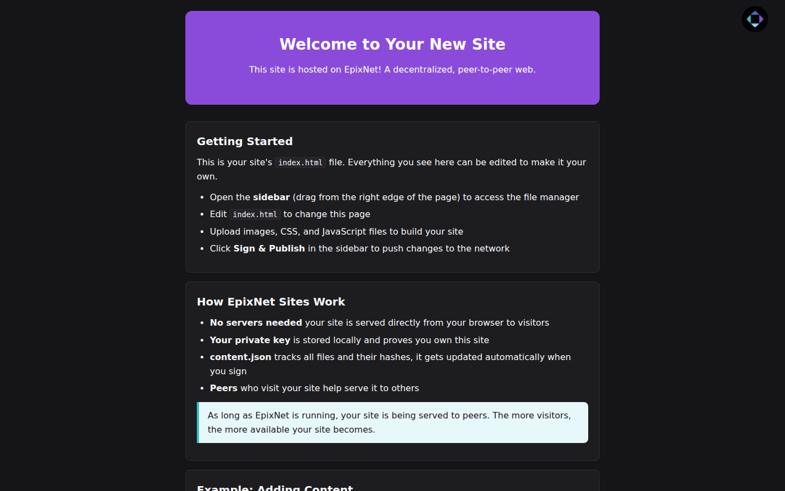
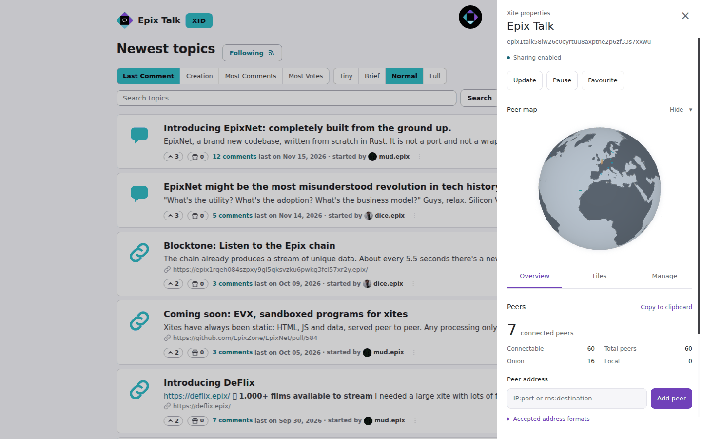

# Build and publish your first xite

This tutorial takes you from an empty node to a published xite (an EpixNet website) that talks to the node, reads a signed JSON data file and updates live when you publish a change. It is written for web developers who are new to EpixNet and assumes only HTML and JavaScript.

## Before you start

You need:

- A running EpixNet node. See [Install EpixNet](../start/install.md) and [Running a node](../start/running.md).
- A text editor.
- About 20 minutes.

The examples use the default dashboard address `http://127.0.0.1:42222/`. If your node selected another port, use that one instead.

## How authoring works

Three facts explain the whole workflow:

1. **A xite is a folder.** It lives at `<data folder>/data/<address>/` and holds ordinary web files plus a signed manifest named `content.json`.
2. **Your node serves that folder as it is on disk.** When you edit a file and reload the page, you see the change at once. No signing is needed for a local preview.
3. **Other nodes accept only signed content.** Before anyone else can receive your change, you sign it (the node rebuilds `content.json` with the hash of every file) and publish it (the node pushes the new `content.json` to peers).

So the loop is: edit, reload, repeat, and when you are happy, sign and publish.

## Step 1: Create the xite

=== "Dashboard"

    1. Open the Dashboard at `http://127.0.0.1:42222/`.
    2. Open the menu with the **☰** button at the top left. In the **Settings** panel, choose **Create new xite**.

    The node creates a new address, copies a starter page into a new folder, signs it and takes you to the new xite. The owner key is derived from your node's master seed and saved in `<data folder>/private/users.json`, so you can sign without typing a key.

    

=== "Command line"

    The node binary doubles as an authoring tool. Stop the node first: `siteCreate` works directly on the data folder and needs its lock.

    ```sh
    epix-server siteCreate
    ```

    The command prints the new address, the folder path and the private key:

    ```text
    ----------------------------------------------------------------------
    Xite private key: <private key>
              !!! ^ Save it now, required to modify the xite ^ !!!
    Xite address:     <address>
    ----------------------------------------------------------------------
    Xite created! You can find it in <data folder>/data/<address>
    ```

    The key is also saved in `users.json`, so later `siteSign` calls do not need it as an argument. Start the node again and open `http://127.0.0.1:42222/<address>/`.

!!! warning "Keep the owner key safe"
    Whoever holds the private key can publish new versions of the xite. Back up `users.json` and store any printed key somewhere private. See [Owner keys](publishing.md#owner-keys) for recovery options.

## Step 2: Find the xite folder

The folder is `<data folder>/data/<address>/`. The default data folder is:

| Platform | Data folder |
| --- | --- |
| Linux | `~/.local/share/EpixNet` (or `$XDG_DATA_HOME/EpixNet`) |
| macOS | `~/Library/Application Support/EpixNet` |
| Windows | `%APPDATA%\EpixNet` |

You can also let the node open it for you. With the xite on screen, drag the round EpixNet button in the top right corner to the left to open the xite sidebar, switch to the **Files** tab and choose **Show directory**.

A new xite contains two files, plus a hidden `.sign-cache.json` that the signer keeps for itself:

```text
<address>/
├── content.json    signed manifest: metadata plus the hash of every file
└── index.html      the starter page
```

## Step 3: Write your own page

Replace `index.html` with the page below. It has a place for xite information and a list that Step 6 fills from a JSON file.

```html title="index.html"
<!DOCTYPE html>
<html>
<head>
 <meta charset="utf-8">
 <meta name="viewport" content="width=device-width, initial-scale=1.0">
 <title>My first xite</title>
 <style>
  body { font-family: system-ui, sans-serif; line-height: 1.6; max-width: 720px; margin: 0 auto; padding: 24px; }
  h1 { margin-bottom: 4px; }
  .meta { color: #666; font-size: 14px; overflow-wrap: anywhere; }
  .note { border: 1px solid #ddd; border-radius: 8px; padding: 12px 16px; margin: 12px 0; }
  .note h2 { font-size: 18px; margin: 0 0 4px; }
 </style>
</head>
<body>

<h1 id="title">My first xite</h1>
<p class="meta">Address: <span id="address">loading</span> | Peers: <span id="peers">0</span></p>

<div id="notes"></div>

<script src="js/lib/epixframe.min.js"></script>
<script src="js/app.js"></script>
</body>
</html>
```

Use relative URLs such as `js/app.js`. The same files are served under different URL forms depending on how the visitor reaches the xite, and relative URLs work in all of them. See [URL forms](anatomy.md#url-forms).

## Step 4: Add EpixFrame

A xite page runs in a sandboxed iframe and cannot open the node's WebSocket itself. It reaches the node by sending messages to the wrapper page around it. [EpixFrame](../libraries/epixframe.md) is the small JavaScript library that does this for you.

Xites carry their own copy of every library so that they work offline and for visitors who only reach the network through Tor or I2P. Download `dist/epixframe.min.js` from the [EpixFrame repository](https://github.com/EpixZone/epixframe) and save it in your xite as:

```text
js/lib/epixframe.min.js
```

The script defines `window.EpixFrame` (a class you can extend) and `window.epixFrame` (a ready-made instance, created the first time you read it). Use one or the other, not both: each instance introduces itself to the wrapper as a new document.

## Step 5: Call the node

Create `js/app.js`. This version asks the node for `siteInfo` and shows the result:

```js title="js/app.js"
class MyXite extends EpixFrame {
  // Called when the wrapper's connection to the node is open.
  onOpenWebsocket() {
    this.cmd("siteInfo", {}, (info) => {
      this.address = info.address;
      this.showInfo(info);
    });
  }

  showInfo(info) {
    var title = info.content && info.content.title;
    document.getElementById("title").textContent = title || info.address;
    document.getElementById("address").textContent = info.address;
    document.getElementById("peers").textContent = info.peers;
  }
}

window.Page = new MyXite();
```

`cmd(name, params, callback)` sends one command and calls you back with the result. Without a callback it returns a Promise instead. The full command list is in the [EpixFrame API overview](../api/index.md); `siteInfo` is described in [Xite and server commands](../api/xite.md).

Reload the xite. The heading now shows the xite title from `content.json` and the address line shows your `epix1...` address.

## Step 6: Add a JSON-backed feature

Data in a xite is usually kept in JSON files. They are signed like any other file, and the node can also load them into an SQL database for you (covered in [Database](database.md)). Here you read one file directly.

Create a data file:

```json title="data/notes.json"
{
  "notes": [
    {
      "note_id": 1,
      "title": "Hello EpixNet",
      "body": "This note lives in a signed JSON file.",
      "date_added": 1767225600
    },
    {
      "note_id": 2,
      "title": "Second note",
      "body": "Edit data/notes.json, sign and publish, and every open copy updates.",
      "date_added": 1767312000
    }
  ]
}
```

Then replace `js/app.js` with the full version:

```js title="js/app.js"
class MyXite extends EpixFrame {
  onOpenWebsocket() {
    this.cmd("siteInfo", {}, (info) => {
      this.address = info.address;
      this.showInfo(info);
    });
    this.loadNotes();
  }

  // Called for every message the node or wrapper pushes to the page.
  onRequest(cmd, message) {
    if (cmd !== "setSiteInfo") return;
    var info = message.params;
    if (info.address !== this.address) return;
    this.showInfo(info);
    // A new version of the data file arrived: show it without a reload.
    if (info.event && info.event[0] === "file_done" && info.event[1] === "data/notes.json") {
      this.loadNotes();
    }
  }

  showInfo(info) {
    var title = info.content && info.content.title;
    document.getElementById("title").textContent = title || info.address;
    document.getElementById("address").textContent = info.address;
    document.getElementById("peers").textContent = info.peers;
  }

  loadNotes() {
    this.cmd("fileGet", { inner_path: "data/notes.json", required: false }, (text) => {
      var notes = [];
      try {
        notes = text ? JSON.parse(text).notes || [] : [];
      } catch (error) {
        this.cmd("wrapperNotification", ["error", "data/notes.json is not valid JSON"]);
      }
      this.renderNotes(notes);
    });
  }

  renderNotes(notes) {
    var list = document.getElementById("notes");
    list.textContent = "";
    notes
      .slice()
      .sort((a, b) => b.date_added - a.date_added)
      .forEach((note) => {
        var item = document.createElement("div");
        item.className = "note";
        var heading = document.createElement("h2");
        heading.textContent = note.title;
        var body = document.createElement("p");
        body.textContent = note.body;
        item.appendChild(heading);
        item.appendChild(body);
        list.appendChild(item);
      });
  }
}

window.Page = new MyXite();
```

What is new:

- **`fileGet`** returns the file content as a string, or `null` when the file is missing. `required: false` tells the node not to wait for a file that is not there. See [File commands](../api/files.md).
- **`onRequest`** receives pushed messages. The node sends `setSiteInfo` whenever the xite changes. When a file finishes downloading, the message carries `event: ["file_done", "<inner path>"]`, which is how a visitor's open page learns that you published new notes. See [Events pushed to the page](anatomy.md#events-pushed-to-the-page).
- **`textContent`**, not `innerHTML`, is used to show data. On xites that accept content from other users this matters a great deal, so it is a good habit from the first page.

!!! tip "Why `fileGet` and not `fetch`"
    A plain `fetch("data/notes.json")` works in the EpixNet Browser and on a local node, where each xite has its own origin. It fails when the xite is reached through a shared gateway or LAN address, where the page runs in an opaque origin, unless the URL carries the xite's `ajax_key`. `fileGet` works everywhere. See [The wrapper sandbox](sandbox.md).

## Step 7: Preview locally

Reload `http://127.0.0.1:42222/<address>/`. You should see the title, the address, a peer count and both notes.

Nothing has been signed yet, and that is fine: your own node serves the working copy from disk. Keep editing and reloading until the page is right.

If nothing appears, open the browser developer tools and look at the console of the xite's frame. `this.log("message")` inside your class prints with the class name as a prefix, here `[MyXite]`, which makes your own lines easy to find.

## Step 8: Review content.json

Open `content.json`. The signer maintains most of it, but the descriptive fields are yours to edit. A xite created from the Dashboard starts from a copy of the Dashboard's own manifest, so check the inherited values:

| Field | What to do |
| --- | --- |
| `title` | Set your xite's name. |
| `description` | Replace the inherited text. |
| `favicon` | Set a path to your own icon, or `""`. |
| `ignore` | A regular expression for files that must not be signed. The inherited value excludes `.git`, which is useful if you keep the folder in git. |
| `order_policy` | Lists the Dashboard's files. Delete the field, or list your own first-paint files. |

You can also edit the title and description without a text editor: in the sidebar open the **Manage** tab, change **Xite title** and **Xite description**, then choose **Save xite settings**.

The complete field list is in the [content.json reference](content-json.md).

## Step 9: Sign and publish

=== "Sidebar"

    1. Open the xite sidebar (drag the round EpixNet button in the top right corner to the left).
    2. Open the **Manage** tab. **This is my xite** is already switched on for a xite you created.
    3. Under **Content publishing**, leave **Content file** set to `content.json` and choose **Sign and publish**.

    

    The node hashes every file, writes the new `content.json`, signs it with the saved owner key and pushes it to the peers it can reach.

=== "Command line"

    ```sh
    epix-server siteSign <address>
    epix-server sitePublish <address>
    ```

    On Linux and macOS both commands are handed to the running node when there is one. On Windows the command line cannot reach a running node, so stop the node first or use the sidebar. See [Signing and publishing from the command line](publishing.md#from-the-command-line).

A notification reports the result:

- **Changes published.** At least one peer accepted the update.
- **Content publish failed: no peers reachable right now. It will spread on the next sync.** Nobody else could be reached. For a brand-new xite this is expected, because no other node has a copy yet. Your signed version is saved and your node serves it to the first visitor.

## Step 10: Share it

Give people the `epix1...` address. On their own node they open:

```text
http://127.0.0.1:42222/<address>/
```

Their node looks for peers that have the xite, downloads `content.json`, verifies the signature against the address and then fetches the files.

A new xite has exactly one copy: yours. Until someone else has downloaded it, visitors can only get it while your node is online and reachable. To help the first visitors find you, open the sidebar's **Overview** tab and choose **Copy to clipboard** in the **Peers** section. It copies a link that carries peer addresses along with the xite address.

For a readable address such as `mysite.epix`, see [Give your xite a .epix name](publishing.md#give-your-xite-a-epix-name).

## The update loop

From here on, every change follows the same steps:

1. Edit files in the xite folder.
2. Reload to preview.
3. **Sign and publish**.

Try it now: add a third note to `data/notes.json`, then sign and publish. On any other node that has the xite open, the note appears without a reload, because that page receives the `file_done` event from Step 6.

When you change files that are already listed in `content.json`, the wrapper also shows a panel at the bottom of the page with the number of modified files and a **Sign & Publish** button. It is a shortcut for the same action. Newly added files do not trigger the panel, so use the sidebar after adding files.

## Troubleshooting

**The page is blank and the console shows `EpixFrame is not defined`.** The library is missing or the path is wrong. Check that `js/lib/epixframe.min.js` exists and that the `<script>` tag for it comes before `js/app.js`.

**`onOpenWebsocket` never runs.** The page was opened outside the wrapper, for example straight from disk. Always open the xite through the node at `http://127.0.0.1:42222/<address>/`.

**Signing fails with a private key error.** The node has no saved key for this xite, or the key belongs to a different address. See [Common publishing problems](publishing.md#common-publishing-problems).

**Visitors see an old version.** They receive the update when their node next reaches a peer that has it. Check that your node is online and that you published after signing.

## Next steps

<div class="grid cards" markdown>

- :material-file-tree: **[Xite anatomy](anatomy.md)**

    How pages are served, how commands travel and which events reach your page.

- :material-file-document-outline: **[content.json reference](content-json.md)**

    Every field of the manifest, with an annotated example.

- :material-database: **[Database](database.md)**

    Query your JSON files with SQL through `dbschema.json`.

- :material-account-multiple: **[User content](user-content.md)**

    Let visitors post their own signed content.

- :material-upload: **[Publishing](publishing.md)**

    Keys, names, cloning, git workflow and problem solving.

- :material-robot-outline: **[Building with AI agents](../ai/index.md)**

    Use an AI coding agent to build and verify xites.

</div>
