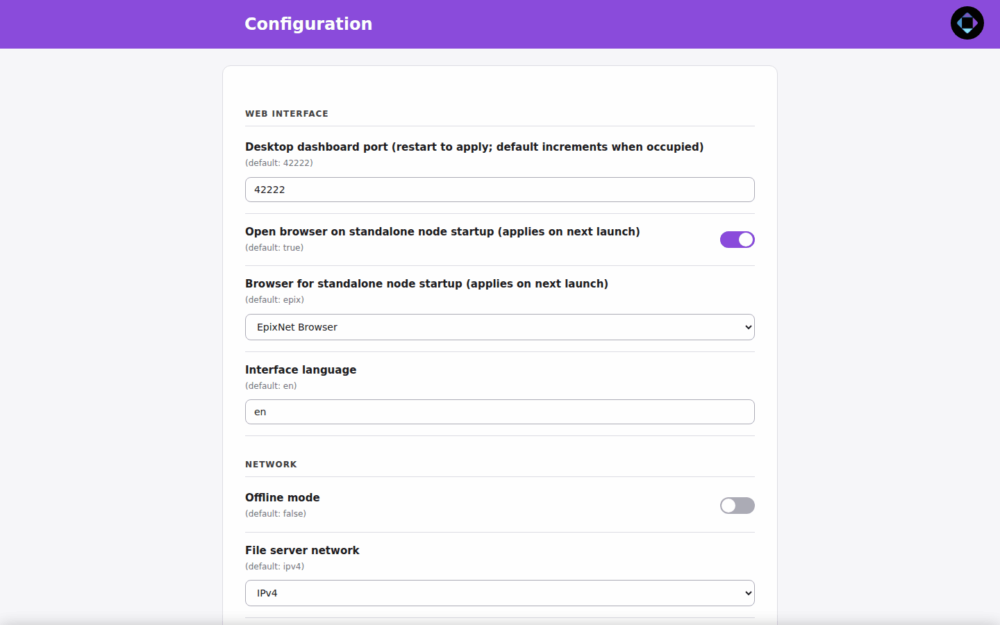

# Frequently asked questions

Short answers to the questions people ask most often about EpixNet, with links to the pages that go deeper. It is written for the current Rust node. If you are new, [How EpixNet works](start/how-it-works.md) gives the full picture and the [glossary](reference/glossary.md) defines the terms.

## The basics

### What is EpixNet?

EpixNet is a peer-to-peer web platform. Websites, called *xites*, are stored on the computers of the people who visit them instead of on a central server. Each xite is signed by its owner, and every node verifies the signature and the file hashes before it accepts content from another peer. See [How EpixNet works](start/how-it-works.md).

### What is a xite?

A xite is a folder of web files plus a signed manifest named `content.json`. It is identified by an address that starts with `epix1`, and it may also have a `.epix` name. Xites range from static pages to full applications such as forums and mail. [Featured xites](start/apps.md) lists the official ones.

### Which platforms are supported?

| Platform | How you get it |
| --- | --- |
| Windows | Installer from the [releases page](https://github.com/EpixZone/EpixNet/releases) |
| macOS | Disk image from the releases page |
| Linux | `.deb`, `.rpm` or AppImage from the releases page |
| Android | APK from the releases page. Requires Android 8 or later on a 64-bit ARM device. |
| iOS | Built from source with Xcode. Store releases are in preparation. |

You can also build every platform from source. Start at [Install EpixNet](start/install.md).

### Is there a mobile app?

Yes. The Android and iOS apps run the same node as the desktop, wrapped in a browser shell, with Tor and I2P built in. Some features differ:

- Phones do not accept incoming clearnet connections. They can still be reached through their Tor or I2P address.
- Installing browser extensions from xites works on desktop and Android, not on iOS.
- The iOS build leaves out the BitTorrent features.
- On Android 10 or later, nearby devices can connect over Bluetooth or Wi-Fi Aware without Internet access.

See [Install on Android](start/install-android.md) and [Install on iOS](start/install-ios.md).

### Does it cost anything?

The software is open source and free. Browsing, posting and hosting xites involve no fees. Registering a `.epix` name through xID costs a fee that is paid on Epix Chain, and any other chain transaction a xite asks you to sign carries the usual network fee.

### Do I need a wallet or an account?

Not to browse. To post in most community xites you need an xID identity, which means registering a `.epix` name with a wallet. EpixNet Browser includes the Epix Wallet. Some xites, such as Epix Mesh Chat, use *local profiles* instead and need neither. See [xID names and identity](start/xid.md).

### How is this different from the old Python version?

The Python implementation is archived. The current node is a rewrite in Rust, and several things changed along the way.

| Area | Python version | Current Rust node |
| --- | --- | --- |
| Peer protocol | A msgpack-based protocol | EDX, which adds verified streaming and range requests. A current node accepts only EDX connections, so it does not exchange data with Python nodes. |
| Tor | An external Tor program | Tor runs inside the node. I2P and Reticulum mesh are also built in. |
| Browser | Any browser, pointed at the local port | EpixNet Browser on desktop (a managed Firefox with the Epix Wallet), plus Android and iOS apps. A system browser still works. |
| Identity | Provider certificates, and later xID | Linked xID identities only. A node can hold several, with one default and a separate choice per xite. |
| Private messaging | Encrypted messages stored in public user files, with visible metadata | Channels, which are designed to also hide who is talking to whom |
| Terminology | Site | Xite. API command names such as `siteInfo` keep the old spelling. |

What carried over: the address format, the signature scheme, the `content.json` signing rules and the `users.json` key file. On first start the Rust node migrates a Python-era profile it finds in its data folder. See [Python interoperability](internals/python-interop.md).

## Privacy and safety

### Is EpixNet anonymous?

Not by default, and no setting makes it a guarantee.

- With Tor in its default `enable` mode, your node reaches onion peers through Tor but still connects directly to other peers. Those peers and the trackers see your IP address.
- In `always` mode, all peer traffic is routed through Tor or I2P. This hides your IP address from peers, at the cost of speed.
- Browser traffic and wallet traffic have their own routing controls.
- Anything you publish under an identity is public and signed. That is true in every routing mode.

Read [Privacy and routing](start/privacy.md) before you rely on any of this.

### What can other peers see about me?

A peer you connect to directly sees your IP address and which xites you request from it or serve to it. Trackers learn which xites your node announces, and it announces the xites it holds. Anyone can read what you sign and publish, together with the identity that signed it.

Peers do not see your keys, your settings or your decrypted private messages. Connections over direct TCP are encrypted, so an observer on the network path does not see the content of the exchange.

### Do I need Tor Browser or a separate Tor program?

No. Tor is part of the node. There is nothing extra to install or configure, and the desktop browser already uses the node's Tor client when it routes traffic through Tor.

### What if Tor is blocked on my network?

Builds that include bridge support can route Tor through a Snowflake bridge. Turn on **Use Tor bridges** in the Network section of the Config page. Where bridge support is not included, the option is shown as unavailable.

### Is it safe to open a xite I do not know?

A xite page runs in a sandboxed frame. It cannot read other xites, the wrapper, or your keys, and it can only use the node through commands that are checked against its permissions. That removes most of the risk of simply looking at a page.

It does not make every xite trustworthy. Do not grant `ADMIN` or `NOSANDBOX` to a xite unless you trust its developer completely, read wallet prompts before you approve them, and treat downloaded files as you would on the ordinary web. See [Sandbox and security](build/sandbox.md).

### Can a xite be taken down?

There is no central place to remove a xite from. It stays available as long as at least one reachable peer keeps a copy. Several things can still happen:

- **The owner** can publish an update that changes or removes content. Peers apply signed updates automatically.
- **You** can delete a xite from your own node at any time, which also stops you from serving it.
- **You** can block a xite or mute a user on your node from the Dashboard.
- **Directories** such as Epix Sites can delist a xite. That affects what the directory shows, not the network.
- **Nobody keeps it.** If every node that held a xite deletes it or goes offline, it is gone.

### What happens when someone publishes harmful content?

Each node operator decides what their node holds. You are never required to keep a xite, and you can delete or block one in the Dashboard. Community xites provide their own tools on top of that: Epix Talk has administrators, moderators and a report queue, Epix Sites has content ratings and reports, and xite owners can set rules for what users may write. A valid signature never means that content is safe or lawful.

## Running a node

### What happens when I visit a xite?

1. A `.epix` name is resolved to an address through Epix Chain, with a proof your node verifies.
2. Your node looks for peers through trackers, the DHT and peer exchange.
3. It downloads the signed `content.json`, checks the signature, then downloads the files and checks each against its hash.
4. The page opens in a sandboxed frame, and the files it needs first are fetched first.
5. Your node keeps the xite and shares it with other peers.

Optional files, such as videos, are fetched when you open them. See [How EpixNet works](start/how-it-works.md#what-happens-when-you-open-a-xite).

### Do I host every xite I visit?

Your node keeps the xites you open and serves them to other peers. That sharing is what keeps xites online. You stay in control:

- Delete a xite in the Dashboard to stop holding and serving it.
- Set **File server port** to `0` on the Config page to disable seeding.
- Turn on **Offline mode** to stop all network transfers.

### How much disk space does it use?

Each xite may use up to 1000 MB by default, and the wrapper asks before it raises that limit for a larger xite. Optional files are fetched only when you open them unless you choose otherwise. A desktop node also donates up to 2 GiB by default to hold encrypted pieces of other people's private files that it cannot read. You can change or disable that under **Storage** on the Config page.

### Do I need to open a port?

No. You can browse and publish without an open port. An open port makes your node directly reachable, which helps other peers get content from you.

A desktop node listens on TCP port 26552 by default, or the next free port if that one is taken, and tries to map it on your router with UPnP. If you forward the port by hand, check the node log for the port that was actually selected. Nodes without an open port stay reachable through their Tor onion service or I2P address when those are running.

### Which ports does EpixNet use?

| Port | Protocol | Purpose | Reachable from |
| --- | --- | --- | --- |
| 42222 | TCP | Dashboard and local web interface | Your own machine only, by default |
| 26552 | TCP | File server for peers | The network. Forward this one if you want to be reachable. |
| 42322 | TCP | Local Tor SOCKS proxy | Your own machine only |
| 42422 | TCP | Xite HTTP proxy used by EpixNet Browser | Your own machine only |
| 42522 | TCP | I2P HTTP proxy used by EpixNet Browser | Your own machine only |
| 1544 | UDP | LAN discovery | Your local network, only when LAN discovery is turned on |

Each of the TCP ports is a starting point: if it is in use, the node takes the next free one. Details are in [Run a node](start/running.md).

### Is there a configuration file?

Yes. Settings are stored in `private/config.json` inside your data folder, and the Config page in the web interface edits the same values. A few startup options are set through environment variables such as `EPIX_HEADLESS`, `EPIX_UI_ADDR`, `EPIX_TOR` and `EPIX_DATA_DIR`. Some settings take effect only after a restart, and the Config page tells you when one is needed.

See [Run a node](start/running.md) and [Dashboard and sidebar](start/dashboard.md).

### Where is my data stored?

| System | Default data folder |
| --- | --- |
| Windows | `%APPDATA%\EpixNet` |
| macOS | `~/Library/Application Support/EpixNet` |
| Linux | `~/.local/share/EpixNet`, or `$XDG_DATA_HOME/EpixNet` |

Inside it, `data` holds the xites and `private` holds your keys and settings. Set `EPIX_DATA_DIR` to use another location, or move the folder from **Storage** on the Config page. See [Data directory](internals/data-directory.md).

### How do I back up my node?

Open the Backup page of your node. The wizard creates an archive with the parts you select:

| Component | Contains |
| --- | --- |
| Keys & identity | Your master seed and xite private keys. This is what recovers your identity and your ownership of xites. |
| Node settings | The node configuration |
| Xites & xite data | All xite content and the list of xites you serve |
| Onion & I2P address keys | The keys behind your `.onion` and `.b32.i2p` addresses, so a moved node keeps them |

You can protect the archive with a password, which encrypts its contents with AES-256. A restore is staged and applied the next time the node starts, and an archive made on one operating system restores on another.

!!! danger "Protect your key backup"
    Anyone who obtains your keys can sign as you and take over the xites you own. Store backups offline and protect them with a strong password. If you lose your keys and have no backup, nothing can recover them.

The **Save as .zip** action in the xite sidebar is different: it exports one xite's signed public files and never includes keys. See [Dashboard and sidebar](start/dashboard.md).

### Can I use the same identity on more than one device?

Yes. Your identities are derived from the master seed, so restoring a backup that includes **Keys & identity** on a second device gives it the same identities. Keep in mind that the backup is as sensitive as the keys themselves. For private messages, a name can have several linked devices, and a message sent to the name reaches every active one.

### Can I run EpixNet on a server?

Yes. Set `EPIX_HEADLESS=1` to run the node without opening a browser, then use the web interface from a browser yourself. The interface listens on `127.0.0.1` by default. If you bind it to another address with `EPIX_UI_ADDR`, anyone who can reach that address can reach your node's interface, so restrict access at the network level and enable the UiPassword plugin, which adds a login page and is off by default. See [Run a node](start/running.md).

### Can I run more than one node on one machine?

Yes, for standalone nodes. Give each instance its own `EPIX_DATA_DIR` and start it headless or with the system browser. Ports are chosen automatically when the defaults are taken. The managed EpixNet Browser keeps a single active profile.

### Can I use EpixNet without Internet access?

Xites you have already downloaded open from your disk with no connection at all. To exchange content with nearby devices, turn on LAN discovery or the Reticulum mesh in the **Offline & Mesh** section of the Config page. Both are off by default. Name resolution needs the chain, so use `epix1` addresses when you are offline. See [Privacy and routing](start/privacy.md).

### How do I see how much bandwidth it uses?

The Dashboard's Stats view shows bandwidth, request and peer charts, including a per-xite breakdown and a map of connected peers.

### How do I check which version I am running?

Open the Dashboard menu (the ☰ button). The bottom of the panel shows the version, for example `EpixNet v0.6.8`. From a terminal, `epix-server --version` prints the same. The `serverInfo` API command also reports `rev`, the short Git commit the build was made from, which you can match against the commits in the [EpixNet repository](https://github.com/EpixZone/EpixNet). See [Check the version](start/running.md#version).

## Names and identity

### What is a xite address?

It is the public identifier of a xite: a bech32 string with the prefix `epix`, derived from the xite's public key. Only the holder of the matching private key can publish under it. See [Addresses and keys](start/how-it-works.md#addresses-and-keys).

### Can I choose a custom address?

Addresses are derived from keys, so you cannot pick one freely. You can search for a key whose address starts with a chosen prefix, and addresses such as `epix1talk...` are of this kind. The [EpixVanity](https://github.com/EpixZone/EpixVanity) repository contains a vanity address generator. For a readable address that anyone can type, register a `.epix` name instead.

### How do I get a .epix name?

Open the [xID xite](start/apps.md#xid), connect a wallet, search for a name and register it. The fee depends on the length of the name and is shown before you confirm. Afterwards you can point the name at a xite and link identities to it. See [xID names and identity](start/xid.md).

### Does EpixNet use a blockchain?

Yes, for a few specific things. Epix Chain stores `.epix` names, their records and the identities linked to them, and your node verifies what it reads from the chain with cryptographic proofs. Xites can also connect a wallet to work with smart contracts.

Xite content is not stored on the chain. Files move between peers, and reading or posting needs no transaction. See [Epix Chain for xites](web3/index.md).

### What is the difference between a xite address and an xID?

A xite address identifies a xite and is free to create. An xID is a `.epix` name registered on chain. A name can point to a xite address, and it can have identity addresses linked to it, which is how your posts show `alice.epix` instead of a long key.

## Building xites

### How do I create a xite?

Click **Create new xite** in the Dashboard, or run `epix-server siteCreate` on the command line. Either way you get a new address and a private key held by your node. Edit the files, sign, and publish. The [quick start](build/quickstart.md) walks through every step.

### Are xites limited to static HTML and CSS?

No. A xite page is delivered as static files, but it can use the EpixFrame API to query a SQL database that the node builds from the xite's JSON files, let users sign and publish their own content, send private messages over channels, and stream media. It can also connect a wallet with EpixKit to use smart contracts on Epix Chain. What a xite cannot have is server-side code. See [Anatomy of a xite](build/anatomy.md).

### Can I use React or another framework?

Yes. A xite is whatever static files your build produces. See [React and bundlers](libraries/react.md).

### How do updates reach visitors?

When you sign and publish, your node pushes the new manifest to the peers it is connected to. They verify it, fetch the changed files and pass it on. Nodes that were not connected learn about the update from update hints, which they poll every 30 seconds, or at the next periodic resync, which runs every 5 minutes by default. Delivery depends on which peers are reachable, so there is no fixed time by which everyone has the update. See [Sign and publish](build/publishing.md).

### What happens if I lose the private key of my xite?

If your node still has its master seed, you may not have lost it. Owner keys are derived from the seed, and a xite created by a current node records the derivation index in its signed `content.json`. Turn on **This is my xite** in the xite sidebar to attempt recovery. A `users.json` backup made after the xite was created also contains the key.

If neither the seed nor a backup is available, the xite can no longer be updated. Existing copies keep working, but nobody can sign a new version. See [Sign and publish](build/publishing.md).

### How do I discard changes I have not signed?

Open the file browser for your xite at `/list/<address>/` on your node, choose **Revert** beside the file, and confirm. This restores the version recorded in the signed `content.json`. It works for files in xites you own, and it cannot undo changes that are already signed.

### Can an AI coding agent build a xite for me?

Yes, and the docs include material written for that purpose. See [AI-assisted development](ai/index.md) for the workflow and a ready-made context file for your project.

### Where do I report a bug or a security issue?

See [Contribute to EpixNet](contributing/index.md) for how to report bugs and security issues.
