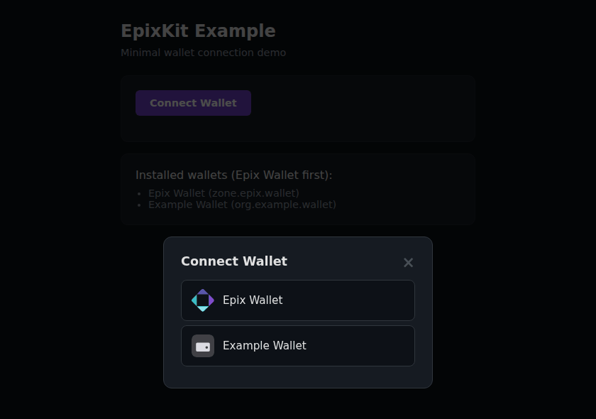

# EpixKit

EpixKit is a small wallet connection library for xites and other web apps that use Epix Chain. This page is the complete reference: every option, every method, what the picker does, and the limits you should know about. It is for developers who want a **Connect wallet** button without building wallet discovery themselves. For a guided walkthrough, start with [Connect a wallet](../web3/wallet-connect.md).

EpixKit does one job. It finds the EVM wallets installed in the visitor's browser, lets the visitor pick one, asks that wallet for an account, switches it to the network you configured, and returns the wallet's raw provider. Encoding transactions and calling contracts is left to the EVM library you choose.

| | |
| --- | --- |
| Repository | [EpixZone/epixkit](https://github.com/EpixZone/epixkit) |
| Version | No tagged releases. Pin the commit you copy |
| License | MIT |
| Dependencies | None |
| Size | One file, `epixkit.js`, about 18 KB unminified |
| Global | `window.EpixKit` |



## Install

Copy `epixkit.js` from the repository into your xite (for example to `js/lib/epixkit.js`), keep its license file next to it, and load it with a script tag. See [Vendoring](index.md#vendoring-ship-local-copies).

```html title="index.html"
<script src="js/lib/epixkit.js"></script>
```

The script is a classic browser script, not an ES module. It defines `window.EpixKit` and starts listening for wallet announcements as soon as it loads. The repository README shows a CDN script tag for quick experiments; do not use that in a xite.

## Quick start

```html title="index.html"
<button id="connect">Connect wallet</button>
<p id="status"></p>

<script src="js/lib/epixkit.js"></script>
<script>
  EpixKit.init({
    chainId: "0x77C",
    chainName: "Epix",
    nativeCurrency: { name: "EPIX", symbol: "EPIX", decimals: 18 },
    rpcUrls: ["https://evmrpc.epix.zone"],
    blockExplorerUrls: ["https://scan.epix.zone"]
  });

  document.getElementById("connect").onclick = async function () {
    var status = document.getElementById("status");
    try {
      var result = await EpixKit.connect();
      status.textContent = "Connected " + result.address + " with " + result.walletName;
    } catch (err) {
      if (err.message !== "User cancelled" && err.message !== "No wallet detected") {
        status.textContent = err.message || "Wallet connection failed";
      }
    }
  };
</script>
```

`connect()` resolves with:

| Field | Description |
| --- | --- |
| `provider` | The wallet's raw [EIP-1193](https://eips.ethereum.org/EIPS/eip-1193) provider. Pass it to your EVM library |
| `address` | The connected account address |
| `walletName` | The wallet's display name, for example `"Epix Wallet"`, `"MetaMask"` or `"Rabby"` |
| `walletIcon` | The wallet's icon as a data URI, or `null` |

## Configuration

### `EpixKit.init(config)`

Call `init()` once, before `connect()`. Calling it again replaces the configuration.

| Option | Type | Description |
| --- | --- | --- |
| `chainId` | `string` | Chain ID as a hex string, for example `"0x77C"`. EpixKit asks the wallet to switch to this network after connecting. Without it, no network switch is requested |
| `chainName` | `string` | Network name shown by the wallet when it adds the network |
| `rpcUrls` | `string[]` | RPC endpoints given to the wallet when it adds the network |
| `blockExplorerUrls` | `string[]` | Block explorer URLs given to the wallet when it adds the network |
| `nativeCurrency` | `object` | `{ name, symbol, decimals }` for the network's coin |
| `excludeWallets` | `string[]` | Extra wallets to hide from the picker. See [Excluded wallets](#excluded-wallets) |
| `installUrl` | `string` | A download link shown when no wallet is installed. See [When no wallet is installed](#when-no-wallet-is-installed) |
| `installLabel` | `string` | Link text for `installUrl`. Defaults to `"a wallet"` |
| `onReconnect` | `function` | Called with a connect result when the wallet used last time is still authorized. See [Reconnect](#reconnect-on-page-load) |
| `requestTimeoutMs` | `number` | Maximum wait for each wallet request, in milliseconds. Defaults to `60000`. Values that are not positive finite numbers fall back to the default |

`chainName`, `rpcUrls`, `blockExplorerUrls` and `nativeCurrency` are only used when the wallet does not know the network yet. Each one is optional and is passed to the wallet only if you set it.

### Chain presets

| Network | Chain ID | Hex |
| --- | --- | --- |
| Epix mainnet | 1916 | `0x77C` |
| Epix testnet | 1917 | `0x77D` |

=== "Mainnet"

    ```js
    EpixKit.init({
      chainId: "0x77C",
      chainName: "Epix",
      nativeCurrency: { name: "EPIX", symbol: "EPIX", decimals: 18 },
      rpcUrls: ["https://evmrpc.epix.zone"],
      blockExplorerUrls: ["https://scan.epix.zone"]
    });
    ```

=== "Testnet"

    ```js
    EpixKit.init({
      chainId: "0x77D",
      chainName: "Epix Testnet",
      nativeCurrency: { name: "EPIX", symbol: "EPIX", decimals: 18 },
      rpcUrls: ["https://evmrpc.testnet.epix.zone"],
      blockExplorerUrls: ["https://testscan.epix.zone"]
    });
    ```

Inside a xite, prefer the endpoints the user's node is configured with over hardcoded ones. Epix Talk and the Epix Airdrop xite read them through [EpixFrame](epixframe.md#chain-endpoints) and fall back to the public endpoint:

```js
var rpcUrl = (await epixFrame.chainEvmRpcUrl()) || "https://evmrpc.epix.zone";
var explorer = (await epixFrame.chainBlockExplorerUrl()) || "https://scan.epix.zone";

EpixKit.init({
  chainId: "0x77C",
  chainName: "Epix",
  nativeCurrency: { name: "EPIX", symbol: "EPIX", decimals: 18 },
  rpcUrls: [rpcUrl],
  blockExplorerUrls: [explorer],
  onReconnect: setupWallet
});
```

See [Epix Chain for xite developers](../web3/index.md) for networks, endpoints and address formats.

## The connect flow

### `EpixKit.connect()`

Returns a promise for `{ provider, address, walletName, walletIcon }`. Call it from a click handler, since wallets open their own prompts in response.

1. **Discover.** EpixKit asks wallets to announce themselves again, waits 150 milliseconds for late announcements, and builds the wallet list (see [Wallet discovery and ordering](#wallet-discovery-and-ordering)).
2. **Pick.** If the wallet used last time is installed, it is selected without showing the picker. Otherwise the picker opens, even when only one wallet is installed, so the visitor always sees which wallet is about to connect.
3. **Connect.** The dialog shows a connecting state while EpixKit sends `eth_requestAccounts` to the wallet.
4. **Switch network.** If you configured `chainId`, EpixKit sends `wallet_switchEthereumChain`. If the wallet answers that it does not know the network (error code `4902`), EpixKit sends `wallet_addEthereumChain` with your configuration.
5. **Read the account.** EpixKit sends `eth_accounts` and takes the first account.
6. **Finish.** The choice of wallet is remembered, the dialog closes, and the promise resolves.

Only one connection attempt can run at a time. A second `connect()` call while the picker or a connection is open rejects immediately.

### Errors

`connect()` rejects with an `Error`. Check `err.message` for the cases you want to treat quietly.

| Message | Meaning | Suggested handling |
| --- | --- | --- |
| `User cancelled` | The visitor closed the picker or the connecting dialog | Ignore |
| `No wallet detected` | No wallet is installed. The dialog already showed the empty state | Ignore, or point to your own help text |
| `A wallet connection is already in progress` | `connect()` was called twice | Disable your button while connecting |
| `The wallet did not share an account. Unlock it and approve the connection, then try again.` | The wallet returned an empty account list | Show the message |
| `The wallet did not respond. ...` | A wallet request timed out. See [Timeouts](#timeouts-and-cancelling) | Show the message |
| Anything else | An error from the wallet itself, such as a rejected request | Show `err.message` |

When a connection fails for a reason other than cancelling, the dialog stays open and shows the error text until the visitor closes it. The promise still rejects, so your code can show its own message as well.

The official xites all use the same pattern:

```js
try {
  await setupWallet(await EpixKit.connect());
} catch (err) {
  if (err.message !== "User cancelled" && err.message !== "No wallet detected") {
    showError(err.message || "Wallet connection failed");
  }
}
```

### Timeouts and cancelling

Every request EpixKit sends to a wallet is limited by `requestTimeoutMs` (60 seconds by default). This matters because a wallet can leave a request unanswered forever, for example when its prompt is hidden behind another window.

- If a request times out, the attempt fails with an explanation and the visitor can try again.
- Closing the connecting dialog cancels the attempt at once. A wallet approval that arrives afterwards is ignored and does not connect.
- Neither a timeout nor a cancel can close a prompt that the wallet itself has opened. The message asks the visitor to close any pending wallet prompt before retrying.

### Reconnect on page load

EpixKit remembers the last wallet in `localStorage` under the key `epixkit_wallet`. Two things use that memory:

- The next `connect()` call selects that wallet without showing the picker.
- If you pass `onReconnect` to `init()`, EpixKit checks right away whether the remembered wallet is still installed and still authorized for your page. If it is, your callback receives the same result object as `connect()`. The check uses `eth_accounts`, which does not open a wallet prompt. If the wallet is on a different network, the network switch request can still prompt.

```js
EpixKit.init({
  chainId: "0x77C",
  onReconnect: function (result) {
    showConnected(result.address, result.walletName);
  }
});
```

You can run the same check yourself with `EpixKit.reconnect()`, which returns a promise for the result object, or for `null` when there is nothing to reconnect or the wallet refuses.

!!! note "No remembered wallet in the opaque sandbox"
    Where a xite page has no `localStorage` (see [The sandbox caveat](#the-sandbox-caveat)), EpixKit cannot remember the wallet. Connecting still works, the picker simply shows every time and `onReconnect` is not called.

### Account and network changes

EpixKit has no events of its own. `getAddress()` returns the account from the moment of connection and is not updated afterwards. To follow changes, listen on the provider you received. The xID manager does this:

```js
function watchWallet(result) {
  var provider = result.provider;
  if (!provider.on) return;

  provider.on("accountsChanged", function (accounts) {
    if (!accounts || !accounts.length) {
      EpixKit.disconnect();
      showDisconnected();
      return;
    }
    showConnected(accounts[0], result.walletName);
  });

  provider.on("chainChanged", function () {
    // Rebuild your EVM library's provider and re-check the network here.
  });
}
```

## Other methods

| Method | Returns | Description |
| --- | --- | --- |
| `EpixKit.disconnect()` | Nothing | Clears EpixKit's connection state and forgets the remembered wallet. It does not revoke the permission inside the wallet |
| `EpixKit.isConnected()` | `boolean` | `true` after a successful `connect()` or reconnect, until `disconnect()` |
| `EpixKit.getAddress()` | `string` or `null` | The account address from the last connection |
| `EpixKit.getProvider()` | provider or `null` | The raw EIP-1193 provider of the connected wallet |
| `EpixKit.getWalletName()` | `string` or `null` | The connected wallet's name |
| `EpixKit.getWallets()` | `Promise<Array>` | Every installed wallet after filtering, as `{ uuid, name, rdns, icon, provider }`, with the Epix Wallet first. Does not connect |
| `EpixKit.reconnect()` | `Promise<object or null>` | Silently restores the last connection if the wallet still allows it |
| `EpixKit.EPIX_WALLET_RDNS` | `string` | `"zone.epix.wallet"`, the Epix Wallet's identifier, for code that treats it specially |

`getWallets()` is useful for status text such as "Epix Wallet detected". `connect()` takes no argument for choosing a wallet, so if you draw your own wallet list you also have to send the provider requests yourself.

```js
var wallets = await EpixKit.getWallets();
var hasEpixWallet = wallets.some(function (w) {
  return w.rdns === EpixKit.EPIX_WALLET_RDNS;
});
```

## Wallet discovery and ordering

EpixKit lists only wallets that are actually installed. It never shows download placeholders for wallets the visitor does not have.

- **EIP-6963 announcements.** Modern wallets announce themselves with a name, an icon and a reverse-DNS identifier. EpixKit listens from the moment the script loads and asks again on every `connect()`, `reconnect()` and `getWallets()` call. See [EIP-6963](https://eips.ethereum.org/EIPS/eip-6963).
- **Legacy injection.** A wallet that only sets `window.ethereum` (or appears in `window.ethereum.providers`) is listed too, and the same provider is never listed twice. Because such a wallet has no announced name, EpixKit names it from its feature flags. It checks specific flags (Epix Wallet, Rabby, Brave Wallet, Coinbase Wallet, Trust Wallet, OKX Wallet and others) before the generic MetaMask flag, since many wallets set that flag for compatibility. An unrecognized provider is listed as `Browser Wallet`.
- **Ordering.** The Epix Wallet (identifier `zone.epix.wallet`) is listed first. The rest are sorted by name.

The Epix Wallet is built into the EpixNet Browser, so visitors using that browser always have at least one entry. See [Browser and wallet](../start/browser-wallet.md).

### Excluded wallets

Two wallets are hidden by default: Phantom, which the library treats as Solana only, and Leap. To hide more, pass names or identifiers in `excludeWallets`:

```js
EpixKit.init({
  chainId: "0x77C",
  excludeWallets: ["coinbase", "com.example.wallet"]
});
```

Each entry is matched, without regard to case, as a substring of the wallet's name and of its reverse-DNS identifier. A short entry can therefore match more wallets than you intended.

### When no wallet is installed

If nothing is detected, the dialog shows an empty state instead of a list, and the promise rejects with `No wallet detected` when the visitor closes it.

- By default the text suggests using the EpixNet Browser, which includes the Epix Wallet, and links to MetaMask and Rabby as examples of other EVM wallets.
- If you set `installUrl` (and optionally `installLabel`), your link is shown first in place of the EpixNet Browser suggestion.

On iOS, browser extensions cannot inject a wallet into a page, so a visitor who relies on an extension wallet there sees this state.

## Style the dialog

The dialog's HTML and CSS are injected into the page the first time they are needed. There are no theming options. The built-in look is a fixed dark panel.

| Selector | Element |
| --- | --- |
| `#epixkit-modal` | The outermost container |
| `.epixkit-overlay` | The full-screen dimmed backdrop (`z-index: 10000`) |
| `.epixkit-box` | The dialog panel |
| `.epixkit-box h3` | The title, "Connect Wallet" |
| `.epixkit-close` | The close button |
| `#epixkit-list` | The wallet list, also used for the connecting and error states |
| `.epixkit-item` | One wallet button |
| `.epixkit-item img` | A wallet icon |
| `.epixkit-connecting`, `.epixkit-spinner` | The connecting state |
| `#epixkit-empty`, `.epixkit-empty` | The empty state shown when no wallet is installed |

To restyle it, add your own rules with a more specific selector than the built-in ones. Prefixing with `#epixkit-modal` is enough. This example maps the dialog onto the [Epix UI kit](ui-kit.md) tokens so it follows your light and dark themes:

```css title="css/app.css"
#epixkit-modal .epixkit-box {
  background: var(--epix-surface);
  border-color: var(--epix-border);
}
#epixkit-modal .epixkit-box h3,
#epixkit-modal .epixkit-item {
  color: var(--epix-text);
}
#epixkit-modal .epixkit-item {
  background: var(--epix-surface-2);
  border-color: var(--epix-border);
}
#epixkit-modal .epixkit-item:hover {
  border-color: var(--epix-accent);
}
```

A few details (the fallback letter icon, the helper text and the error text) use inline styles and need `!important` to override.

## The sandbox caveat

Whether a wallet can talk to your xite depends on how the xite is being served. A wallet extension exchanges messages with the page it is connected to, and many wallets require that page to have a real origin. See [The wrapper sandbox](../build/sandbox.md) for the full model.

| How the visitor opens the xite | Page origin | Wallets |
| --- | --- | --- |
| EpixNet Browser with a `.epix` address | A separate content origin for that xite | The page has a real origin, which is what wallets need |
| A local node opened through `127.0.0.1` or `localhost` | A per-xite `localhost` origin | The page has a real origin. Account permissions are scoped to that xite on that node |
| A node reached over the LAN, or a public gateway | Opaque (`null`) | A wallet may never answer. EpixKit times out and explains |

In the opaque case EpixKit detects that the page origin is `null` and changes the timeout message to say that the restricted frame can block wallet connections and to suggest the desktop EpixNet Browser with a `.epix` address. EpixKit does not try to work around the sandbox. It grants no permissions and does not relay wallet requests through another page.

## Use with an EVM library

EpixKit returns a standard provider, so any EVM library that accepts one will work. Vendor the library into your xite like everything else.

### ethers v6

Epix Talk, the xID manager and the Epix Airdrop xite all use the ethers v6 UMD build, loaded from a local file.

```html
<script src="js/lib/epixkit.js"></script>
<script src="js/lib/ethers.umd.min.js"></script>
```

```js
var wallet = { provider: null, signer: null, address: null };

async function setupWallet(result) {
  wallet.provider = new ethers.BrowserProvider(result.provider);
  wallet.signer = await wallet.provider.getSigner();
  wallet.address = result.address;
}

async function sendOneEpix(to) {
  var tx = await wallet.signer.sendTransaction({
    to: to,
    value: ethers.parseEther("1")
  });
  await tx.wait();
  return tx.hash;
}
```

For reading chain data you do not need a wallet at all. Create a read-only provider from an RPC URL and keep the wallet for transactions:

```js
var readProvider = new ethers.JsonRpcProvider(rpcUrl);
var balance = await readProvider.getBalance(address);
```

### viem

viem accepts an EIP-1193 provider through its `custom` transport. viem is distributed as ES modules, so it is normally used through a bundler (see [Frameworks and bundlers](react.md)). Check the viem documentation for the version you vendor.

```js
import { createWalletClient, custom, defineChain } from "viem";

const epix = defineChain({
  id: 1916,
  name: "Epix",
  nativeCurrency: { name: "EPIX", symbol: "EPIX", decimals: 18 },
  rpcUrls: { default: { http: ["https://evmrpc.epix.zone"] } },
  blockExplorers: { default: { name: "Epix Explorer", url: "https://scan.epix.zone" } }
});

const result = await window.EpixKit.connect();

const client = createWalletClient({
  account: result.address,
  chain: epix,
  transport: custom(result.provider)
});
```

EpixKit itself is still loaded with a script tag in this setup, which is why the example reads it from `window`.

## Test it

The repository includes a demo page, `example.html`, and regression tests for the connection logic that run on Node.js with no dependencies:

```sh
node --test tests/*.test.cjs
```

The tests cover timeouts, cancelling, late wallet approvals, adding an unknown network, empty account lists and concurrent connection attempts.

## Next steps

- [Connect a wallet](../web3/wallet-connect.md) walks through a complete xite.
- [Reading and writing contracts](../web3/contracts.md) covers tipping, airdrop claims and randomness.
- [Contract kits](contracts.md) describes the contracts those tutorials call.
