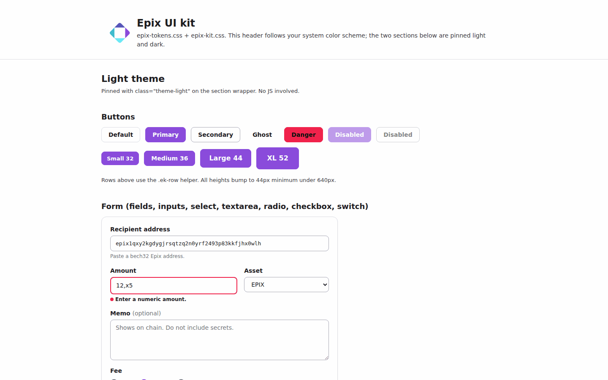

# UI kit and brand assets

The Epix UI kit is a pair of CSS files that give a xite the same colors, type scale, spacing and components as the official ones, in light and dark themes. This page documents the tokens and component classes, shows how to vendor and theme them, and lists the brand logo and icon files. It is for developers who want a consistent look without a framework.

Both the kit and the brand files live in the [EpixZone/assets](https://github.com/EpixZone/assets) repository, under the MIT license.

| File | Size | Content |
| --- | --- | --- |
| [`ui-kit/epix-tokens.css`](https://github.com/EpixZone/assets/blob/main/ui-kit/epix-tokens.css) | About 7 KB | Design tokens as CSS custom properties, for both themes |
| [`ui-kit/epix-kit.css`](https://github.com/EpixZone/assets/blob/main/ui-kit/epix-kit.css) | About 18 KB | Component classes with the `ek-` prefix. Requires the tokens file |
| [`ui-kit/demo.html`](https://github.com/EpixZone/assets/blob/main/ui-kit/demo.html) | About 31 KB | Every component, shown once in light and once in dark |

The kit contains no JavaScript and loads no external assets. It uses flat, solid colors only.



## Install

Copy the two CSS files into your xite and link them in this order, tokens first. See [Vendoring](index.md#vendoring-ship-local-copies).

```html title="index.html"
<!DOCTYPE html>
<html lang="en">
<head>
  <meta charset="utf-8">
  <meta name="viewport" content="width=device-width, initial-scale=1">
  <title>My xite</title>
  <link rel="stylesheet" href="css/epix-tokens.css">
  <link rel="stylesheet" href="css/epix-kit.css">
  <style>
    body {
      margin: 0;
      padding: var(--epix-space-6);
      background: var(--epix-bg);
      color: var(--epix-text);
      font-family: var(--epix-font-sans);
      font-size: var(--epix-text-body1-size);
      line-height: var(--epix-text-body1-lh);
    }
  </style>
</head>
<body class="{themeclass}">
  <div class="ek-card">
    <h2 class="ek-card-title">Hello</h2>
    <p class="ek-card-sub">A card from the Epix UI kit.</p>
    <div class="ek-row">
      <button class="ek-btn ek-btn-primary" type="button">Continue</button>
      <button class="ek-btn ek-btn-ghost" type="button">Cancel</button>
    </div>
  </div>
</body>
</html>
```

The kit styles its own classes and nothing else. It does not reset the page, so set the page background, text color and font on `body` yourself, as shown.

To see every component, open `demo.html` next to the two CSS files in any browser. It needs no server.

## Themes

Light is the default. The tokens file switches to dark in two ways:

- **Automatically**, through `@media (prefers-color-scheme: dark)`, when the visitor's system prefers dark.
- **Explicitly**, through a class. `theme-dark` forces dark and `theme-light` forces light, on any element. The class wins over the system setting, and it applies to everything inside that element.

```html
<body class="theme-dark">...</body>

<!-- A light panel inside a dark page -->
<section class="theme-light">...</section>
```

### Follow the node's theme

These are the same class names the node uses on its own pages. When the node serves an `.html` file from a xite, it replaces the literal text `{themeclass}` with `theme-dark` if the user's stored `theme` setting is `dark`, and with `theme-light` otherwise. Writing `<body class="{themeclass}">` opens the page in that stored theme. Epix Talk does this.

The substitution looks only at the stored `theme` value. It ignores the separate "follow the system theme" setting (`use_system_theme`, on by default), so a visitor who left the default and whose system is dark still receives `theme-light`, which the kit treats as an explicit choice of light. To honor that setting, apply the theme from script as shown below. If you prefer to follow the visitor's system setting only, leave the class off.

The substitution happens once, when the page is served. To apply the full setting, and to react when the user changes the theme while your xite is open, read it from `serverInfo` and listen for the `setServerInfo` push. The logic below matches what the wrapper does for its own interface:

```js title="js/theme.js"
function applyTheme(settings) {
  if (!settings) return;
  var theme = settings.theme === "dark" ? "dark" : "light";
  if (settings.use_system_theme !== false && window.matchMedia) {
    theme = window.matchMedia("(prefers-color-scheme: dark)").matches ? "dark" : "light";
  }
  document.body.classList.toggle("theme-light", theme === "light");
  document.body.classList.toggle("theme-dark", theme === "dark");
}

epixFrame.on("openWebsocket", async function () {
  var server = await epixFrame.serverInfo();
  applyTheme(server.user_settings);
});

epixFrame.on("request", function (cmd, message) {
  if (cmd === "setServerInfo") applyTheme(message.params.user_settings);
});
```

See [EpixFrame](epixframe.md) for the library used here.

## Design tokens

All tokens are CSS custom properties with the `--epix-` prefix. Use the **theme aliases** in your own CSS. They change with the theme, while the raw color values do not.

### Theme aliases

| Token | Use | Light | Dark |
| --- | --- | --- | --- |
| `--epix-bg` | Page background | `#FEFEFE` | `#151517` |
| `--epix-surface` | Cards, inputs, panels | `#FEFEFE` | `#1D1D1F` |
| `--epix-surface-2` | Hover fills, table headers, secondary panels | `#F6F6F9` | `#242428` |
| `--epix-border` | Default borders and dividers | `#DCDCE3` | `#2E2E32` |
| `--epix-border-strong` | Input borders | `#ABABB5` | `#404045` |
| `--epix-text` | Primary text | `#1D1D1F` | `#F6F6F9` |
| `--epix-text-mid` | Secondary text | `#404045` | `#DCDCE3` |
| `--epix-text-low` | Hints and placeholders | `#72747B` | `#ABABB5` |
| `--epix-accent` | Primary actions | `#8A4BDB` (purple) | The same |
| `--epix-accent-2` | Secondary accent | `#69E9F5` (cyan) | The same |
| `--epix-on-accent` | Text on the accent color | `#FEFEFE` | The same |
| `--epix-focus` | Focus ring color | `#8A4BDB` | `#69E9F5` |

### Brand and semantic colors

| Token | Value | Token | Value |
| --- | --- | --- | --- |
| `--epix-purple` | `#8A4BDB` | `--epix-indigo` | `#5954CD` |
| `--epix-cyan` | `#69E9F5` | `--epix-teal` | `#31BDC6` |
| `--epix-success` | `#2DCE89` | `--epix-success-soft` | `#E8F8F0` |
| `--epix-warning` | `#F0B622` | `--epix-warning-soft` | `#FCF6E3` |
| `--epix-danger` | `#F0224B` | `--epix-danger-soft` | `#FDEDEC` |
| `--epix-info` | `#31BDC6` | `--epix-info-soft` | `#E7F8FA` |
| `--epix-ink-soft` | `#1D1D1F` | `--epix-ink-strong` | `#09090A` |

The neutral ramp runs from `--epix-neutral-0` (`#FEFEFE`) to `--epix-neutral-12` (`#020202`). The theme aliases above are built from it.

!!! warning "Contrast rules that the kit depends on"
    The tokens file documents the contrast checks behind these rules. Follow them when you write your own components.

    - The strong semantic colors (`--epix-success`, `--epix-warning`, `--epix-danger`, `--epix-info`) are fills, not text colors.
    - Put `--epix-ink-soft` text on any `-soft` fill, and `--epix-ink-strong` text on a strong semantic fill or on cyan.
    - Soft fills stay light in the dark theme, so their ink stays dark.
    - Do not use `--epix-text-low` for body-size text on `--epix-surface-2`. Use `--epix-text-mid` there.

### Type

| Token group | Size | Weight | Line height |
| --- | --- | --- | --- |
| `--epix-text-h1-*` | 24px | 700 | 1.25 |
| `--epix-text-h2-*` | 22px | 700 | 1.3 |
| `--epix-text-h3-*` | 20px | 600 | 1.3 |
| `--epix-text-h4-*` | 18px | 600 | 1.35 |
| `--epix-text-h5-*` | 14px | 600 | 1.4 |
| `--epix-text-subtitle-*` | 16px | 500 | 1.45 |
| `--epix-text-body1-*` | 16px | 400 | 1.5 |
| `--epix-text-body2-*` | 14px | 400 | 1.5 |
| `--epix-text-body3-*` | 13px | 400 | 1.45 |
| `--epix-text-caption-*` | 12px | 400 | 1.4 |
| `--epix-text-overline-*` | 11px | 600 | 1.4 |

Each group has three properties, ending in `-size`, `-weight` and `-lh`. For example:

```css
h1 {
  font-size: var(--epix-text-h1-size);
  font-weight: var(--epix-text-h1-weight);
  line-height: var(--epix-text-h1-lh);
}
```

The font stacks are `--epix-font-sans`, which starts with Inter, and `--epix-font-mono`, which starts with IBM Plex Mono. Both continue with system fonts.

!!! note "Fonts are not included"
    The kit ships no font files. Unless the visitor has Inter or IBM Plex Mono installed, the stacks fall back to the system fonts, which is a reasonable default. If you want the named fonts, add the font files to your xite and declare them with `@font-face`. Do not link a font service.

### Spacing, shape and layering

| Tokens | Values |
| --- | --- |
| `--epix-space-1` to `--epix-space-12` | A 4px grid: 4, 8, 12, 16, 20, 24, 28, 32, 36, 40, 44, 48 pixels |
| `--epix-radius-sm`, `-md`, `-lg` | 4px, 8px, 12px |
| `--epix-border-width`, `--epix-border-width-2` | 1px, 2px |
| `--epix-focus-ring` | A 2px solid outline in `--epix-focus`, with `--epix-focus-ring-offset` of 2px |
| `--epix-shadow-sm`, `--epix-shadow` | Two subtle shadows, the same in both themes |
| `--epix-z-base`, `-sticky`, `-dropdown`, `-overlay`, `-modal`, `-toast` | 0, 100, 200, 300, 400, 500 |

## Components

Every component class starts with `ek-`. State is expressed with ordinary attributes (`disabled`, `checked`, `aria-invalid`, `aria-selected`) or with the helper classes `is-open`, `is-active` and `is-invalid`. Because the kit has no JavaScript, your code toggles those.

| Component | Classes |
| --- | --- |
| Button | `ek-btn`, with `ek-btn-primary`, `ek-btn-secondary`, `ek-btn-ghost` or `ek-btn-danger`, and a size: `ek-btn-sm` (32px), `ek-btn-md` (36px, the default), `ek-btn-lg` (44px), `ek-btn-xl` (52px) |
| Form field | `ek-field` wrapping `ek-field-label`, a control, and `ek-field-hint` or `ek-field-error` |
| Text controls | `ek-input`, `ek-select`, `ek-textarea`, and `ek-input-mono` for addresses and hashes |
| Switch | `ek-switch` on a label that contains a checkbox and an `ek-switch-track` span |
| Checkbox and radio | `ek-checkbox` or `ek-radio` on the input, inside an `ek-check` label |
| Card | `ek-card`, `ek-card-title`, `ek-card-sub` |
| Table | `ek-table`, `ek-num` for right-aligned numeric cells, `ek-table-collapse` to turn rows into cards on narrow screens |
| Modal | `ek-modal` containing `ek-modal-dialog`, `ek-modal-title`, `ek-modal-actions`. Add `ek-sheet` to dock it to the bottom edge on narrow screens |
| Menu | `ek-menu`, `ek-menu-item`, `ek-menu-sep` |
| Tabs | `ek-tabs`, `ek-tab` |
| Toast | `ek-toast` with `ek-toast-success`, `-warning`, `-danger` or `-info`, `ek-toast-title`, and `ek-toast-stack` as the fixed container |
| Progress bar | `ek-progress` containing `ek-progress-bar`, with `ek-progress-success`, `-warning` or `-danger` |
| Progress ring | An `svg` with `ek-ring`, containing circles with `ek-ring-track` and `ek-ring-value` |
| Badge | `ek-badge` with `ek-badge-success`, `-warning`, `-danger`, `-info` or `-accent` |
| Tag | `ek-tag` with `ek-tag-success`, `-warning`, `-danger` or `-info` |
| Definition list | `ek-dl` on a `dl`, and `ek-mono` for monospace values |
| Layout helpers | `ek-row` (a wrapping flex row) and `ek-grid` (an auto-fitting grid with 240px minimum columns) |

Below 640px wide, buttons, inputs, menu items, tabs and switches grow to at least 44px high for touch.

### Buttons

```html
<div class="ek-row">
  <button class="ek-btn" type="button">Default</button>
  <button class="ek-btn ek-btn-primary" type="button">Primary</button>
  <button class="ek-btn ek-btn-secondary" type="button">Secondary</button>
  <button class="ek-btn ek-btn-ghost" type="button">Ghost</button>
  <button class="ek-btn ek-btn-danger" type="button">Danger</button>
  <button class="ek-btn ek-btn-primary" type="button" disabled>Disabled</button>
</div>
```

`ek-btn` also works on links. For a link that should look disabled, set `aria-disabled="true"`.

### Form fields

```html
<form class="ek-card">
  <div class="ek-field">
    <label class="ek-field-label" for="to">Recipient address</label>
    <input class="ek-input ek-input-mono" id="to" name="to" spellcheck="false">
    <span class="ek-field-hint">Paste an Epix address.</span>
  </div>

  <div class="ek-field">
    <label class="ek-field-label" for="amount">Amount</label>
    <input class="ek-input" id="amount" name="amount" inputmode="decimal"
           aria-invalid="true" aria-describedby="amount-err">
    <span class="ek-field-error" id="amount-err">Enter a numeric amount.</span>
  </div>

  <div class="ek-row">
    <label class="ek-switch">
      <input type="checkbox" name="save" checked>
      <span class="ek-switch-track"></span> Save to contacts
    </label>
    <label class="ek-check">
      <input class="ek-checkbox" type="checkbox" name="confirm"> I checked the address
    </label>
  </div>
</form>
```

An invalid control is marked with `aria-invalid="true"` or the `is-invalid` class. The error text stays in the normal text color with a red dot, because red at caption size does not meet contrast requirements.

### Tables that collapse on phones

Give each cell a `data-label`. Below 640px, `ek-table-collapse` hides the header row and shows each row as a card with the labels in front of the values.

```html
<table class="ek-table ek-table-collapse">
  <thead>
    <tr><th scope="col">Peer</th><th scope="col">Status</th><th scope="col">Sent</th></tr>
  </thead>
  <tbody>
    <tr>
      <td data-label="Peer">Peer 1</td>
      <td data-label="Status"><span class="ek-badge ek-badge-success">Online</span></td>
      <td data-label="Sent" class="ek-num">1.2 GB</td>
    </tr>
  </tbody>
</table>
```

### Modals and bottom sheets

A modal is hidden until it has the `is-open` class or an `open` attribute.

```html
<div class="ek-modal ek-sheet" id="confirm" role="dialog" aria-modal="true" aria-labelledby="confirm-title">
  <div class="ek-modal-dialog">
    <h4 class="ek-modal-title" id="confirm-title">Remove peer?</h4>
    <p>You can add it back later.</p>
    <div class="ek-modal-actions">
      <button class="ek-btn ek-btn-ghost" type="button" id="confirm-cancel">Cancel</button>
      <button class="ek-btn ek-btn-danger" type="button">Remove peer</button>
    </div>
  </div>
</div>

<script>
  var modal = document.getElementById("confirm");
  function openModal() { modal.classList.add("is-open"); }
  function closeModal() { modal.classList.remove("is-open"); }
  document.getElementById("confirm-cancel").onclick = closeModal;
</script>
```

The kit handles the look only. Focus management, the Escape key and closing on a backdrop click are yours to add.

### Tabs, menus and toasts

```html
<div class="ek-tabs" role="tablist" aria-label="Views">
  <button class="ek-tab is-active" type="button" role="tab" aria-selected="true">Overview</button>
  <button class="ek-tab" type="button" role="tab" aria-selected="false">Peers</button>
</div>

<div class="ek-menu" role="menu">
  <button class="ek-menu-item is-active" type="button" role="menuitem">Copy address</button>
  <button class="ek-menu-item" type="button" role="menuitem" disabled>Export key</button>
  <div class="ek-menu-sep" role="separator"></div>
  <button class="ek-menu-item" type="button" role="menuitem">Disconnect</button>
</div>

<div class="ek-toast-stack">
  <div class="ek-toast ek-toast-success" role="status">
    <div><div class="ek-toast-title">Saved</div>Your changes were published.</div>
  </div>
</div>
```

`ek-menu` is only the panel. Position it and show or hide it from your own code. `ek-toast-stack` is fixed to the bottom right of the page.

For messages that should appear in the wrapper's own notification area instead of inside your page, use the `wrapperNotification` command (see [Wrapper commands](../api/wrapper.md)).

### Progress

```html
<div class="ek-progress" role="progressbar" aria-label="Sync" aria-valuenow="72" aria-valuemin="0" aria-valuemax="100">
  <div class="ek-progress-bar" style="width:72%"></div>
</div>

<svg class="ek-ring" viewBox="0 0 48 48" role="img" aria-label="72 percent">
  <circle class="ek-ring-track" cx="24" cy="24" r="20"/>
  <circle class="ek-ring-value" cx="24" cy="24" r="20" stroke-dasharray="125.66" stroke-dashoffset="35.2"/>
</svg>
```

For the ring, `stroke-dashoffset` is `125.66 * (1 - value)`, where `value` runs from 0 to 1. Show the number as text next to a success or warning bar, since those fills alone do not contrast enough with the track in the light theme.

## Customize

Override tokens after the tokens file loads. Changing an alias restyles every component that uses it.

```css title="css/app.css"
:root,
.theme-light,
.theme-dark {
  --epix-accent: var(--epix-teal);
  --epix-on-accent: var(--epix-ink-strong);
}
```

Epix Talk does this to use teal as its accent. Check contrast when you change an accent: Talk uses the brand teal for fills, with near-black text on them, and darkens the teal for text and links in the light theme so that it stays readable on white.

You do not have to take the whole kit. The page that a newly created xite starts from includes a small inline copy of the tokens and a few plain rules, with no component file. That is a fine starting point for a simple page.

To match the [EpixKit](epixkit.md) wallet dialog to these tokens, see [Style the dialog](epixkit.md#style-the-dialog).

## Brand assets

The same repository holds the Epix logos and icons under `images/`.

| Folder | Files | Use |
| --- | --- | --- |
| `images/logos/` | `epix-logo.svg`, `epix-logo.png` | The main Epix logo |
| | `logo-icon-on-black.svg`, `logo-icon-on-black.png` | The mark on a black background |
| | `logo-without-bg.svg`, `logo-without-bg.png` | The mark with a transparent background |
| `images/icons/` | `epix-icon.svg` | The mark as a vector. This is the source for every generated icon |
| | `icon.png`, `icon_200x200.png`, `favicon.ico` | Small raster icons and a favicon |
| `images/icons/apps/` | `airdrop.svg`, `blog.svg`, `dashboard.svg`, `explorer.svg`, `generic.svg`, `git.svg`, `mail.svg`, `post.svg`, `sites.svg`, `syncronite.svg`, `talk.svg`, `wallet.svg`, `wiki.svg`, `xid.svg` | App icons in a shared style. `generic.svg` is the neutral one. `preview/` holds 32px and 64px PNG renders |
| `images/icons/generated/web/` | `favicon.ico`, `favicon-16.png`, `favicon-32.png`, `favicon-48.png`, `apple-touch-icon-180.png`, `maskable-192.png`, `maskable-512.png` | A ready web icon set |
| `images/icons/generated/` | `android/`, `ios/`, `linux/`, `macos/`, `windows/`, `tray/`, `extension/`, `wallet/` | Platform icon sets used by the node, the shells and the wallet |
| `images/patterns/` | `pattern-1-on-gradient`, `pattern-1-without-bg` (SVG and PNG) | Background patterns |
| `images/backgrounds/` | `epix-bg.png` | A background image with the wordmark |
| `mascot/` | PNG, GIF and video files | Mascot artwork. These files are large |

The mark is drawn in the four brand colors that the tokens file exposes: purple `#8A4BDB`, indigo `#5954CD`, cyan `#69E9F5` and teal `#31BDC6`.

### Naming conventions

The repository README sets these rules for file names:

- Lowercase letters.
- Hyphens instead of spaces.
- Descriptive names that indicate content and format, such as `logo-icon-on-black.svg` or `pattern-1-without-bg.png`.

### Usage guidelines

From the same README:

1. Do not modify the original files. If you need a variation, create a copy with a new name.
2. Keep the directory structure when you add assets.
3. Follow the naming conventions for new files.
4. Prefer SVG, which scales cleanly. PNG files exist for places where SVG is not supported, and ICO for favicons.

### Use them in a xite

Copy the files you need into your xite, for example into `img/`, and reference them with relative paths. Do not link to the repository or to any other host.

```html

```

To give your xite its own icon, copy an icon file into the xite and set the `favicon` key in `content.json` to its path; see the [content.json reference](../build/content-json.md).

!!! note "SVG files open as downloads when visited directly"
    The node serves SVG files as attachments when they are opened as a page of their own, because an SVG can carry scripts. Embedding one with `` or as a CSS background works normally.

### Regenerating the icon sets

The files under `images/icons/generated/` are produced by `scripts/generate-icons.mjs` from `images/icons/epix-icon.svg`. This is maintainer tooling: it needs the `sharp` and `png-to-ico` packages and expects paths from the maintainers' environment. As a xite developer you only need the generated files.

## Next steps

- [Build your first xite](../build/quickstart.md) starts from the default page, which already uses a subset of these tokens.
- [EpixKit](epixkit.md) can be restyled with the same tokens.
- [Coding conventions](../contributing/conventions.md) covers how the official xites are written.
