# Featured xites

This page introduces the xites maintained by the EpixNet project: what each one does, where to find it, and where its source lives. It is for new users who want something to open after installing, and for developers looking for real code to learn from. If the word *xite* is new to you, read [How EpixNet works](how-it-works.md) first.

## Opening a xite

Every xite has a permanent address that starts with `epix1`. Some also have a `.epix` name registered through xID.

=== "EpixNet Browser"

    Type the name or the address in the address bar, for example `talk.epix`.

=== "System browser"

    Add the name or the address to your node's local URL. The default dashboard port is 42222:

    ```text
    http://127.0.0.1:42222/talk.epix/
    http://127.0.0.1:42222/epix1talk58lw26c0cyrtuu8axptne2p6zf33s7xxwu/
    ```

The first visit downloads the xite from other peers, which can take a moment. After that it opens from your own disk. Names are resolved through Epix Chain, so on a network without Internet access use the `epix1` address.

!!! note "Signed is not the same as safe"
    The xites below are published by the EpixNet project. Most of them display content written by other users, and the directory lists xites published by anyone. A valid signature tells you who published something, not whether it is safe, accurate or lawful where you live.

## At a glance

| Xite | What it is | Name | Needs an xID to write |
| --- | --- | --- | --- |
| [Dashboard](#dashboard) | Control panel for your node | `dashboard.epix` | No |
| [Epix Talk](#epix-talk) | Forum | `talk.epix` | Yes |
| [Epix Mail](#epix-mail) | Private mail over channels | none | Yes |
| [Epix Post](#epix-post) | Social feed | none | Yes |
| [Epix Blog](#epix-blog) | Blog that you can clone | `blog.epix` | Yes, to comment |
| [Epix Wiki](#epix-wiki) | Collaborative wiki | none | Yes, to publish |
| [Epix Sites](#epix-sites) | Xite directory and search | none | Yes, to list or vote |
| [xID](#xid) | Name and identity manager | none | Uses your wallet |
| [DeFlix](#deflix) | Peer-to-peer video library | `deflix.epix` | Yes, to like or comment |
| [Epix Explorer](#epix-explorer) | Block explorer for Epix Chain | none | No |
| [Epix Mesh Chat](#epix-mesh-chat) | Chat that works without Internet | none | No |

The Name column shows the `.epix` name each xite declares in its `content.json`. A xite listed with none is opened by its `epix1` address.

Reading never requires an identity. See [xID names and identity](xid.md) for how to get one.

## Dashboard

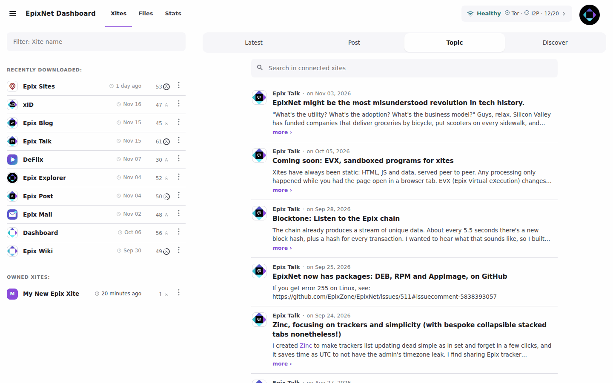

The Dashboard is the control panel for your node and the first page you see. It lists the xites you hold and lets you add, clone, update, favorite and delete them. It also has a file browser with storage limit controls, a statistics view with bandwidth, request and peer charts and a world map of connected peers, an activity feed, lists for muted users and blocked xites, and a console log viewer. Because it manages the node, it is the one xite that holds the `ADMIN` permission by default. The repository also contains `template-new/`, the starting point the Dashboard copies when you choose **Create new xite**.

| | |
| --- | --- |
| Address | `epix1dashanwfts3qcflekhmkvcz66ss4kxz2tr2k6g` |
| Name | `dashboard.epix` |
| Source | [EpixZone/EpixDash-Xite](https://github.com/EpixZone/EpixDash-Xite) |

For a full walkthrough, see [Dashboard and sidebar](dashboard.md).

## Epix Talk

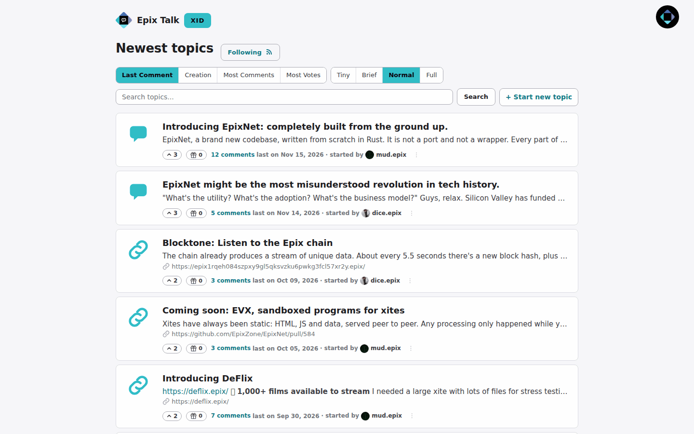

Epix Talk is a forum. Topics are organized into groups and categories, posts are written in Markdown with syntax highlighting, and topics and comments can be upvoted. Authors can edit their own posts in place. Forum owners can appoint administrators and moderators, who work through a report queue. Every post is signed by its author's xID identity and stored in that author's own directory inside the xite. Talk is cloneable, so you can start a forum of your own from it.

| | |
| --- | --- |
| Address | `epix1talk58lw26c0cyrtuu8axptne2p6zf33s7xxwu` |
| Name | `talk.epix` |
| Source | [EpixZone/EpixTalk-Xite](https://github.com/EpixZone/EpixTalk-Xite) |

For developers, Talk is a good reference for [user content](../build/user-content.md), [the database](../build/database.md) and merge files.

## Epix Mail

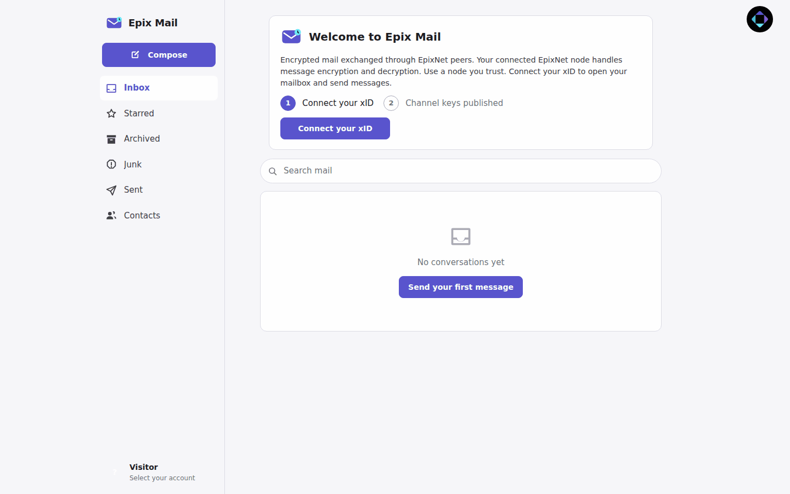

Epix Mail is private mail between xID names, with group conversations, a conversation list, a thread view with inline reply, and Inbox, Starred, Archived, Junk and Sent folders. It is a client for the node's *channels*: your node encrypts, decrypts, indexes and searches the messages, and the xite only displays them. Sealed messages travel through a shared pool hosted on the [xID](#xid) xite, which is designed so that the pool does not show who is writing to whom.

Message content is readable in the mail interface and inside the node while it is processed, and the node keeps a local decrypted index. Use a node you trust, and remember that a recipient can always copy what they receive. Mail does not guarantee anonymity or delivery.

| | |
| --- | --- |
| Address | `epix1pvta40a8d944w3npr9ztqrfh3wec53hh2je4fa` |
| Name | none |
| Source | [EpixZone/EpixMail-Xite](https://github.com/EpixZone/EpixMail-Xite) |

See [Channels and local profiles](../build/messaging.md) for how channels work and what their limits are.

## Epix Post

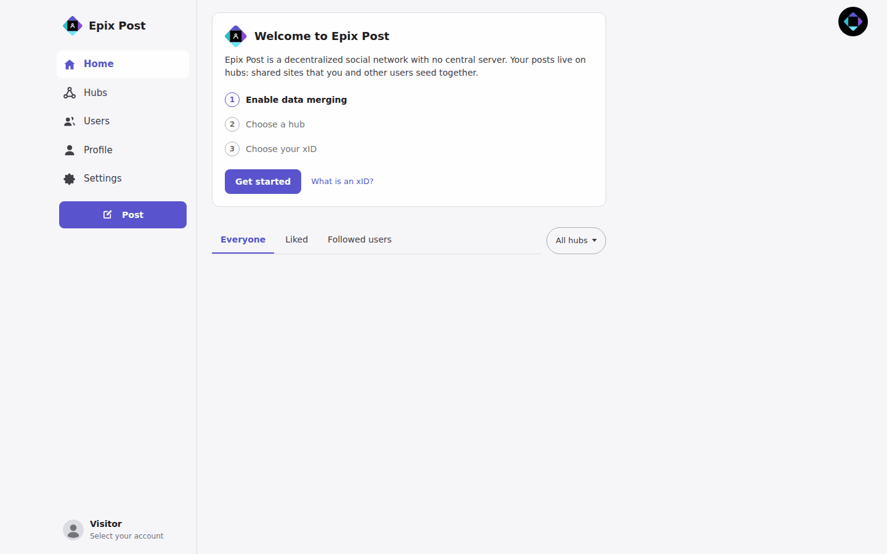

Epix Post is a social network with a post feed, user profiles with avatar and bio, follows, comments, likes and image uploads. It is a *merger xite*: the application itself holds no posts. Posts live in separate *hub* xites that the application reads together, so communities can run their own hubs. Post ships with one default hub and includes a Hubs page where you can review community ratings and reports before you download another hub.

| | |
| --- | --- |
| Address | `epix1p0stmcza0xjkvv0vnjlk0ypr7xsunt4lxkhgcm` |
| Default hub | `epix12fdtj0j77kltvdw2eqfzw392mr34r2al22mqrf` |
| Name | none |
| Source | [EpixZone/EpixPost-Xite](https://github.com/EpixZone/EpixPost-Xite) |

For developers, Post is the reference for [merger xites and hubs](../build/merger-hubs.md).

## Epix Blog

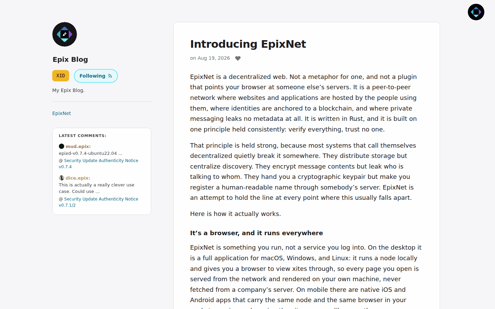

Epix Blog is a blogging platform. The owner writes posts in Markdown or rich text, with code highlighting, image zoom and optional video. Readers with an xID can comment, like posts and comments, and follow the blog for updates. Blog is cloneable: the copy becomes a new xite with its own address that you own and sign.

| | |
| --- | --- |
| Address | `epix18l0gy59ka9ka89wm9mwsspfmkcv9tvf7g0cs6f` |
| Name | `blog.epix` |
| Source | [EpixZone/EpixBlog-Xite](https://github.com/EpixZone/EpixBlog-Xite) |

## Epix Wiki

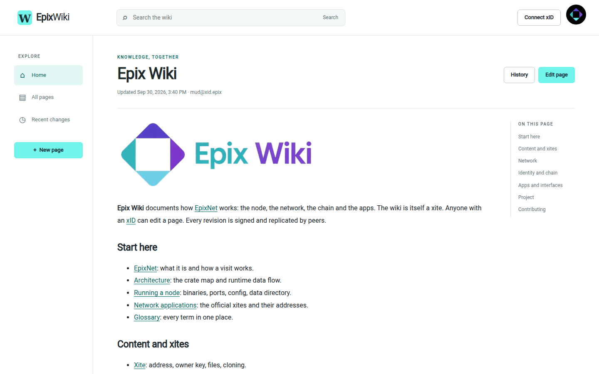

Epix Wiki is a collaborative wiki. You can browse pages, recent changes and full-text search without signing in. With an xID you can create and edit pages in Markdown or rich text, link pages with `[[Page name]]`, and publish. Every edit is stored as a separately signed revision, so a page's history can be browsed and an older revision can be restored as a new one. The wiki is cloneable and loads no external assets.

| | |
| --- | --- |
| Address | `epix1wkkpkx4ldeuh30e3wnz25ft70j9rj9ns77plwa` |
| Name | none |
| Source | [EpixZone/EpixWiki-Xite](https://github.com/EpixZone/EpixWiki-Xite) |

## Epix Sites

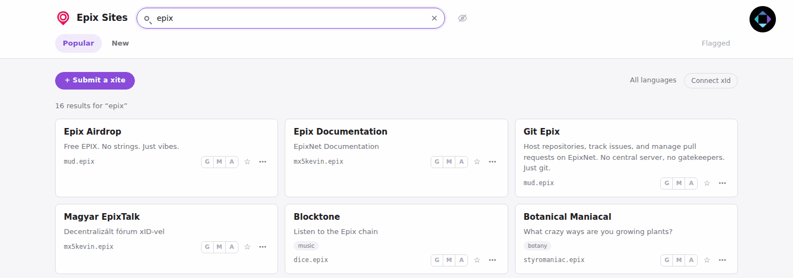

Epix Sites is a directory and search engine for xites. You can search titles, descriptions, tags and addresses, or browse by category and language. Each listing is a public, signed record tied to the xID that submitted it, and declares a content rating of General, Mature or Adult. The community votes on ratings and can file reports or vouch for a listing. Those votes move a listing between states such as Verified, Mislabeled, Reported and Delisted. Safe mode is on by default and hides listings rated Adult.

Delisting affects what the directory shows. It does not remove a xite from the network.

| | |
| --- | --- |
| Address | `epix1searchd8hcnyfacvklmszzxwx9ptnf5rde04xf` |
| Name | none |
| Source | [EpixZone/EpixSites-Xite](https://github.com/EpixZone/EpixSites-Xite) |

## xID

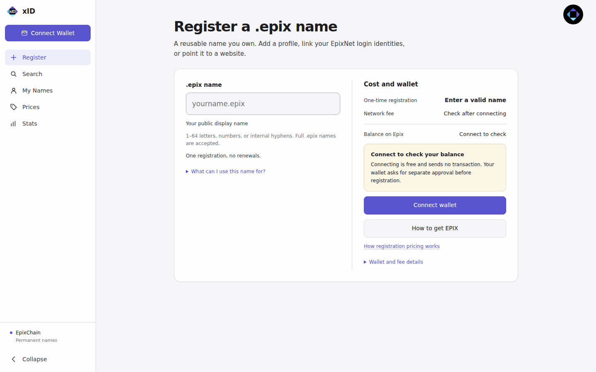

The xID xite is where you register and manage `.epix` names on Epix Chain. It shows availability and the registration fee as you type, lists the names your wallet owns, and lets you set a primary name, transfer a name, edit the avatar and bio of a profile, configure the records attached to a name, and link EpixNet identity addresses to it. It also provides forward and reverse lookups. Registration fees are set by the chain according to name length, and according to the xite's documentation they are burned and names do not expire. All changes are chain transactions that you approve in your wallet.

This xite has a second role. It is the *channel hub*: every linked identity publishes its channel key bundle here, and the shared message pool used by Epix Mail lives here. Your node adds it automatically when channels are enabled.

| | |
| --- | --- |
| Address | `epix1xauthduuyn63k6kj54jzgp4l8nnjlhrsyaku8c` |
| Name | none |
| Source | [EpixZone/EpixNet-xAuth](https://github.com/EpixZone/EpixNet-xAuth) |

See [xID names and identity](xid.md) for the user guide and [xID for developers](../web3/xid.md) for the on-chain interface.

## DeFlix

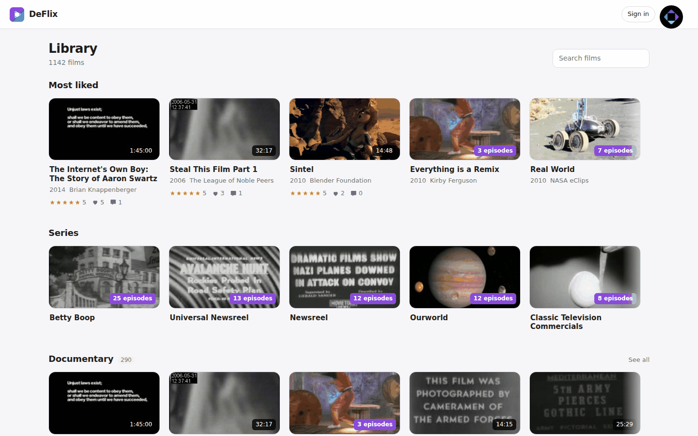

DeFlix is a film library that streams peer to peer. The library page lists every film with search and sorting, and each film has its own watch page with a permanent link. Video files are declared optional, so your node fetches a film only when you play it. Posters and subtitles are small and always available. Anyone with an xID can like films and write threaded comments. The player is a standalone script, `js/lib/EpixPlayer.js`, that other xites can reuse.

| | |
| --- | --- |
| Address | `epix1jaahfehr280m9uqlf44vtkrz9hjkvq8fewz68v` |
| Name | `deflix.epix` |
| Source | [EpixZone/DeFlix-Xite](https://github.com/EpixZone/DeFlix-Xite) |

For developers, DeFlix is the reference for optional files and media streaming. See [Files, media and EDX](../build/files.md).

## Epix Explorer

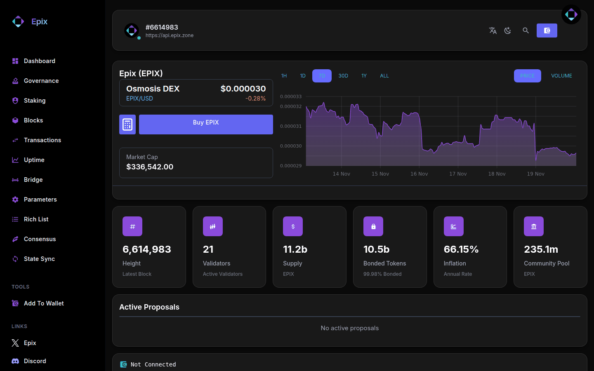

Epix Explorer is a block explorer and web wallet for Epix Chain packaged as a xite. It reads live data straight from chain API endpoints instead of from its own indexing backend, and covers blocks, transactions, accounts, staking, governance and IBC. The application is delivered by peers like any other xite, but the chain data it shows comes from the chain endpoints, so it needs a route to them.

| | |
| --- | --- |
| Address | `epix1epxrwflutk4j2saxuy84wvv52tdepuep8yqcqk` |
| Name | none |
| Source | [EpixZone/epix.explorer](https://github.com/EpixZone/epix.explorer) |

## Epix Mesh Chat

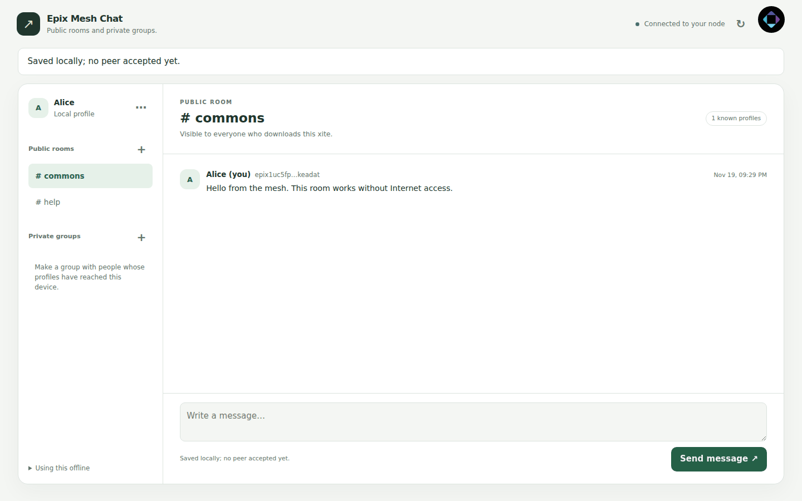

Epix Mesh Chat offers public rooms and encrypted private groups between connected EpixNet peers, and it is built to work without Internet access. Instead of an xID it uses a *local profile*: a signing identity your node creates for this one xite after you approve a permission prompt. An xID can be linked later, but it is optional. All assets are bundled, so the xite loads nothing from outside.

Keep its limits in mind. Private groups hold at most eight members and membership is fixed. The encryption does not provide forward secrecy. History is bounded: each author keeps up to 128 public and 32 private messages, and older ones are pruned. Public metadata includes the sender, time and ciphertext size.

Each chat community is its own xite with its own address, and everyone in a group must use the same one. The repository explains how to create a separate chat xite for your community.

| | |
| --- | --- |
| Address | Per community. Ask your group for its address, or create your own from the repository. |
| Name | none |
| Source | [EpixZone/EpixMeshChat-Xite](https://github.com/EpixZone/EpixMeshChat-Xite) |

See [Privacy and routing](privacy.md) for LAN discovery and Reticulum mesh setup, and [Channels and local profiles](../build/messaging.md) for the local profile API.

## Epix Documentation

The documentation you are reading is itself a xite. Opening it on your own node gives you the full docs offline, including search, and your node helps serve them to others. The same build is also plain static HTML, so it works from an ordinary web server.

| | |
| --- | --- |
| Address | `epix1readmehqfdxy4pzx7u72wwaerc4psx0gt6fety` |
| Name | none |
| Source | [EpixZone/EpixNetDocs](https://github.com/EpixZone/EpixNetDocs) |

## More xites and examples

These smaller xites are useful mainly as examples of [Epix Chain integration](../web3/index.md).

| Xite | What it shows | Address | Source |
| --- | --- | --- | --- |
| Epix Airdrop | Connecting a wallet and claiming from an airdrop pool contract | `epix1drp5v2gs20fass9t7h8yfmtfwc8hvmjvszswtt` | [EpixZone/epix-airdrop-xite](https://github.com/EpixZone/epix-airdrop-xite), contract in [EpixZone/epix-airdrop](https://github.com/EpixZone/epix-airdrop) |
| VRF Debugger | A test page for the chain's verifiable random function beacon | `epix1k2332529z7kvtneswpure2ewakzrynm6uakrtu` | [EpixZone/vrf-debugger](https://github.com/EpixZone/vrf-debugger) |
| Epix Dice | An on-chain dice game that uses the chain's randomness | `epix19l4mggjyydf4ed0k0pugqy6j2gzmm40k2azz3k` | Not published separately |

!!! warning "Real funds"
    Xites that connect a wallet can ask you to sign transactions that move real assets. Read every wallet prompt before you approve it. See [Browser and wallet](browser-wallet.md).

## Start your own

Several of these xites are meant to be copied.

- **Clone one.** Talk, Blog and Wiki are marked cloneable. A clone is a new xite with a new address and a key that you hold. See [Sign and publish](../build/publishing.md).
- **Start from the template.** The Dashboard's **Create new xite** button gives you a minimal xite to edit. The [quick start](../build/quickstart.md) walks through it.
- **Read the source.** All of the repositories above are public. Most of the xites are plain JavaScript with no build step, so the code you read is the code that runs.
