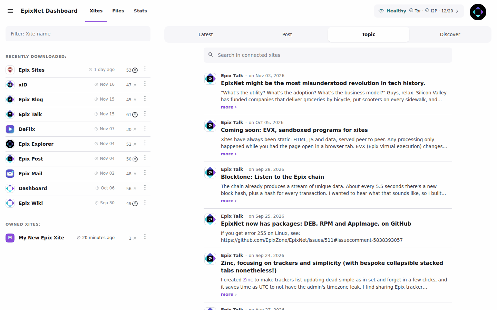
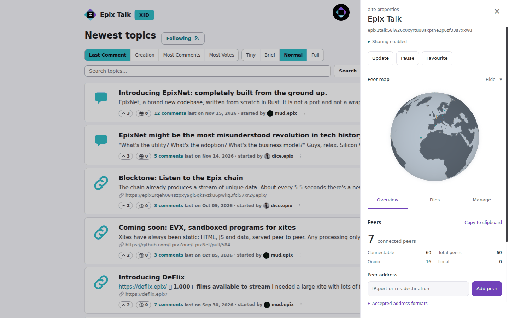
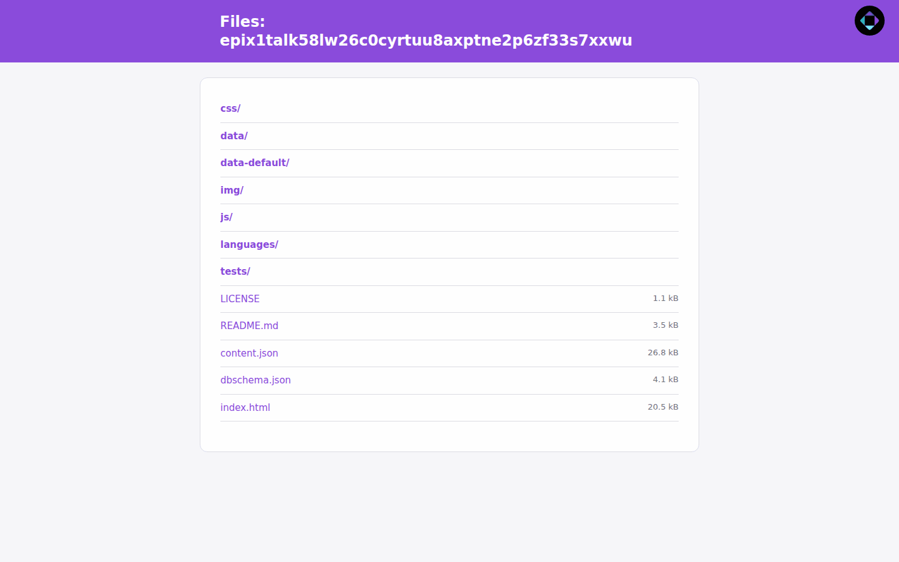
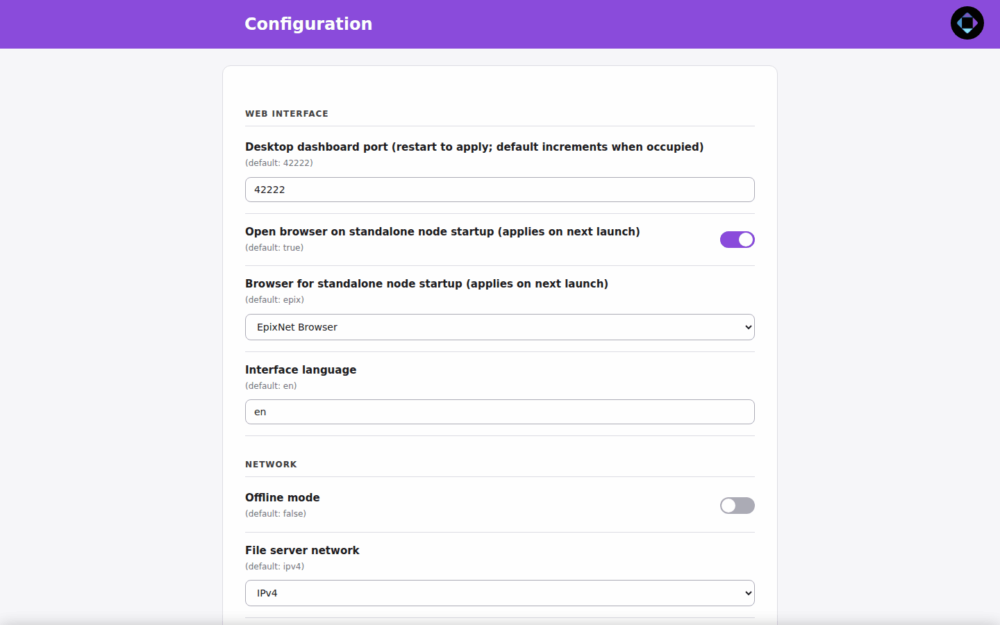

# Dashboard, sidebar, and node settings

This page is a tour of the screens you use to run your node day to day: the Dashboard xite, the sidebar that slides out over every xite, the Config page, the built-in file browser, and the Backup and Restore wizard. It is written for people who have EpixNet installed and want to know what each control does. If you have not installed yet, start with [Install EpixNet](install.md).

A xite is a website published on EpixNet: a folder of files signed by its owner and shared between peers. See [How EpixNet works](how-it-works.md) for the concepts, and the [glossary](../reference/glossary.md) for terms.

## Open the Dashboard

The Dashboard is itself a xite (`dashboard.epix`) and it is the home page of your node.

- In EpixNet Browser it opens at `https://dashboard.epix/` when the app starts.
- In a system browser it is served by the node at `http://127.0.0.1:42222/` by default. If that port is taken the node tries `42223`, `42224`, and so on, so check the address the node printed at startup.

The round button in the top right corner of every xite takes you back to the Dashboard when you click it. The same button opens the [xite sidebar](#the-xite-sidebar) when you drag it.

The Dashboard has three pages, shown as tabs in the header on wide screens and in the menu on narrow ones:

| Page | What it is for |
| --- | --- |
| **Xites** | The list of xites your node holds, plus the activity feed and the Discover view. |
| **Files** | Optional files: what you have downloaded, the storage limit, pinning and seeding. |
| **Stats** | Transfer charts, connection facts, the most active xites, and a peer map. |

## The xite list

Each row is one xite. From left to right it shows the xite's icon (or a letter tile when it has none), its title, a star if you marked it as a favorite, an unread badge if the xite has notifications for you, when it was last updated, and how many peers the node knows for it.

The list is grouped into sections that appear only when they have something in them:

| Section | What lands there |
| --- | --- |
| Recently downloaded | Xites added in the last 24 hours. |
| Running out of size limit | Xites that are close to their storage limit. The row offers a **Set limit to N MB** action that doubles the limit. |
| Favorited xites | Xites you marked with **Favorite**. |
| Owned xites | Xites you own, meaning you ticked **This is my xite** in the sidebar or created them here. |
| Connecting xites | Xites that are still being fetched and have no title to show yet. |
| Connected xites | Everything else. |
| Merged: *type* | Merged xites whose merger xite is not in the list. See [Merger xites and hubs](../build/merger-hubs.md). |

A merger xite, such as a social app that reads from several hubs, shows a small counter with a chevron next to its title. Click it to expand the merged xites nested under it. The collapsed row then shows the group's newest update time and the sum of everyone's peers.

Once you have more than ten xites, the rows tighten to one line each and a **Filter** box appears above the list. It matches on title, merged type, and address.

### Status messages on a row

| Message | Meaning |
| --- | --- |
| A ring around the peer icon | The node is asking peers whether anything is newer. Nothing is known to be wrong. |
| Updating... | A peer has something newer and the node is verifying it. |
| Updating: N left | Files are being downloaded. The count includes optional files this node has promised to fetch. |
| Updated! | The last file of an update landed. The message fades after a few seconds. |
| No peers | An update or file failed and the node has at most one peer for this xite. |
| N file update failed / Update failed | Peers are known but the download or verification did not complete. |
| Deleting… | The node is removing the xite. |

!!! note
    "No peers" does not mean the xite is gone. It means no peer that holds it is reachable from your node right now. Availability on EpixNet always depends on reachable peers.

### Row actions

Click the three dots at the end of a row to open its actions.

| Action | What it does |
| --- | --- |
| **Favorite** / **Unfavorite** | Moves the xite into or out of the Favorited section. |
| **Update** | Asks peers for a newer version now instead of waiting for the background check. |
| **Check files** | Runs an update that also re-checks the files already on disk, instead of only looking for newer content. Use it when a xite looks broken or incomplete. |
| **Pause** / **Resume** | A paused xite is not shared and is skipped by background updates. The row is dimmed while paused. |
| **Save as .zip** | Downloads the xite's signed public files as an archive. See [Save a xite as a zip](#save-a-xite-as-a-zip). |
| **Clone** | Shown only when the xite's owner marked it as cloneable. Creates a new xite you own from its files. |
| **Upgrade code** | Shown on xites you own that were cloned from another xite. Copies the newer code from the source. Changes you made to the cloned JavaScript and CSS files are lost. |
| **Delete** | Removes the xite from your node. Choose **Blacklist** instead to delete it and add it to your block list, with a reason you type in. |

On an expanded merger row the actions become **Update all**, **Check all files**, **Pause all** or **Resume all**, and **Delete all**, and they apply to the merger and every merged xite under it. **Delete all** keeps any xite you own.

Xites you own cannot be deleted from the list. The Dashboard sends you to the xite's sidebar instead, where deleting also asks about the saved private key.

### Add a xite

There is no "add" button. Open a xite's address or `.epix` name in the address bar, or follow a link to it, and the node adds it: it resolves the name, finds peers, downloads the files, verifies them against the owner's signature, and shows a waiting screen until the page can load. The **Discover** view lists the official xites with an **Activate** link that does exactly this. See [Featured xites](apps.md).

To create a xite of your own, open the menu and choose **Create new xite**. The Dashboard clones its built-in template into a new xite that you own. [Build your first xite](../build/quickstart.md) continues from there.

## The feed and Discover

Next to the xite list (or behind the **Feed** switch on a phone) is the activity feed. Xites you follow publish entries into it: new posts, comments, and mentions. See [Feeds, notifications and search](../build/feeds-search.md) for how a xite takes part.

- **Latest** shows everything. Type filters appear when the feed holds at least two kinds of entry.
- **Discover** shows the welcome view with the official xites. It is also what you see while the feed is empty.
- The search box searches the xites you are connected to. Add `site:Name` to search one xite only.
- Notification alerts appear above the feed with a count per xite. Click the cross to dismiss one.
- If a block list you subscribed to names a xite you are serving, a notice appears here with the reason.

## The menu

Click the menu button (three lines) in the top left to open the settings panel.

| Entry | What it does |
| --- | --- |
| **Xites**, **Files**, **Stats** | Switch page. |
| **Network health** | Opens the health drawer described below. |
| **Manage blocks** | Shows users you muted and block lists you subscribed to, with a cross to remove each one. |
| **Update all xites** | Runs **Update** on every xite that is not paused. |
| **Order by** | Sort the list by **Updated**, **Peers**, **Added**, or **Size**. |
| **Theme** | **System**, **Light**, or **Dark**. The choice applies to the Dashboard and the node's own pages. |
| **Language** | The interface language, listed in each language's own name. |
| **Create new xite** | Creates a xite you own from the template. |
| **Configuration** | Opens the [Config page](#the-config-page). |
| **Plugins** | Opens the plugin manager, where built-in features can be switched on and off. |
| **Node stats** | Opens a diagnostics page with connections, trackers, and a per-xite table. |
| **Backup & Restore** | Opens the [backup wizard](#backup-and-restore). |
| **Show data directory** | Opens the node's data folder in your file manager. |
| **Shut down EpixNet** | Stops the node after a confirmation. |

The bottom of the panel shows the version you are running, for example `EpixNet v0.6.8`.

Some entries are hidden when the feature behind them is switched off, and on a node that runs as a restricted public gateway.

## Network health

The chip in the header summarizes how well your node is connected. Click it for the full picture.

| State | Meaning |
| --- | --- |
| Healthy | At least five trackers are answering, or at least three quarters of the ones tried. |
| Degraded | Fewer than five trackers are answering, and they are less than three quarters but at least one in ten of the ones tried. |
| Bad | Fewer than five trackers are answering, and they are fewer than one in ten of the ones tried. |
| Limited | Other peers cannot connect to you. You can still browse and download. |
| Offline mode | Network communication is disabled in Config. |
| Checking… / Waiting for trackers… | The node is still starting or testing. |

The drawer lists:

- **Warnings**, such as a system clock that is more than 30 seconds off, recent node errors, and a reminder to check your browser's routing when Tor Always is on. A **Restart EpixNet client** button sits under them.
- **Connections**: Clearnet (Open, Closed, or Disabled, with your address and port), Tor, and I2P, each with its own address once it is online.
- **Trackers**: how many announced, the average announce time, and one row per tracker rated by its success over time.
- **Re-check reachability**, which tests again whether peers can reach your file server port.
- A switch labeled **Route every connection through Tor (slower)**. It sets Tor to Always and offers a restart. Read [Privacy and routing](privacy.md) before relying on it.

## Files: optional files and storage

Optional files are files a xite offers on demand instead of with the page, typically media and archives. The **Files** page is where you manage the copies your node keeps. [Optional files and big files](../build/files.md) explains the model for xite authors.

**Storage** shows how much of the optional file limit is used. Click **Edit limit** to change it. Enter a size in GB (for example `10`), a size in MB with an `M` suffix (`500M`), or a percentage of free disk space (`10%`).

Below it, each xite that offers optional files has a panel with:

- how much required **Content** and **Optional** data you hold, and how much was **Sent** and **Received**;
- a **Ratio** ring comparing upload to download for that xite (half a ring is break-even);
- an **Auto-download new optional files** switch that fetches and seeds every optional file the xite publishes;
- any folders you committed to help distribute, each with a **Stop** link;
- a table of the downloaded files with size, peers, upload, and finish time.

Tick files to select them, then **Pin**, **UnPin**, or **Delete** them from the bar that appears. **Search files** looks across all xites.

!!! info "What pinning does"
    Downloaded optional files are a cache. When they grow past the storage limit the oldest are deleted automatically. A pinned file is never touched by that cleanup: it stays on disk and keeps seeding until you delete it yourself.

## Stats

The **Stats** page reads from the node's own chart database. It shows upload and download totals with a share ratio, a transfer chart for the last 24 hours or 7 days, the number of connected peers (and how many are onion peers), the xites that moved the most data, and a world map with a list of top countries.

Peer locations are estimates made on your machine from a location database bundled with the node. Peers on Tor and I2P have no location to show.

## The xite sidebar

Every xite has a properties panel. To open it, drag the round button in the top right corner to the left. Dragging the same button downward opens the node's log console instead, with **All**, **Info**, **Warning**, and **Error** tabs.

The header shows the xite's title and address, whether sharing is enabled or paused, and three buttons: **Update**, **Pause** or **Resume**, and **Favourite** or **Unfavourite**. Under it is a collapsible **Peer map** (a globe with a dot per located peer), then three tabs.

!!! note
    The sidebar's favourite flag is stored with the xite's own settings. The Dashboard keeps its own list of favorites for sorting its xite list, so the two are set separately.

### Overview tab

- **Peers**: connected peers, plus counts of connectable, total, onion, and local peers. **Copy to clipboard** copies a link to the xite that carries peer addresses when shareable ones are known, which helps someone else reach it. **Add peer** accepts `IPv4:port`, `[IPv6]:port`, `host.onion:port`, an I2P host with an optional port, or `rns:destination` for a mesh peer.
- **Data transfer**: megabytes received and sent for this xite.
- **Identity**: the identity you use on this xite, shown as an xID name when you selected one. **Change** or **Select** opens the identity picker, **Disconnect** removes the selection, and a line shows how much of your per-user storage on this xite you have used. See [xID](xid.md).

### Files tab

- **Files & storage**: file count and stored size, with a **Storage breakdown** by category.
- **Browse files** opens the [file browser](#the-file-browser).
- **Show directory** opens the xite's folder on disk in your file manager.
- **Save as .zip** downloads the signed public files.
- **Storage limit**: the most this xite may store on your node, in MB, with the share already used. The default is 1000 MB. Change the number and click **Save limit**. When a xite is running out of room, the wrapper offers to raise the limit for you.
- **Optional files** (only on xites that declare them):
    - **Download files I open** fetches an optional file when you view it.
    - **Pre-download everything** also fetches files you have not opened.
    - **Auto-download maximum file size** caps automatic downloads in MB. `0` means no limit.
    - **Download previous files** runs a one-time pass that fetches the optional files you are currently missing. It does not turn on automatic downloading.
    - While a bulk download runs, a progress panel shows the current file and a collapsible list.
- **Needs to be updated** lists files that failed to download and how often each was retried.

You always share the optional files you have downloaded, whichever toggles are set. The node-wide defaults for new xites are in Config under **Optional Files**.

### Manage tab

- **This is my xite** shows the editing and publishing controls. Tick it on a xite you created or hold the key for. If the node has no saved key for the xite, it tries to recover one from your master seed.
- **Xite title**, **Xite description**, and **xID name** edit the matching fields of `content.json`. **Save xite settings** writes them, and signs right away when a private key is saved. See the [content.json reference](../build/content-json.md).
- **Content publishing**:
    - The key line reads **Private key saved** with a **Forget** link, or **No saved private key** with **Add saved private key**.
    - **Content file** is the manifest to sign. It defaults to `content.json`. Buttons below it fill in the xite's other signable manifests, such as `data/users/content.json`.
    - **Sign and publish** signs the chosen manifest and pushes it to peers. The menu next to it offers **Sign** and **Publish** as separate steps.
    - If your selected identity is an allowed signer for that manifest, no key is asked for. Otherwise the saved key is used, and without one the node prompts for the private key.
- **Database**: the path and size of the xite's SQL cache, with **Reload schema** and **Rebuild database**. Rebuilding recreates the database from the xite's JSON files. See [The xite database](../build/database.md).
- **Remove xite**: **Delete xite** removes it from your node. If a private key is saved, the confirmation says so and deleting also forgets the key.

!!! warning "Back up keys before you delete"
    Deleting a xite you own with **Forget private key and delete xite** removes the saved signing key from this node. Without that key, a backup of it, or a master seed that can re-derive it, nobody can publish updates to the xite again. See [Publishing](../build/publishing.md) for key backup and recovery.

## Save a xite as a zip

**Save as .zip**, in the sidebar and in the Dashboard row actions, downloads a xite's signed public files and manifests, including optional files you have downloaded.

- It excludes private encrypted files, unsigned edits, node settings, and keys.
- If a required file is missing or does not match its signed hash, the download reports an error. Finish downloading or signing the xite, then try again.
- Exports run one at a time and use temporary disk space.
- Limits are 8 GiB per file and 16 GiB of file data per archive.

## The file browser

Open **Browse files** in the sidebar, or go to `/list/<address>/` on your node, to see a xite's files as a plain directory listing. Directories are links, files open in the browser, and the heading is a breadcrumb back up the tree.

On xites you own, a **Revert** link appears beside each file that is declared in the signed `content.json`. It restores the signed version and discards your unsigned edits to that file.

1. Click **Revert** beside the file.
2. Read the confirmation and click **Revert file**.
3. Reload the xite to use the restored version.

Things to know about Revert:

- It restores from a verified local copy, or from a peer that still has the file. Your edited file stays in place until a verified replacement is available.
- It cannot undo changes that have already been signed.
- It is not offered for `content.json` itself, or for new files that were never signed.

If a xite declares [EVX programs](../build/evx.md), the listing also shows an **EVX declaration** link to a read-only inspection view.

## The Config page

**Configuration** in the menu opens `/Config`, the node's settings. Each row shows the setting, its default, and a control. A dot in the margin marks a value that differs from the default. Click the dot to reset it.

Change what you need, then click **Save settings** in the bar that appears at the bottom. Some settings are only read when the node starts. After saving one of those, a second bar offers **Restart EpixNet**.

| Section | Settings |
| --- | --- |
| **Web Interface** | Dashboard port, whether to open a browser at startup and which one (EpixNet Browser or the system browser), interface language. |
| **Network** | Offline mode, IPv4, IPv6 or dual stack, the file server port (`0` disables seeding), a manual public IP, the Tor mode, Tor bridges, the I2P mode and SAM port, tracker lists, and whether this node answers announces as a tracker. |
| **Offline & Mesh** | Local network discovery and the Reticulum mesh, with its TCP interfaces and listen address. Both are off by default. |
| **Optional Files** | Defaults for newly added xites: fetch optional files you open, pre-download everything, and **full retention** (keep a full copy of all active xites, including optional files). |
| **Storage** | The data directory, and how much disk to donate for holding encrypted shards you cannot read (`0` turns that off). |
| **Performance** | Log level. |
| **Epix Chain Config** | The chain RPC, EVM RPC and block explorer addresses, the endpoints and quorum used to bootstrap xID verification, and **Clear xID Cache**. |
| **Identities** | Your linked xIDs, with **Make default** and **Remove**, plus buttons to link a new identity or find ones already linked to your addresses. See [xID](xid.md). |
| **Channels** | Settings for metadata-private messaging used by apps such as Epix Mail. See [Channels and local profiles](../build/messaging.md). |

The Tor, I2P, discovery, and mesh options are explained in [Privacy and routing](privacy.md). Environment variables and command line flags that override these settings are listed in [Running EpixNet](running.md).

!!! tip
    Per-xite optional file toggles in the sidebar override the node-wide defaults. Changing a default in Config does not touch xites you already have, with one exception: full retention also covers existing xites.

### Move the data directory

To move the node's data to another disk, enter an absolute path under **Storage > Data directory** and save. The move waits for a restart.

- At the next start the node copies its data to the new location before opening anything, and switches only after the copy finishes. The original stays in place as a backup, so the destination needs room for a full copy.
- The move covers node identities, settings, downloaded xites, and statistics. Browser profiles and wallet extension storage stay in their original folder.
- Choose a new, empty directory or an existing complete node directory. Selecting an existing node directory switches to that node's identity without overwriting it.
- In the desktop app, after the restart wait for the tray icon to return, close the old browser window, and open the browser from the tray. The old window still uses the previous folder's profile.
- To cancel a queued move, save the current directory again before restarting.

See [Data directory layout](../internals/data-directory.md) for what lives where.

## Backup and restore

**Backup & Restore** in the menu opens a wizard at `/Backup` with a **Backup** tab and a **Restore** tab.

### Create a backup

Choose what to include:

| Component | Contents |
| --- | --- |
| **Keys & identity** | Your master seed and per-xite private keys. This is what recovers your identity. |
| **Node settings** | The node configuration. |
| **Xites & xite data** | All xite content and the list of served xites. Off by default because it can run to gigabytes. |
| **Onion & I2P address keys** | The private keys behind your `.onion` and `.b32.i2p` addresses, so a moved node keeps the same addresses. |

Optionally set a password of at least eight characters, then click **Create backup**. The archive is saved in the `backups` folder of the data directory and appears under **Stored backups**, where you can **Download** or **Delete** it.

- A backup is a standard zip file. With a password its contents are encrypted with AES-256, and it still opens in ordinary zip tools as a last resort. File names inside the archive stay visible.
- Without the password an encrypted backup cannot be restored. There is no recovery path.

!!! danger "A backup of your keys is your identity"
    Anyone who obtains an unencrypted keys backup can act as you on every xite and sign for the xites you own. Set a password, download the archive, and store it somewhere other than this computer.

### Restore a backup

1. Open the **Restore** tab. Pick a stored backup, or use **Restore from another device** to upload an archive made elsewhere. Backups restore across operating systems.
2. Choose which components to restore, and enter the password if the backup is encrypted.
3. Click **Restore**. The node first creates a safety backup of the current data, so you can undo from the same page.
4. Restart EpixNet. The restore is applied at the next start, before anything reads the data folder. Until then a bar at the bottom lets you cancel it.

!!! warning "Move address keys, do not share them"
    If a backup contains onion and I2P address keys, take the node they came from offline before you start a second node with them restored. Two nodes announcing the same address compete for it, and peers reach one or the other unpredictably.

A backup made by a newer EpixNet with a newer archive format is refused with a message asking you to update first.

## Shared and restricted nodes

Three built-in features change what the Dashboard offers. All three are off by default and are managed on the **Plugins** page. The first two are compiled into the standalone `epix-server` node and may be missing from other builds. The Plugins page lists only what your build contains.

- **UiPassword** puts a login in front of the whole interface. A **Logout** chip appears in the Dashboard.
- **Multiuser** gives each visitor their own master seed. A **User** chip offers **Show your masterseed** and **Logout**.
- **NoNewSites** locks the node's xite set: adding and deleting xites is blocked. Public gateways use this, together with a banner that says the gateway is read-only.

Turning **UiConfig** or **UiPluginManager** off removes the matching page entirely, not only its link. After that it cannot be switched back on from the web interface, so do this only on a node you administer some other way.

## Related pages

- [Running EpixNet](running.md): run modes, ports, environment settings, and the data folder.
- [Privacy and routing](privacy.md): what the Tor, I2P, discovery, and mesh settings do.
- [Publishing](../build/publishing.md): signing, publishing, and key recovery in depth.
- [Admin commands](../api/admin.md): the commands behind these screens.
