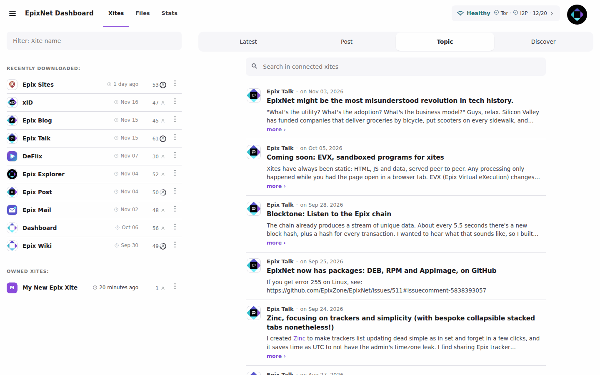

# Install EpixNet

This page helps you pick the right way to install EpixNet: which platform guide to follow, what each download contains, and when it makes sense to build from source instead. It is written for new users and for operators setting up a server. Each platform has its own step-by-step guide linked below.

## What you install

EpixNet is a peer-to-peer node written in Rust. On desktop it is normally packaged with two companions:

- **EpixNet Browser**, a managed Firefox ESR that opens `.epix` addresses like ordinary web pages.
- **Epix Wallet**, a browser extension built into EpixNet Browser for Epix Chain accounts and xID.

A xite is a website published on EpixNet (see [How EpixNet works](how-it-works.md) and the [glossary](../reference/glossary.md)). Your node downloads the xites you open, verifies their signatures, and can share them with other peers.

The same node also runs without the browser, as a standalone or headless server. On phones it runs inside a native app.

## Pick your platform

<div class="grid cards" markdown>

-   :material-linux: **Linux**

    ---

    Native `.deb` and `.rpm` packages, an AppImage, a tarball for servers, or a source build.

    [Linux guide](install-linux.md)

-   :material-microsoft-windows: **Windows**

    ---

    A per-user installer, or a source build with the Visual Studio C++ tools.

    [Windows guide](install-windows.md)

-   :material-apple: **macOS**

    ---

    A disk image with the EpixNet app, or a source build with the Apple command line tools.

    [macOS guide](install-macos.md)

-   :material-android: **Android**

    ---

    An APK you install directly and can keep updated with Obtainium, or a source build.

    [Android guide](install-android.md)

-   :material-apple-ios: **iOS**

    ---

    Built from source with Xcode. There is no release download for iOS yet.

    [iOS guide](install-ios.md)

</div>

## What you get on each platform

| Platform | Release download | What it contains |
| --- | --- | --- |
| Linux (64-bit Intel/AMD) | `.deb`, `.rpm`, `.AppImage`, `.tar.gz` | EpixNet Browser with a bundled Firefox ESR, Epix Wallet, the node, and the standalone `epix-server` command for headless use |
| Windows (64-bit Intel/AMD) | `Epix-Setup-<version>.exe` | EpixNet Browser with a bundled Firefox ESR, Epix Wallet and the node, installed for the current user |
| macOS 11 or later | `Epix-<version>.dmg` | The EpixNet app: EpixNet Browser with a bundled Firefox ESR, Epix Wallet and the node |
| Android 8 or later (64-bit ARM) | `epix-android-<version>.apk` | The node inside an app that uses GeckoView (Firefox's engine), with the wallet built in |
| iOS 17 or later | None | Build the app with Xcode on a Mac |

Features vary by platform. For example, the standalone `epix-server` command ships in the Linux packages only; on Windows and macOS you build it from source when you need a headless node or the command line actions described in [Run a node](running.md#command-line-actions).

## Release downloads

Prebuilt packages are attached to each release on GitHub:

- [Latest stable release](https://github.com/EpixZone/EpixNet/releases/latest)
- [All releases](https://github.com/EpixZone/EpixNet/releases)

At the time of writing the latest release is v0.6.8. It ships these files:

| File | Use it for |
| --- | --- |
| `epixnet_<version>_amd64.deb` | Ubuntu 22.04+, Zorin 17/18, Mint 21/22, Pop!_OS 22.04+, Debian 12+ |
| `epixnet-<version>.x86_64.rpm` | Current Fedora |
| `EpixNet-<version>-x86_64.AppImage` | openSUSE, Arch, Manjaro, EndeavourOS and other current glibc desktops |
| `epix-linux-<version>.tar.gz` | Manual installs and headless Linux servers |
| `Epix-Setup-<version>.exe` | Windows installer |
| `Epix-<version>.dmg` | macOS disk image |
| `epix-android-<version>.apk` | Direct installation on Android |
| `epix-android-<version>.aab` | App store bundle. It cannot be installed directly; use the APK |
| `SHA256SUMS` | SHA-256 checksums for the four Linux packages and the helper script |
| `enable-epixnet-sandbox.sh` | Recovery helper for the browser sandbox permission on Ubuntu (see the [Linux guide](install-linux.md#appimage-sandbox)) |

The Linux packages are compatibility targets, not a promise that every distribution and version has been tested. Check the release notes for the platforms validated for a particular build.

### Verify a Linux download

Download `SHA256SUMS` into the same folder as the package, then check it:

```sh
sha256sum -c SHA256SUMS --ignore-missing
```

The command prints `OK` beside each file it found and verified. `SHA256SUMS` covers the Linux files only.

!!! warning "Download from the official repository"

    Install EpixNet only from the [EpixZone/EpixNet releases page](https://github.com/EpixZone/EpixNet/releases) or from source you cloned from that repository. Your node holds private keys for your identities, wallets and xites, so a modified build could take them.

## Release download or source build

Use a **release download** when you want EpixNet Browser and the wallet working with no build tools. Packages include their own Firefox ESR, so you do not need Rust or a separate Firefox installation.

**Build from source** when one of these applies:

- You want a headless node on Windows or macOS, or the `epix-server` command line actions there.
- You run a Linux server and prefer small Git updates over downloading the full bundle for each release.
- Your platform has no package (iOS, or a Linux system the packages do not target).
- You want to track development, audit the code, or contribute.

A source build needs Git, a C compiler, Rust and the protobuf compiler (`protoc`). Each platform guide starts from a machine with nothing installed and lists the exact commands.

From a checkout you can build three different things:

| Build | Command | Result |
| --- | --- | --- |
| Standalone node | `cargo build --release -p epix-server` | The `epix-server` binary: node, command line actions, system browser or headless |
| Full desktop | `./scripts/run-browser.sh` | EpixNet Browser with the wallet, launched straight from the checkout |
| Mobile app | See the [Android](install-android.md) and [iOS](install-ios.md) guides | The node packaged for a phone |

!!! note "The standalone build does not include EpixNet Browser"

    `epix-server` starts EpixNet Browser by default, through the `epix-browser` executable beside it. A plain `cargo build -p epix-server` does not build that launcher, so start a standalone build with `--browser system` or in headless mode. [Run a node](running.md) explains the choices.

## First launch

=== "Desktop app"

    Start **EpixNet** from your applications menu, Start menu or Applications folder. A startup window shows progress while the node boots, then EpixNet Browser opens the Dashboard at `dashboard.epix`.

    The node keeps running in the system tray after you close the browser window, so the xites you keep stay available to other peers. Use **Open EpixNet** in the tray menu to bring the browser back and **Quit EpixNet** to stop the node.

=== "Standalone node"

    Start the node with your system browser:

    ```sh
    ./target/release/epix-server --browser system
    ```

    Your browser opens the Dashboard. If it does not, go to `http://127.0.0.1:42222/`. If that port was taken, EpixNet picked the next free one and saved it in the `ui_port` file inside your data folder.

=== "Headless server"

    Start the node without opening any browser:

    ```sh
    EPIX_HEADLESS=1 ./target/release/epix-server
    ```

    Reach the Dashboard at `http://127.0.0.1:42222/` on that machine, or through an SSH tunnel from your own computer. The [Linux guide](install-linux.md#headless-release) has a complete service setup.

=== "Phone"

    Open the app. It starts the node inside the app and shows the Dashboard in its built-in browser.



The first start takes longer than later ones: the node prepares its data folder, connects to peers, and downloads the Dashboard xite. A xite loads only when a copy is available locally or from a reachable peer, so loading times depend on who is online.

EpixNet does not change your operating system's default web browser.

## Updating and removing

- **Update** by installing the newer package over the old one. Quit EpixNet from the tray first on desktop. A source checkout updates with Git and a rebuild.
- **Remove** the application with your platform's normal uninstall method.

Uninstalling removes the program files only. Your profiles, keys, wallets and xites stay in your [data folder](running.md#data-folder) until you delete it yourself.

!!! danger "Back up before you delete the data folder"

    The data folder holds the private keys for your identities and for every xite you own. If you delete it without a backup, those keys are gone. See [Dashboard and sidebar](dashboard.md) for backup and restore.

## Where to go next

- [Run a node](running.md): run modes, environment settings, ports, the data folder and command line actions.
- [Dashboard and sidebar](dashboard.md): a tour of the Dashboard, the xite sidebar and the Config page.
- [Browser and wallet](browser-wallet.md): EpixNet Browser and the embedded Epix Wallet.
- [Privacy and routing](privacy.md): what Tor and I2P support does and does not protect.
- [Featured xites](apps.md): things to open first.
- [Quick start](../build/quickstart.md): build and publish your own xite.
