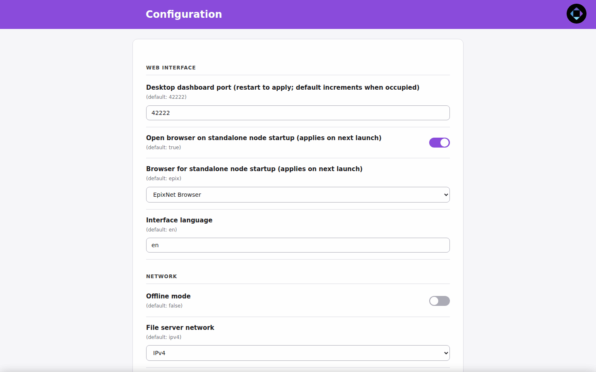

# Run a node

This page explains how to start and operate an EpixNet node once it is installed: the three desktop run modes, how the node picks a browser, every setting you can pass at startup, which ports it uses, where it keeps its data, and the command line actions built into `epix-server`. It is for desktop users who want more control and for operators running servers. If you have not installed EpixNet yet, start with [Install EpixNet](install.md).

## The two programs

A desktop installation contains two executables that both run the same node:

| Program | What it is |
| --- | --- |
| `epix-browser` | The desktop launcher. It runs the node, a managed Firefox (EpixNet Browser), the Epix Wallet and the tray icon together. This is what the **EpixNet** shortcut starts. |
| `epix-server` | The standalone node. It runs the node with your system browser or with no browser at all, and it doubles as the [command line tool](#command-line-actions). |

The Linux packages install both. The Windows installer and the macOS app contain `epix-browser` but not `epix-server`; build `epix-server` from source on those systems (see the [Windows](install-windows.md#build-from-source) and [macOS](install-macos.md#build-from-source) guides).

The examples below write `epix-server` as a bare command. From a source checkout, use `./target/release/epix-server` (or `.\target\release\epix-server.exe` on Windows) instead.

## Three ways to run on desktop { #run-modes }

=== "EpixNet Browser"

    The full desktop experience: the node, a managed Firefox that opens `.epix` names as ordinary pages, and the wallet.

    Start **EpixNet** from your applications menu. On Linux you can also start it from a terminal:

    ```sh
    epix-browser
    ```

    From a source checkout on Linux, one command prepares everything and launches it:

    ```sh
    ./scripts/run-browser.sh
    ```

    The node keeps running in the system tray after you close the browser window. Use **Quit EpixNet** in the tray menu to stop it.

=== "System browser"

    The standalone node opens the Dashboard in whatever browser your operating system uses by default:

    ```sh
    epix-server --browser system
    ```

    Pages load from `http://127.0.0.1:42222/`. You do not get the wallet extension or `.epix` names in the address bar in this mode.

=== "Headless"

    For a server or seedbox with no screen. The node serves the network and never opens a browser:

    ```sh
    EPIX_HEADLESS=1 epix-server
    ```

    Open the Dashboard yourself at `http://127.0.0.1:42222/`, directly or through an SSH tunnel.

In every mode the node does the same work: it downloads and verifies the xites you open, keeps them in your data folder, and shares them with other peers. A xite is a website published on EpixNet (see the [glossary](../reference/glossary.md)).

## Choose the browser { #browser }

When `epix-server` starts without an action, it decides which browser to open. The choice comes from the first of these that is set:

1. The `--browser epix` or `--browser system` flag (`--browser=system` also works).
2. The `EPIX_BROWSER` environment variable, set to `epix` or `system`.
3. The saved setting **Browser for standalone node startup** on the Config page.
4. The default, `epix`.

Two things turn browser opening off entirely, whatever the choice above: `EPIX_HEADLESS=1`, and clearing **Open browser on standalone node startup** on the Config page.

Any value other than `epix` or `system` is an error, as is an option `epix-server` does not know: startup stops with a message instead of guessing.



What each choice does:

| Choice | Behavior |
| --- | --- |
| `epix` | `epix-server` hands the launch to the `epix-browser` executable in the same folder, which runs the node and the managed browser together. It looks only beside itself, never on your `PATH`. |
| `system` | `epix-server` runs the node and opens the Dashboard in your system browser. |

If `epix` is selected and there is no `epix-browser` beside `epix-server`, startup stops with a `Cannot launch EpixNet Browser` message. EpixNet does not silently switch to a different browser. Install the full desktop bundle, pass `--browser system`, or run headless.

A few rules to keep in mind:

- These settings never change your operating system's default browser.
- EpixNet Browser requires a loopback dashboard address. With a LAN-facing bind such as `EPIX_UI_ADDR=0.0.0.0:42222`, use `--browser system` or `EPIX_HEADLESS=1`.
- Startup reads the saved choices from the current data folder before it applies a queued restore or data folder move. Browser preferences that arrive with that operation take effect on the following launch.
- Releases v0.6.4 and earlier always use the system browser and do not support `--browser`. Omit the flag there.

## Open a xite by name { #open-a-xite }

Pass one target after the options to open that xite instead of the Dashboard:

```sh
epix-server --browser system talk.epix
epix-browser talk.epix
./scripts/run-browser.sh talk.epix
```

A target can be any of these:

| Form | Example |
| --- | --- |
| A `.epix` name | `talk.epix` |
| A xite address | `epix1talk58lw26c0cyrtuu8axptne2p6zf33s7xxwu` |
| An `epix://` link | `epix://talk.epix/` |
| An `http://` or `https://` URL whose host is a xite | `https://talk.epix/` |

With no target, the node opens the Dashboard by its address, so a normal start does not depend on name resolution. `.epix` names are resolved through Epix Chain (see [xID names and identity](xid.md)).

`epix-server` accepts one target only. Anything that is not an option or an [action name](#command-line-actions) is treated as a target.

If EpixNet Browser is already running, starting it again with a target does not start a second node. The new launch passes the target to the running instance, which opens it, and then exits.

## EpixNet Browser launcher options { #launcher }

`epix-browser` accepts a target and two flags:

| Argument | Effect |
| --- | --- |
| `<target>` | The xite to open, in any form from the table above. Defaults to `dashboard.epix`. |
| `--background` | Start the node and the tray icon without opening a browser window. Open the browser later from the tray. |
| `--quit` | Ask a running EpixNet to close its browser and shut down its node, wait for it, then exit. Exit status `0` means EpixNet closed or was not running; `2` means the running instance acknowledged but did not exit within 30 seconds. |

The tray menu shows the version, your IP address, peer and connection counts and transfer totals, plus Tor and I2P status lines when those transports are on. It also has **Open EpixNet**, an **Open at Login** toggle and **Quit EpixNet**.

If no system tray is available, EpixNet Browser runs until you close the browser window and then shuts the node down.

On Windows the launcher opens no terminal window. Run it from a terminal to see live output. Started from a shortcut, it writes its log to `%APPDATA%\EpixNet\log\epix-browser.log`.

See [Browser and wallet](browser-wallet.md) for the browser itself.

## Headless servers { #headless }

A headless node is the standalone `epix-server` with `EPIX_HEADLESS=1`. The [Linux guide](install-linux.md#headless-release) has a complete setup with a dedicated user and a systemd unit. The points below apply on any system.

**Reach the Dashboard through a tunnel.** The node listens on `127.0.0.1:42222` by default. From your own machine:

```sh
ssh -L 42222:127.0.0.1:42222 you@server
```

Then open `http://127.0.0.1:42222/` in a browser on your machine.

**Use `/StatsJson` for health checks.** It answers a plain request:

```sh
curl -s http://127.0.0.1:42222/StatsJson
```

Requests for xite paths are different. The node has a DNS-rebinding guard, so a bare `curl http://127.0.0.1:42222/<xite>/` returns `403 Cross-origin request blocked`. Browser page loads are allowed.

**Put a reverse proxy in front only if you need to.** Point it at `127.0.0.1:42222`. The node accepts requests whose `Host` header is an IP address, `localhost`, or a `.epix` name. For any other hostname, list it under the `ui_host` key in `private/config.json` inside the data folder. The value is a string with one hostname per line.

**Let the service manager restart it.** When the node runs as the main process of a systemd service (systemd 248 or newer), the **Restart EpixNet** button on the Config page exits the process with status `75`, and a unit with `Restart=on-failure` starts it again. Outside systemd, the standalone node relaunches itself with the same arguments. **Shut down EpixNet** in the Dashboard menu exits successfully and leaves a service stopped.

!!! warning "Exposing the dashboard"

    Direct peers and services can see your node's IP address, and anyone who can reach the dashboard address can reach your node's web interface. Keep the dashboard on loopback unless you have a reason not to. See [Privacy and routing](privacy.md).

## Environment settings { #environment }

Set these before you start EpixNet to change how it runs.

=== "Linux and macOS"

    ```sh
    EPIX_HEADLESS=1 EPIX_UI_ADDR=127.0.0.1:9000 epix-server
    ```

=== "Windows PowerShell"

    ```powershell
    $env:EPIX_HEADLESS = "1"
    $env:EPIX_UI_ADDR = "127.0.0.1:9000"
    .\target\release\epix-server.exe
    ```

### Main settings

| Variable | What it does | Default |
| --- | --- | --- |
| `EPIX_HEADLESS` | Serve the network but never open a browser. Any value other than empty, `0` or `false` turns it on. Read by `epix-server`. | off |
| `EPIX_BROWSER` | `epix` or `system`: the browser for standalone node startup. The `--browser` flag takes precedence. Read by `epix-server`. | saved choice, otherwise `epix` |
| `EPIX_UI_ADDR` | The address and port the dashboard listens on, for example `127.0.0.1:9000`. | `127.0.0.1:42222` |
| `EPIX_TOR` | Node Tor mode: `enable`, `disable` or `always`. Overrides the Config page for this run. | saved choice, otherwise `enable` |
| `EPIX_DATA_DIR` | The folder where EpixNet keeps its data (xites, keys, settings). | see [Data folder](#data-folder) |

!!! warning "What the Tor modes mean"

    `enable` reaches `.onion` peers over Tor and connects to every other peer directly, so those peers and trackers see your IP address. `always` requires Tor for the node's peer traffic. Browser and wallet traffic have separate routing controls. None of these modes guarantees anonymity. Read [Privacy and routing](privacy.md) before relying on one.

### Logging and diagnostics

| Variable | What it does |
| --- | --- |
| `EPIX_LOG` | Log filter for the node's console output, in the usual Rust `tracing` form, such as `debug` or `epix_runtime=debug`. `RUST_LOG` is used when `EPIX_LOG` is not set. The default shows warnings, plus informational messages from the node and its Tor client. |
| `EPIX_PROXY_LOG` | Set to any value other than empty or `0` to print per-connection diagnostics from EpixNet Browser's local proxy. |
| `EPIX_TRACE_CLONE` | Set to any value to print timing lines while a xite is being cloned. |
| `EPIX_LOCK_WATCHDOG` | The node aborts itself if it detects that it has been frozen for about two minutes, so a supervisor can restart it. Set this to `log` to keep the warnings but never abort. |

The standalone node also writes its node log to `debug.log` in the data folder. When that file is larger than 8 MiB at startup it is renamed to `debug.log.old` and a new one is started. The **Level of logging to file** setting on the Config page controls how much goes into it.

### Desktop launcher

| Variable | What it does |
| --- | --- |
| `EPIX_FIREFOX` | Path to the Firefox executable EpixNet Browser should use, ahead of the bundled one. Used for [source builds](install-linux.md#full-desktop). |
| `EPIX_NO_TRAY` | Set to any value other than empty or `0` to run without the tray icon. |
| `EPIX_NO_SPLASH` | Set to any value other than empty or `0` to skip the startup window. |
| `EPIX_NMH` | Path to the `epix-nmh` native messaging host, when it is not beside the launcher. |
| `EPIX_CERTUTIL` | Path to the NSS `certutil` tool, when it is not found automatically. Not used on macOS. |

### Chain endpoints and storage

| Variable | What it does | Default |
| --- | --- | --- |
| `EPIX_XID_RPC_URL` | Pins the chain REST endpoint used to resolve `.epix` names to a single URL, for example a local devnet. When unset, the node follows the endpoint list on the Config page. | Config page list |
| `EPIX_CMT_RPC_URL` | Overrides the CometBFT RPC endpoint configured for the xID light client. | built-in endpoint |
| `EPIX_EDX_STORE_QUOTA_BYTES` | Byte limit for cached content fetched from other peers. Content you own is exempt. Older cached content is evicted past the limit. | 8 GiB |
| `EPIX_EDX_ONION_LANES` | How many parallel transfer lanes a download opens to one overlay peer (Tor, I2P or mesh), from 1 to 4. Clearnet peers always get one. | 3 |
| `EPIX_EDX_COMPLETE_MEDIA` | Set to `0` or `false` to stop the node from finishing a partly streamed media file in the background. It then fetches only the parts you view. | on |
| `EPIX_EDX_RECIPROCITY` | Set to `0` or `false` to turn off the upload governor that paces and prioritizes what the node serves to other peers. | on |

EDX is the node's content distribution layer (see [EDX content distribution](../internals/edx.md)). The source also reads variables that exist only for automated tests, lab setups, transition periods and builds. They are not listed here. The build-time variables `EPIX_WALLET_DIST` and `EPIX_WALLET_SKIP` are described in the node repository's [`shells/wallet-ext/README.md`](https://github.com/EpixZone/EpixNet/blob/main/shells/wallet-ext/README.md).

Most day-to-day settings live on the Config page, not in environment variables. See [Dashboard and sidebar](dashboard.md).

## Ports { #ports }

| Port | Used for | Listens on | Change it with |
| --- | --- | --- | --- |
| `42222` | Dashboard and xite pages (the UI server) | loopback by default | `EPIX_UI_ADDR`, or **Desktop dashboard port** on the Config page |
| `26552` | File server: connections from other peers, used for seeding | all interfaces (loopback only in Tor `always` mode) | **File server port** on the Config page (`fileserver_port`) |
| `42322` | Local Tor SOCKS proxy | loopback | selected automatically |
| `42422` | EpixNet Browser's xite HTTP proxy | loopback | selected automatically |
| `42522` | EpixNet Browser's I2P HTTP proxy | loopback | selected automatically |

### How fallback ports work

**Dashboard.** If the default port `42222` is already taken, EpixNet tries `42223`, `42224`, and so on until one is available. The selected port is saved in a file named `ui_port` inside your data folder, so scripts and tunnels can read it.

Any other dashboard port you configure is treated as fixed. If it is not available, startup fails instead of moving to another port.

**Choosing a dashboard port.** These are checked in order:

1. `EPIX_UI_ADDR`, which sets both the address and the port.
2. `"ui_port": 44990` in `<data folder>/private/config.json`, or **Desktop dashboard port** on the Config page. Restart to apply. Numeric strings such as `"44990"` also work. The key is `ui_port`; `uiport` is not a setting.
3. The `ui_ip` and `ui_port` keys of a legacy `epixnet.conf` (see [Python interoperability](../internals/python-interop.md)).
4. The default, `127.0.0.1:42222`.

**File server.** The file server also tries each next port if its configured port is taken, starting at `26552` by default. Use the selected port from the node log (the line that starts `Seeding files`) when you set up port forwarding. Setting `fileserver_port` to `0` disables seeding.

**Local proxies.** The Tor SOCKS proxy and the two browser proxies each hold the first available loopback port from their starting point, so another node or application can keep its existing listener. Clients use the actual selected endpoints. Do not configure anything to use fixed proxy ports. The SOCKS endpoint stays reserved while Tor is starting, disabled or recovering, and rejects traffic until Tor is ready.

Automatic selection for the dashboard, the file server and the proxies skips ports `43110` through `43113`.

The mobile apps run the same node inside the app and always use the endpoints that node reports after startup, so nothing on a phone needs a fixed port. See the [Android](install-android.md) and [iOS](install-ios.md#differences) guides.

## Data folder { #data-folder }

EpixNet keeps your xites, keys and settings in one folder:

| System | Default data folder |
| --- | --- |
| Windows | `%APPDATA%\EpixNet` |
| macOS | `~/Library/Application Support/EpixNet` |
| Linux | `~/.local/share/EpixNet`, or `$XDG_DATA_HOME/EpixNet` when that variable is set |

A few files in it are useful to know:

| Path | Purpose |
| --- | --- |
| `data/` | One folder per xite, named by its address. |
| `private/` | Node identities, keys and `config.json`. Never share this folder. |
| `ui_port` | The dashboard port selected at the last start. |
| `debug.log` | The standalone node's log file. |
| `log/epix-browser.log` | EpixNet Browser's log on Windows when it is started from a shortcut. |
| `lock.pid` | The lock that stops two nodes from using the same folder. It may remain after a normal exit. Do not delete it to get past a running process; close that process instead. |

The full layout is described in [Data directory layout](../internals/data-directory.md).

!!! danger "Protect `private/`"

    The `private` folder holds the master seed and private keys for your identities and for the xites you own. Anyone who copies it can act as you. Back it up somewhere safe and never publish it. See [Dashboard and sidebar](dashboard.md) for backup and restore.

### Which folder is used

The node picks its data folder in this order:

1. `EPIX_DATA_DIR`, when set.
2. The `data_dir` entry in `epixnet.conf` in the default folder. The Config page writes this entry when you move the folder.
3. The default folder from the table above.

### Move the data folder

Open **Config > Storage**, enter an absolute path, and save. The change waits for a restart. You can keep using the current node until then, or cancel the queued move by saving its current directory again.

At the next start, EpixNet copies the latest saved node data before opening its databases. It switches to the new directory only after the copy finishes. The original data stays in place as a backup, so the destination needs room for a full copy.

Things to know before you move:

- The move covers `private/` and `data/`: node identities, settings, downloaded xites and statistics. Browser profiles, wallet extension storage, browser certificates and other files outside those two folders remain in their original folder.
- Choose a new directory or an existing complete node directory. EpixNet does not merge a partially copied destination with the source. Selecting an existing node directory switches to that identity without overwriting it.
- On Windows the destination must support persistent access permissions, such as NTFS.
- In the desktop app, after using the Config page's restart button for a data move, wait for the EpixNet tray icon to return, close the old browser window, and open the browser from the tray. The old window still uses the previous folder's profile and certificate trust.

If a move fails, the startup error names the failing operation. Fix the reported problem, such as insufficient space or another running node, and start EpixNet again. Do not delete source data or manually merge partial destination folders.

!!! note "`EPIX_DATA_DIR` is an explicit override"

    When `EPIX_DATA_DIR` is set, the node uses exactly that folder. It does not apply a move queued from the Config page, and it does not read settings from a legacy `epixnet.conf`.

## Run several nodes { #several-nodes }

One data folder belongs to one running node. To run more than one node on the same machine, give each its own data folder and use the standalone node:

```sh
EPIX_DATA_DIR="$HOME/epix-node-2" EPIX_HEADLESS=1 epix-server
```

Each instance needs a separate `EPIX_DATA_DIR`, and each must run with `EPIX_HEADLESS=1` or `--browser system`. The managed EpixNet Browser keeps a single active profile, so it is not the tool for side-by-side nodes.

You do not have to assign ports by hand. The second node finds `42222` taken and moves to the next free dashboard port, and the file server and local proxies do the same. Read the second node's dashboard port from the `ui_port` file in its data folder.

If you start a node on a data folder that another EpixNet process is using, it refuses to start and reports that another EpixNet process owns the folder.

## Check the version { #version }

From a terminal:

```sh
epix-server --version
```

This prints `epix-server` followed by the version, for example `epix-server 0.6.8`. `-V` does the same.

In a running node:

- The Dashboard menu shows `EpixNet v<version>` at the bottom.
- The tray menu of the desktop app shows `EpixNet <version>` under **Open EpixNet**.
- The `serverInfo` API command reports `version` and `rev`, the short Git commit the build was made from. You can match `rev` against the commits in the [EpixNet repository](https://github.com/EpixZone/EpixNet/commits/main) to confirm exactly what you are running. See [xite and server commands](../api/xite.md).

`epix-server --help` (or `-h`, or `help`) prints the usage summary, the list of actions and the main environment variables.

## Command line actions { #command-line-actions }

`epix-server` doubles as an authoring and diagnostics tool. Put an action name first and it runs that action and exits instead of starting a node:

```text
epix-server <action> [arguments...]
```

Arguments are positional. An action exits with status `0` on success. On failure it prints `<action>: <error>` and exits with status `1`. When you leave out a required argument, the error is the action's usage line.

The action name must be the first argument and is case-sensitive. Anything else in that position is treated as a [xite to open](#open-a-xite).

!!! note "Command names say `site`"

    The action names keep the word `site` (`siteCreate`, `siteSign`), like the API command names. They work on xites.

### How actions reach your data

Actions work on the same data folder as the node, chosen the same way (including `EPIX_DATA_DIR`). There are two paths:

- **Live.** On Linux and macOS a running node listens on a local admin socket, `admin.sock` in the data folder, that only someone with file access to that folder can reach. Some actions send their work to the running node through it.
- **Offline.** The action opens the data folder itself. This needs exclusive use of the folder, so it fails while a node is running on it.

| Action | Node running | Node stopped |
| --- | --- | --- |
| `siteSign`, `sitePublish`, `siteList`, `siteDelete`, `siteDownload`, `siteSignMessage` | Runs through the node | Runs offline |
| `siteCreate`, `siteVerify`, `dbRebuild`, `dbQuery`, `importBundle` | Fails: stop the node first | Runs offline |
| `siteCmd` | Runs through the node | Fails: needs a running node |
| `crypt*`, `peerPing` | No data folder needed | No data folder needed |

Windows has no admin socket, so every data folder action takes the offline path there. Stop the node before you run one, and note that `siteCmd` is not available.

### Create, sign and publish

| Action | What it does |
| --- | --- |
| `siteCreate` | Creates a new xite and prints its private key, its address and the folder it was created in. |
| `siteSign <address> [privatekey] [inner_path] [--full] [--keep-missing]` | Signs the xite after you edit its files. |
| `sitePublish <address> [inner_path]` | Pushes the already signed `content.json` to peers. |
| `siteVerify <address>` | Checks every declared file against the signed `content.json`. |

```sh
epix-server siteCreate
epix-server siteSign <address>
epix-server siteVerify <address>
epix-server sitePublish <address>
```

Details:

- `siteCreate` saves the new private key in your data folder as well as printing it. Save the printed key somewhere safe: it is required to modify the xite.
- `siteSign` uses the key saved at `siteCreate` when you do not pass one. `inner_path` defaults to `content.json`; give another path to sign a different content file, such as a user's content file. To pass an `inner_path` without a key, put an empty string (`""`) in the key position.
- `--full` hashes every file again instead of trusting the sign cache. `--keep-missing` keeps declared optional files whose file is gone from disk; by default they are removed from the manifest.
- You do not need to stop the node to sign. When a node is running, `siteSign` asks that node to do the signing, so its content store registers the new version and peers can fetch it straight away.
- `sitePublish` does not sign. Run `siteSign` first. With the node stopped it can only dial clearnet peers directly, and it reports an error when no peer is reachable; the update then spreads on the next sync.
- `siteVerify` prints `[OK]` with the number of files checked, or one `[CHANGED]` line per file that differs.

!!! danger "Private keys on the command line"

    Anything you type as an argument is stored in your shell history and is visible to other processes on the machine while the command runs. Prefer the saved key, which needs no argument. Whoever holds a xite's private key controls the xite.

The full authoring workflow, including the Dashboard and sidebar route, is in [Quick start](../build/quickstart.md) and [Signing and publishing](../build/publishing.md).

### Manage xites

| Action | What it does |
| --- | --- |
| `siteList` | Lists the xites on this node. Through a running node it also shows each xite's peer count. |
| `siteDownload <address>` | Adds a xite. A running node starts downloading it; with the node stopped it is queued and downloads at the next start. |
| `siteDelete <address>` | Removes a xite from this node. |
| `importBundle <bundle.zip>` | Imports xites from a zip file whose top-level folders are xite addresses (optionally inside one wrapper folder). Each xite is extracted, verified and added. |

### Databases

| Action | What it does |
| --- | --- |
| `dbRebuild <address>` | Rebuilds the xite's SQL database from its JSON files and prints how long it took. Fails if the xite has no `dbschema.json`. |
| `dbQuery <address> "<sql>"` | Runs a query against the xite's database and prints the rows as JSON. |

```sh
epix-server dbQuery <address> "SELECT name FROM sqlite_master WHERE type = 'table'"
```

Both actions open the data folder themselves, so they fail while a node is running on it. To query a running node on Linux or macOS, send the `dbQuery` API command through [`siteCmd`](#run-an-api-command-against-a-running-node):

```sh
epix-server siteCmd <address> dbQuery '{"query": "SELECT name FROM sqlite_master WHERE type = '"'"'table'"'"'"}'
```

See [Database](../build/database.md) for how the database is built.

### Run an API command against a running node

```text
epix-server siteCmd <address> <command> [json-params]
```

`siteCmd` runs any [EpixFrame API](../api/index.md) command against your running node, bound to one xite, and prints the result as JSON. It is how you reach commands that take their target xite from the connection. The parameters are a JSON value and default to `{}`.

```sh
epix-server siteCmd <address> siteInfo
```

The admin socket is a trusted operator channel: commands sent through it run with full access and none of the restrictions a page or a public gateway has. Treat file access to the data folder as full control of the node.

### Keys and signatures

The `crypt*` actions are pure key operations. They read nothing from the data folder and do not contact a node.

| Action | What it does |
| --- | --- |
| `cryptSign <message> <privatekey>` | Signs a message with a private key and prints the signature. |
| `cryptVerify <message> <sign> <address>` | Prints `true` if the signature matches the message and address, otherwise `false`. |
| `cryptGetPrivatekey <master_seed> [index]` | Derives the private key at `index` (default `0`) from a 64-character master seed. |
| `cryptPrivatekeyToAddress <privatekey>` | Prints the address that belongs to a private key. |

To prove that you control a xite's address, for example to answer an ownership challenge, sign a message as the xite:

```text
epix-server siteSignMessage <address> [message]
```

It asks for the message if you leave it out, then prints the signature. You do not pass the key. A running node signs with the key it already holds. Otherwise the key saved in the data folder is used. Only if neither has the key does the command ask for it on standard input, so it never lands in your shell history. Terminal echo is turned off while you type where the `stty` command is available.

### Peer diagnostics

| Action | What it does |
| --- | --- |
| `peerPing <ip> <port>` | Opens an encrypted link to a clearnet peer's file server port and prints five round-trip times. |

```sh
epix-server peerPing 203.0.113.9 26552
```

!!! note "`peerGetFile` and `peerCmd`"

    The node repository's README still lists `peerGetFile` and `peerCmd`. The current `epix-server` does not implement them: `peerPing` is the only peer action, and the other two names are read as a xite target, so the command fails or tries to open a xite by that name. Use `siteCmd` to run commands against your own node.

## Where to go next

- [Dashboard and sidebar](dashboard.md): the Config page, the file browser, backup and restore.
- [Privacy and routing](privacy.md): Tor, I2P, LAN discovery and the Reticulum mesh.
- [Quick start](../build/quickstart.md): build and publish your first xite.
- [Node architecture](../internals/architecture.md): how the pieces fit together.
