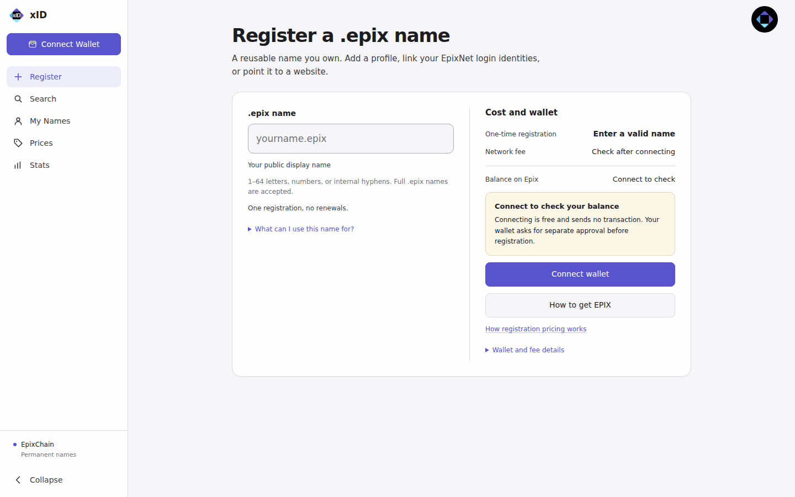

# xID: names and identity

xID is EpixNet's naming and identity system. It gives you a readable name such as `alice.epix`, a small public profile, and a way to prove that the things you post on different xites come from the same person. This page is for users: how to get a name, how to use it in apps, and what becomes public when you do. Developers should read [xID for developers](../web3/xid.md).

A xite is a website published on EpixNet. See the [glossary](../reference/glossary.md) for other terms.

## What an xID is

An xID is a record on Epix Chain, the blockchain EpixNet uses for naming. It has four parts.

| Part | What it is | Who can change it |
| --- | --- | --- |
| **Name** | `yourname.epix`. Permanent once registered. | Nobody. The owner can transfer it. |
| **Profile** | An avatar address and a short bio. | The owner |
| **Records** | Where the name points. The main one is a xite address. | The owner |
| **Linked identities** | The node identities that are allowed to act under this name. | The owner |

Two kinds of keys are involved, and it helps to keep them apart:

- Your **wallet** owns the name. Registering, editing the profile, and linking identities are chain transactions that the wallet approves.
- Your **node identity** signs what you post on xites. It is a key your node keeps for you, and it never needs to hold funds.

Linking tells the chain "this node identity speaks for this name". After that, apps can show your posts under `yourname.epix`, and other people's nodes can check that claim against the chain for themselves.

You do not need an xID to browse. You need one to post in most apps.

## Open the xID manager

Everything on this page happens in the xID xite, which the Dashboard lists under **Discover** as **xID**. Its address is `epix1xauthduuyn63k6kj54jzgp4l8nnjlhrsyaku8c`.

Its pages are **Register**, **Search**, **My Names**, **Prices**, and **Stats**. Searching and reading need no wallet. Anything that changes the chain needs a wallet connection. In [EpixNet Browser](browser-wallet.md) the built-in Epix Wallet appears first in the wallet picker.

## Register a name

You need a wallet on Epix Chain with enough EPIX to cover the registration fee and the network fee.

1. Open the xID manager. The **Register** page is the first one you see.
2. Type the name you want. Availability and the fee are checked as you type.
3. Click **Connect wallet** and approve the connection. Connecting is free and sends no transaction. If your wallet is on another network, the page offers to switch it to Epix.
4. Review **Cost and wallet**: the one-time registration fee, the estimated network fee, and your balance.
5. Click **Register** and approve the transaction in your wallet.
6. When the page reads "*yourname*.epix is yours", choose **Manage your name** to continue.

### Name rules

- 1 to 64 characters.
- The letters `a` to `z`, the digits `0` to `9`, and hyphens. A name cannot start or end with a hyphen.
- Names are stored in lowercase. You can type `alice` or `alice.epix`.

### What it costs

- The registration fee depends on the length of the name. The **Prices** page shows the current price tiers and a fee calculator. Both are read from the chain, so check them there instead of relying on a figure quoted elsewhere.
- The fee is paid once. There are no renewals, and names do not expire.
- Registration fees are burned, which means they are destroyed and paid to nobody.
- The network fee for processing the transaction is separate and is set by your wallet.

The page fetches the fee from the chain again just before it asks your wallet, and stops if the price changed, so you never approve a stale quote. It also simulates the transaction first. If it would fail, you see the reason without the wallet opening.

If you do not have enough EPIX, the card's funding help shows your receive address and where to look for EPIX.

!!! warning "Names are permanent and public"
    A name cannot be renamed or deleted, and its history stays on the chain. Choose one you are comfortable being known by. See [What is public](#what-is-public).

## Manage your names

**My Names** lists every name your connected wallet owns. Click **View** to open a name's detail page.

### Primary name

A wallet can own several names. The **primary** name is the one shown when someone looks up your wallet address. Use **Set Primary** in the list, or **Set as Primary Name** on the name's page.

### Profile

Click **Edit** in the profile section to set:

- an **Avatar URL**, up to 256 bytes;
- a **Bio**, up to 512 bytes including formatting. The editor supports Markdown with Bold, Italic, Heading, List, Quote, Code, and Link buttons and a **Preview** tab.

Raw HTML in a bio is shown as text, and embedded images are shown as their description only. Links are checked before they are displayed.

Saving a profile is a chain transaction with a network fee.

!!! note
    The avatar is an address, not an upload. Whoever views your profile fetches the image from wherever it is hosted, and that host sees the request.

### Transfer

**Transfer Name** at the bottom of a name's page moves ownership to another wallet address. This is irreversible. The new owner controls the profile, the records, and the linked identities.

## Link your node identity

Linking is what makes a name usable in apps. It connects the identity your node uses for signing to the name your wallet owns.

### From an app

The usual way is to start in the app you want to use.

1. In the app, choose the option to sign in or connect an xID. The node shows a picker titled "Select the xID account you want to use on this site".
2. Pick an identity you already linked, or choose **New** to link another.
3. Choosing **New** opens the xID manager in a three-step wizard: **Connect wallet**, **Choose name**, **Link and return**.
4. Select a name you own, or register one on the spot. Registration and linking are separate transactions, and each has a network fee.
5. Approve the link transaction in your wallet.
6. The wizard waits until your node has confirmed the link on the chain, then sends you back to the app with the identity selected.

If the confirmation takes too long, use **Retry confirmation**. You can also go back and pick the name in the app's identity picker. You do not need to register again.

### From the Config page

Open **Configuration** in the Dashboard menu and scroll to **Identities**.

| Control | What it does |
| --- | --- |
| **Linked xIDs** | A table of the identities this node holds, with the name and the identity address. |
| **Make default** | Sets the identity used on every xite that has not chosen its own. |
| **Remove** | Removes the identity from this node's list. Its key stays in the node's key file, and content it already published stays valid. |
| **Link a new identity** | Starts the same wizard as above. |
| **Find identities already linked to my addresses** | Asks the chain which names already list one of this node's addresses and records them. Useful after restoring a backup. |

### From a name's page

On a name's detail page, the **Linked Identities** section shows your current node identity with a **Link as Identity** button, and a **+ Link Identity** form where you can paste any identity address and give it a label such as "laptop" or "server".

### Several devices, one name

Each node has its own identities. To post under the same name from a second computer or a phone, link that device's identity to the name as well. A name can hold several linked identities, each with its own label.

### Choosing an identity per xite

Your default identity applies everywhere until you choose otherwise. To use a different one on a particular xite, or none at all, open that xite's [sidebar](dashboard.md#the-xite-sidebar), go to **Identity** on the Overview tab, and click **Change**. **Disconnect** removes the selection for that xite.

### Revoke an identity

If a device is lost or a key may have been copied, open the name's page and click **Revoke** next to that identity.

- The identity is marked **Revoked** on the chain, with the block number at which it was revoked. It stays in the list as a record.
- Revoking does not remove content that the identity already published. If a key was misused, that content has to be dealt with on each xite where it was posted.

## Point a name at a xite

A name can also be the address of a xite, so that visitors type `yourname.epix` instead of a long `epix1...` address.

1. Publish your xite and open it in EpixNet.
2. Copy its `epix1...` address, or the full address from the address bar.
3. On the name's page, open **Xite & other records** and choose to set a record. The **EpixNet xite** record type is selected for you.
4. Paste the address. A preview shows the destination. Only the xite address is stored.
5. Click **Save xite address** and approve the transaction.

After the transaction confirms, EpixNet nodes can resolve the name to your xite. Nodes cache name lookups, so the change can take a while to appear everywhere. On your own node you can speed that up with **Clear xID Cache** on the Config page.

This record only points visitors to the xite. It does not publish content and it does not give anyone access to your account. The xite side of the setup is described in [Publishing](../build/publishing.md).

### Other record types

The same section can store standard DNS-style records.

| Type | Holds |
| --- | --- |
| A | An IPv4 address |
| AAAA | An IPv6 address |
| CNAME | Another host name |
| TXT | Text, such as a verification code |
| MX | A mail server with its priority |
| NS | A name server |
| SRV | A service location: priority, weight, port, and host name |

Rules that apply to every record:

- A name holds one value per record type. Saving replaces the existing value.
- A value can be up to 1,024 bytes.
- The optional cache duration is `0` for the default, or between 60 and 604,800 seconds (7 days).

!!! info "These are not public DNS"
    The records are settings stored on Epix Chain. The xID manager does not provide DNS hosting, and saving a record does not make your name resolve on the ordinary internet. Only software that reads xID records uses them. An MX record does not create a mailbox, and it does not configure Epix Mail.

## Look up names

The **Search** page works without a wallet.

- **Find a name** tells you whether a name is free, and its fee, or shows its owner and profile if it is taken.
- **Find a wallet's names** lists every name owned by a `0x...` or `epix1...` wallet address.
- An identity lookup shows which name a node identity address is linked to.

The **Stats** page shows the number of registered names, the total registration fees burned, a breakdown by top-level domain, and up to five recent xIDs taken from the user data your node holds.

## How apps use your xID

- **Epix Talk** and **Epix Post** identify you by your xID. Your posts appear under your name, and your content is stored on the xite in a folder that belongs to your identity.
- **Epix Mail** addresses messages by name. Avatars and names in its directory come from the chain, and a link such as "message this person" on a profile opens the composer with the name filled in.
- **The xID xite itself** is where each linked identity publishes the public keys that encrypted messaging needs, so that others can write to you by name.

When another person's node receives something you posted, it does not take the name on trust. It checks with the chain that the signing identity really is an active linked identity of that name. Your node does the same for content from others. The technical details are in [How the node verifies xID](../internals/xid-light-client.md).

!!! note
    Because that check depends on the chain, a node that cannot reach any chain endpoint may hold back content from named users until it can verify it.

See [Featured xites](apps.md) for the apps themselves.

## What is public

Everything stored in an xID is on a public ledger. Anyone can read it, with or without EpixNet, and it cannot be erased.

| Public | Details |
| --- | --- |
| The name and its owner | Your wallet address is shown as the owner. Anyone can list all names a wallet owns. |
| The registration | The transaction, its time, and the fee paid from your wallet. |
| Profile | The avatar address and bio, including earlier versions in the chain's history. |
| Records | Every record you set, including the xite a name points to. |
| Linked identities | Every identity address, its label, when it was linked, and when it was revoked. |
| Transfers | Past and present owners. |

What follows from that:

- Using the same xID on several xites deliberately connects your activity on them. If you want activity kept apart, use different names, and consider registering them from different wallets, because anyone can see which names a wallet owns.
- Labels are public. Do not put anything sensitive in a label such as a device name.
- A wallet that received funds from an exchange or another identifiable source can connect a name to you through the chain's history.

Routing options such as Tor protect your network address. They do not hide anything on this list. See [Privacy and routing](privacy.md).

## Troubleshooting

| Symptom | What to try |
| --- | --- |
| "Switch your wallet to Epix" | Approve the network switch. The wallet can add Epix if it is missing. |
| "Add EPIX to continue" | Your balance does not cover the registration fee plus the network fee. Open the funding help for your receive address. |
| "The registration price changed" | The fee was updated between the quote and the approval. Review the new fee and try again. |
| The wizard says the link is saved on chain but the node has not confirmed it | Use **Retry confirmation**, or return to the app and choose the name in its identity picker. |
| An app does not offer a name you own | Open the name's page and check that this node's identity is listed as **Active**. If it is not, link it. If it is, use **Find identities already linked to my addresses** on the Config page. |
| A name still opens the old xite after you changed its record | Use **Clear xID Cache** on the Config page and reload. |

## Related pages

- [EpixNet Browser and Epix Wallet](browser-wallet.md): the wallet that owns your names.
- [Dashboard, sidebar, and node settings](dashboard.md): the Identities section and backing up your node keys.
- [User content](../build/user-content.md): how xites store what named users post.
- [xID for developers](../web3/xid.md): resolving and verifying names from a xite.
