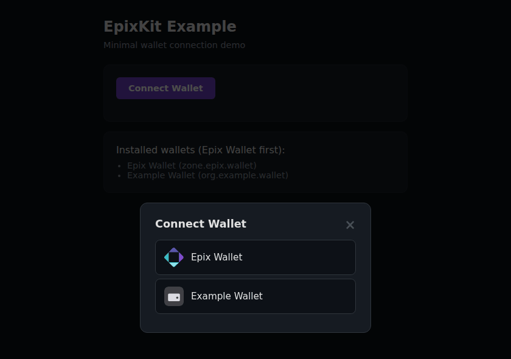

# Connect a wallet

This tutorial adds wallet connection to a xite, from an empty page to a working connect button that survives reloads, account switches and network switches. It uses [EpixKit](../libraries/epixkit.md) for wallet discovery and the picker, and [ethers](https://docs.ethers.org/v6/) version 6 for everything after that. It is written for xite authors who know basic JavaScript. No build step is involved.

By the end you will have three small files you can copy into any xite.



## How the pieces fit

- **EpixKit** is a single JavaScript file with no dependencies. It finds the wallets installed in the browser, shows a picker, asks the chosen wallet for an account, switches it to your chain, and hands you the wallet's raw provider. It does not send transactions.
- **The raw provider** is the wallet's standard EIP-1193 object. You call `provider.request(...)` on it and listen to its `accountsChanged` and `chainChanged` events.
- **ethers** wraps the raw provider so you can read balances, build transactions and call contracts.
- **A read-only provider** is a second ethers provider that talks straight to an EVM RPC endpoint. Use it for everything that does not need a signature, so the page works before a wallet is connected.

## Before you start

You need:

- A xite you own and can edit. The [quick start](../build/quickstart.md) gets you there.
- A wallet in the browser you test with. [EpixNet Browser](../start/browser-wallet.md) includes the Epix Wallet. In a regular browser, any EVM wallet that announces itself through EIP-6963 works.
- The page opened through EpixNet Browser, or through `http://127.0.0.1:<port>/<address>/` on the machine that runs the node. Wallets can fail on a LAN address or a public gateway. See [When the wallet never answers](#when-the-wallet-never-answers).

## Step 1: Vendor the libraries

A xite must carry its own scripts. Loading them from a CDN breaks the xite offline and lets a third party change your page. Copy the three libraries into `js/lib/` in your xite folder.

```sh
mkdir -p js/lib

# EpixKit: one file, MIT license.
curl -L -o js/lib/epixkit.js \
  https://raw.githubusercontent.com/EpixZone/epixkit/main/epixkit.js

# ethers 6.13.4, the UMD build the official xites vendor.
curl -L -o js/lib/ethers.umd.min.js \
  https://cdnjs.cloudflare.com/ajax/libs/ethers/6.13.4/ethers.umd.min.js

# EpixFrame, the bridge to the node.
curl -L -o js/lib/epixframe.min.js \
  https://raw.githubusercontent.com/EpixZone/epixframe/main/dist/epixframe.min.js
```

Check what you downloaded before you sign it. The official xites record this SHA-256 for the ethers 6.13.4 UMD build:

```text
fd66c04651929c6a37806a37e8217e6b6aac07c7e816ad478f52690b7429bc61  ethers.umd.min.js
```

```sh
sha256sum js/lib/ethers.umd.min.js      # on macOS: shasum -a 256 js/lib/ethers.umd.min.js
```

!!! tip "Record where each file came from"
    The official xites keep a `js/lib/README.md` that lists each vendored file, its source URL or commit, and its SHA-256, and keep the matching license files next to the libraries. Do the same. For EpixKit, note the commit you copied instead of tracking `main`, so an update is always a deliberate change that you review and re-sign.

Your xite folder now looks like this:

```text
index.html
js/
  chain.js          (step 2)
  wallet.js         (step 4)
  lib/
    epixframe.min.js
    epixkit.js
    ethers.umd.min.js
```

## Step 2: Describe the network

Create `js/chain.js`. It holds the two network presets and one function that decides which endpoints to use.

```js title="js/chain.js"
// Network presets for Epix Chain.
window.EPIX_NETWORKS = {
  mainnet: {
    id: 1916,
    hex: "0x77C",
    name: "Epix",
    evmRpcs: ["https://evmrpc.epix.zone"],
    explorer: "https://scan.epix.zone"
  },
  testnet: {
    id: 1917,
    hex: "0x77D",
    name: "Epix Testnet",
    evmRpcs: ["https://evmrpc.testnet.epix.zone"],
    explorer: "https://testscan.epix.zone"
  }
};

window.EPIX_CURRENCY = { name: "EPIX", symbol: "EPIX", decimals: 18 };

// Resolve the endpoints for a network. On mainnet, prefer the endpoints the
// visitor's node is configured with. Outside the wrapper, or when the node
// does not answer within two seconds, keep the public defaults.
window.loadNetwork = async function (key) {
  var preset = window.EPIX_NETWORKS[key];
  var net = {
    id: preset.id,
    hex: preset.hex,
    name: preset.name,
    evmRpcs: preset.evmRpcs.slice(),
    explorer: preset.explorer
  };
  // Reading epixFrame creates the bridge to the wrapper, on any network.
  var embedded = epixFrame.isEmbedded;
  if (key !== "mainnet" || !embedded) return net;

  var timeout = new Promise(function (resolve) { setTimeout(function () { resolve(null); }, 2000); });
  var asked = epixFrame.serverInfo().catch(function () { return null; });
  var info = await Promise.race([asked, timeout]);
  if (!info) return net;

  if (Array.isArray(info.chain_evm_rpc_urls) && info.chain_evm_rpc_urls.length) {
    net.evmRpcs = info.chain_evm_rpc_urls.slice();
  } else if (info.chain_evm_rpc_url) {
    net.evmRpcs = [info.chain_evm_rpc_url];
  }
  if (info.chain_block_explorer_url) {
    net.explorer = String(info.chain_block_explorer_url).replace(/\/+$/, "");
  }
  return net;
};
```

What this does:

- **Testnet uses fixed endpoints.** The node's `serverInfo` endpoints describe the chain the node is configured for, which is mainnet by default. Mixing a testnet chain ID with the node's mainnet RPC is a common mistake.
- **Mainnet asks the node.** The user may have replaced the public endpoints on the Config page, for example with their own RPC server. Honoring that choice is the reason to ask.
- **The page still works on its own.** `epixFrame.isEmbedded` is `false` when the page is opened outside the wrapper, and the two second race covers a node that does not answer.

The chain facts are explained in [Epix Chain for xite developers](index.md#networks-and-endpoints).

## Step 3: Write the page

```html title="index.html"
<!DOCTYPE html>
<html lang="en">
<head>
  <meta charset="utf-8">
  <meta name="viewport" content="width=device-width, initial-scale=1">
  <title>Wallet demo</title>
</head>
<body>
  <h1>Wallet demo</h1>

  <div id="disconnected">
    <button id="connect" disabled>Connect wallet</button>
  </div>

  <div id="connected" hidden>
    <p><span id="wallet-name"></span> <code id="address"></code></p>
    <p id="balance"></p>
    <p id="wrong-chain" hidden>
      Your wallet is on another network.
      <button id="switch">Switch to <span id="network-name"></span></button>
    </p>
    <button id="disconnect">Disconnect</button>
  </div>

  <p id="error" role="alert"></p>

  <script src="js/lib/epixframe.min.js"></script>
  <script src="js/lib/epixkit.js"></script>
  <script src="js/lib/ethers.umd.min.js"></script>
  <script src="js/chain.js"></script>
  <script src="js/wallet.js"></script>
</body>
</html>
```

The connect button starts disabled and is enabled once EpixKit is configured. The scripts load in dependency order: the libraries first, then your network presets, then the wallet code.

EpixKit injects its own modal markup and styles (class names prefixed `epixkit-`) the first time the picker opens. You do not add any markup for it.

## Step 4: Connect, reconnect and react to changes

Create `js/wallet.js`. This is the whole connection lifecycle. The sections after the listing explain each part.

```js title="js/wallet.js"
(function () {
  var NETWORK = "testnet";      // change to "mainnet" when you ship

  var net = null;               // endpoints and chain ID in use
  var readProvider = null;      // read-only JSON-RPC provider
  var revision = 0;             // increases on every wallet change
  var wallet = empty();

  function empty() {
    return { raw: null, provider: null, address: null, name: "", chainOk: false };
  }

  function el(id) { return document.getElementById(id); }

  function showError(message) { el("error").textContent = message || ""; }

  // ---- start up ----------------------------------------------------------

  async function start() {
    net = await loadNetwork(NETWORK);

    // staticNetwork skips the eth_chainId round trip ethers would otherwise
    // make before the first call.
    readProvider = new ethers.JsonRpcProvider(
      net.evmRpcs[0],
      { chainId: net.id, name: "epix" },
      { staticNetwork: true }
    );

    EpixKit.init({
      chainId: net.hex,
      chainName: net.name,
      nativeCurrency: EPIX_CURRENCY,
      rpcUrls: net.evmRpcs,
      blockExplorerUrls: [net.explorer],
      onReconnect: onConnected   // a returning visitor reconnects silently
    });

    el("connect").disabled = false;
  }

  // ---- connect and disconnect ---------------------------------------------

  async function connect() {
    showError("");
    el("connect").disabled = true;
    try {
      await onConnected(await EpixKit.connect());
    } catch (err) {
      var message = (err && err.message) || "";
      // Closing the picker, or having no wallet installed, needs no error
      // text: EpixKit already showed the picker or its empty state.
      if (message !== "User cancelled" && message !== "No wallet detected") {
        showError(message || "Wallet connection failed");
      }
    }
    el("connect").disabled = false;
  }

  // Runs after EpixKit.connect(), after a silent reconnect, and after the
  // wallet reports a different account.
  async function onConnected(result) {
    var mine = ++revision;
    wallet.raw = result.provider;
    wallet.provider = new ethers.BrowserProvider(result.provider, "any");
    wallet.address = ethers.getAddress(result.address);
    wallet.name = result.walletName || "";
    watch(result.provider);
    await checkChain();
    if (mine !== revision) return;   // a newer change replaced this one
    render();
    loadBalance();
  }

  function disconnect() {
    EpixKit.disconnect();
    ++revision;
    wallet = empty();
    render();
  }

  // ---- account and network changes ---------------------------------------

  // EIP-1193 events come from the raw provider, not from EpixKit.
  function watch(raw) {
    if (!raw.on || raw._demoWatched) return;
    raw._demoWatched = true;

    raw.on("accountsChanged", function (accounts) {
      if (wallet.raw !== raw) return;          // not the wallet in use
      if (!accounts || !accounts.length) { disconnect(); return; }
      onConnected({ provider: raw, address: accounts[0], walletName: wallet.name });
    });

    raw.on("chainChanged", function () {
      if (wallet.raw !== raw) return;
      var mine = ++revision;
      wallet.provider = new ethers.BrowserProvider(raw, "any");
      checkChain().then(function () {
        if (mine !== revision) return;
        render();
        loadBalance();
      });
    });
  }

  async function checkChain() {
    var raw = wallet.raw, ok = false;
    try {
      ok = Number(await raw.request({ method: "eth_chainId" })) === net.id;
    } catch (err) { /* treated as the wrong network */ }
    if (raw === wallet.raw) wallet.chainOk = ok;
  }

  async function switchChain() {
    var raw = wallet.raw;
    showError("");
    try {
      try {
        await raw.request({ method: "wallet_switchEthereumChain", params: [{ chainId: net.hex }] });
      } catch (err) {
        if (!err || err.code !== 4902) throw err;   // 4902: the wallet does not know the chain
        await raw.request({
          method: "wallet_addEthereumChain",
          params: [{
            chainId: net.hex,
            chainName: net.name,
            rpcUrls: net.evmRpcs,
            blockExplorerUrls: [net.explorer],
            nativeCurrency: EPIX_CURRENCY
          }]
        });
      }
    } catch (err) {
      if (!err || err.code !== 4001) showError((err && err.message) || "Could not switch network");
    }
    if (raw !== wallet.raw) return;
    await checkChain();
    render();
  }

  // ---- balance ------------------------------------------------------------

  async function loadBalance() {
    var address = wallet.address, mine = revision;
    el("balance").textContent = "";
    if (!address) return;
    try {
      var wei = await readProvider.getBalance(address);
      if (mine !== revision) return;           // answer for an older state
      el("balance").textContent = formatEpix(wei) + " EPIX";
    } catch (err) {
      if (mine === revision) el("balance").textContent = "Balance unavailable";
    }
  }

  function formatEpix(wei) {
    var n = Number(ethers.formatEther(wei));
    return n >= 1000 ? Math.round(n).toLocaleString() : n.toFixed(4).replace(/\.?0+$/, "");
  }

  // ---- signing --------------------------------------------------------------

  // The signer for a transaction. Fails early with a readable message.
  async function signer() {
    if (!wallet.provider) throw new Error("Connect your wallet first");
    if (!wallet.chainOk) throw new Error("Switch your wallet to " + net.name);
    return wallet.provider.getSigner(wallet.address);
  }

  // ---- page ---------------------------------------------------------------

  function render() {
    var on = !!wallet.address;
    el("disconnected").hidden = on;
    el("connected").hidden = !on;
    if (!on) return;
    el("wallet-name").textContent = wallet.name;
    el("address").textContent = wallet.address;
    el("wrong-chain").hidden = wallet.chainOk;
    el("network-name").textContent = net.name;
  }

  el("connect").addEventListener("click", connect);
  el("disconnect").addEventListener("click", disconnect);
  el("switch").addEventListener("click", switchChain);

  start().catch(function (err) {
    showError("Could not start: " + ((err && err.message) || err));
  });

  // Other scripts on the page read the connection through this object.
  window.DemoWallet = {
    get address() { return wallet.address; },
    get chainOk() { return wallet.chainOk; },
    get provider() { return wallet.provider; },
    get readProvider() { return readProvider; },
    get network() { return net; },
    signer: signer
  };
})();
```

Reload the xite, select **Connect wallet**, pick a wallet, and approve the connection in the wallet. The page shows the wallet name, the address and the EPIX balance.

## What the code does

### Initialization

`EpixKit.init(config)` stores the configuration and, when you pass `onReconnect`, starts the background reconnect check described below. It opens no dialog. Call it once, before `connect()`.

| Option | Used for |
| --- | --- |
| `chainId` | Required. The hex chain ID the wallet is switched to: `"0x77D"` for testnet, `"0x77C"` for mainnet. |
| `chainName`, `rpcUrls`, `blockExplorerUrls`, `nativeCurrency` | Sent to the wallet only when it does not know the chain yet and EpixKit has to add it. |
| `onReconnect` | Called with a connect result when the wallet used last time is still authorized. |
| `requestTimeoutMs` | Maximum wait for each wallet request. The default is `60000`. |
| `excludeWallets` | Extra wallet names or identifiers to hide from the picker. |
| `installUrl`, `installLabel` | A download link of your choice for the empty state. |

The complete option list is in the [EpixKit reference](../libraries/epixkit.md).

### Connecting

`EpixKit.connect()` returns a promise for `{ provider, address, walletName, walletIcon }`. Under the hood it:

1. Asks every installed wallet to announce itself and waits briefly for late ones.
2. Shows the picker, with the Epix Wallet first. The picker is shown even when only one wallet is installed, so the user sees which wallet is about to connect.
3. Requests accounts from the chosen wallet (`eth_requestAccounts`).
4. Switches the wallet to your chain, adding the chain first if the wallet does not know it.
5. Reads the connected account and resolves.

If the user picked a wallet on a previous visit, `connect()` skips the picker and uses that wallet again.

The promise rejects when the user closes the picker (`"User cancelled"`), when no wallet is installed (`"No wallet detected"`, after the empty state was shown), when the wallet refuses, and when a request times out. On a wallet error EpixKit also shows the message inside its own dialog, which stays open until the user closes it.

Only one connection attempt can run at a time. A second `connect()` call while the picker is open rejects with `"A wallet connection is already in progress"`, which is why the tutorial disables the button during the attempt.

### Reconnecting after a reload

EpixKit remembers the chosen wallet in `localStorage` under the key `epixkit_wallet`. When you pass `onReconnect`, `init()` checks that wallet in the background:

- It asks for accounts with `eth_accounts`, which never opens a prompt.
- If the wallet still authorizes your xite, it switches the wallet to your chain and calls `onReconnect` with the same result shape as `connect()`.
- If anything fails, nothing happens and the user sees the connect button.

Two things to know:

- **A reconnect can still show a network prompt.** If the returning user's wallet is on another chain, the switch request on reconnect makes the wallet ask.
- **No storage, no reconnect.** In an opaque origin `localStorage` is unavailable, EpixKit stores nothing, and every visit starts disconnected. See [the sandbox caveat](index.md#the-sandbox-caveat-for-wallets).

### Disconnecting

`EpixKit.disconnect()` clears EpixKit's own state and the remembered wallet. It does not talk to the wallet, so the wallet may still list your xite as a connected site. That is normal: revoking a site's access is done by the user inside the wallet. After `disconnect()`, the next `connect()` shows the picker again.

Your own state must be cleared too, which is what `wallet = empty()` does.

### Account and network changes

EpixKit does not relay wallet events. Subscribe on the raw provider:

| Event | Argument | What to do |
| --- | --- | --- |
| `accountsChanged` | Array of addresses | Empty array: the user disconnected your xite in the wallet, so disconnect. Otherwise switch to `accounts[0]` and reload everything that depended on the old account. |
| `chainChanged` | Hex chain ID | Recreate the ethers `BrowserProvider`, check the chain again, and block writes until the wallet is back on your chain. |

Three habits from the official xites keep this reliable:

- **Subscribe once per provider.** The same raw provider comes back on every reconnect. The `_demoWatched` flag prevents stacking a new pair of listeners each time.
- **Ignore events from a wallet you no longer use.** The `wallet.raw !== raw` check drops events from a provider the user has switched away from.
- **Discard stale answers.** Every change increments `revision`. An asynchronous result that arrives after a newer change is thrown away instead of overwriting fresh state. Without this, a slow balance request for the old account can land on top of the new one.

The `"any"` argument to `ethers.BrowserProvider` tells ethers not to pin the provider to the first network it sees. The tutorial still recreates the provider on `chainChanged`, as the xID manager does.

### Showing the balance

The balance is read through the read-only provider, not through the wallet:

```js
var wei = await readProvider.getBalance(address);   // bigint, in aepix
var text = ethers.formatEther(wei);                 // decimal string, in EPIX
```

Reading through your own provider means the number is always the balance on the network your xite targets, whatever network the wallet is on. `getBalance` returns a `bigint`. Keep amounts as `bigint` for any arithmetic or comparison and convert to a string only for display.

### Getting a signer

`DemoWallet.signer()` returns an ethers signer for the connected account, and refuses when the wallet is on the wrong network. Use it wherever you send a transaction:

```js title="Send a small test transfer"
async function sendTest() {
  var status = document.getElementById("error");
  try {
    var signer = await DemoWallet.signer();
    var tx = await signer.sendTransaction({
      to: DemoWallet.address,                 // a transfer to yourself
      value: ethers.parseEther("0.001")
    });
    status.textContent = "Sent: " + tx.hash;
    await tx.wait();
    status.textContent = "Confirmed: " + tx.hash;
  } catch (err) {
    status.textContent = err.shortMessage || err.message || "Transaction failed";
  }
}
```

The wallet shows its own approval prompt with the network fee. [Read and write contracts](contracts.md) covers transactions properly: simulation, status, fees and readable errors.

## Errors and timeouts

| What happened | What you see | What to do |
| --- | --- | --- |
| User closed the picker | Rejection with message `User cancelled` | Nothing. Do not show an error. |
| No wallet installed | The picker shows its empty state, then a rejection with `No wallet detected` | Nothing more. The empty state already points to EpixNet Browser and to wallet downloads. |
| User rejected the connection in the wallet | Rejection from the wallet, normally with `code` `4001` | Show a short neutral message or nothing. |
| Wallet is locked or shares no account | `The wallet did not share an account. Unlock it and approve the connection, then try again.` | Show the message. |
| A wallet request was never answered | Rejection after `requestTimeoutMs` with a message that starts `The wallet did not respond.` | Show the message. See the next section. |
| `connect()` called twice | `A wallet connection is already in progress` | Disable your button while connecting. |

!!! warning "A timeout does not close the wallet's prompt"
    When a request times out, EpixKit stops waiting. It cannot dismiss a prompt the wallet already opened. If the user retries with the old prompt still pending, the wallet may queue or refuse the new request. EpixKit's timeout message tells the user to close any pending prompt first. Keep that text visible.

Closing the "Connecting" dialog cancels the attempt, and a late answer from the wallet cannot complete a cancelled connection.

### When the wallet never answers

Wallets talk to pages over a message channel bound to the page's exact origin. A xite opened through a LAN address or a public gateway runs in an opaque origin, and an installed wallet's channel can be blocked there. The request then simply never completes.

EpixKit detects that it is running in an opaque origin and changes the timeout message to explain it: the xite's restricted frame can block wallet connections, and the user should try the desktop EpixNet Browser with a `.epix` address. EpixKit does not, and cannot, grant sandbox permissions or forward wallet requests through another page.

What you should do:

- Keep the page useful without a wallet. Reads through your read-only provider do not involve the wallet at all.
- Do not request the `NOSANDBOX` permission to make a wallet work.
- If you want to warn early, `window.origin === "null"` tells you the page is in an opaque origin before the user tries to connect.

The origin modes are explained in [The wrapper sandbox](../build/sandbox.md#which-origin-your-page-gets).

## Going to mainnet

1. Change `NETWORK` to `"mainnet"` in `js/wallet.js`.
2. Replace every testnet contract address with its mainnet counterpart. Keep addresses next to the network preset so the two cannot drift apart.
3. Test with a small amount first. A mainnet transaction spends real EPIX and cannot be undone.
4. [Sign and publish](../build/publishing.md) the xite.

## Optional: list wallets yourself

If you want your own picker or a "no wallet found" hint before the user clicks, `EpixKit.getWallets()` returns the installed wallets without connecting:

```js
var wallets = await EpixKit.getWallets();
// [{ uuid, name, rdns, icon, provider }, ...], the Epix Wallet first

var hasEpixWallet = wallets.some(function (w) {
  return w.rdns === EpixKit.EPIX_WALLET_RDNS;    // "zone.epix.wallet"
});
```

The other read-only helpers are `EpixKit.isConnected()`, `EpixKit.getAddress()`, `EpixKit.getProvider()` and `EpixKit.getWalletName()`.

## Checklist

- [ ] `epixkit.js`, `ethers.umd.min.js` and `epixframe.min.js` are served from your xite, with their sources and hashes recorded.
- [ ] `EpixKit.init` is called once, with the chain ID that matches your contract addresses.
- [ ] The connect button is disabled while a connection attempt is running.
- [ ] `User cancelled` and `No wallet detected` do not produce an error message.
- [ ] `accountsChanged` and `chainChanged` are handled, once per provider.
- [ ] Writes are blocked while the wallet is on another network, with a button to switch.
- [ ] Reads use the read-only provider and work before a wallet is connected.
- [ ] You tested a reload (silent reconnect), a disconnect, an account switch and a network switch.

## Related pages

- [Epix Chain for xite developers](index.md)
- [Read and write contracts](contracts.md)
- [EpixKit reference](../libraries/epixkit.md)
- [EpixFrame library guide](../libraries/epixframe.md)
- [The wrapper sandbox](../build/sandbox.md)
- [Browser and wallet](../start/browser-wallet.md)
