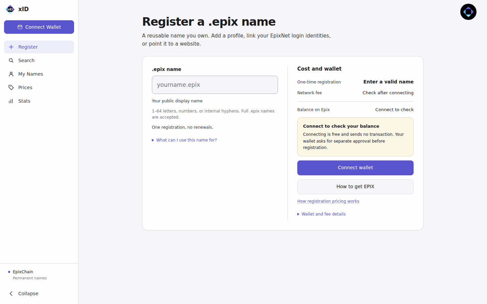

# xID for developers

xID is the naming and identity system of Epix Chain. A name such as `alice.epix` is owned by a chain account and can carry a profile, DNS-like records and a list of linked EpixNet identities. This page is for xite authors and contract authors who want to read, verify or act on that data. For the user's view (registering a name, linking a node, pointing a name at a xite), see [xID: names and identity](../start/xid.md).



## What xID does for a xite

- **Names instead of addresses.** `talk.epix` in the address bar resolves to a xite address through an on-chain record.
- **Authors with names.** A visitor's posts live in a directory named after their xID, such as `data/users/alice.epix/`. Every node checks against the chain that the key which signed the content is linked to that name.
- **One identity across systems.** The same name identifies an author in a xite and an account on chain, so a contract can pay "the owner of `alice.epix`" without your page knowing a wallet address.

## What is registered on chain

Each name is one record in the chain's xID module, with several parts attached to it.

| Part | Fields | Notes |
| --- | --- | --- |
| **Name record** | `name`, `tld`, `owner`, registration block height | The owner is a chain account. Ownership can be transferred. |
| **Profile** | `avatar` (a URL), `bio` | The module's Cosmos message validation allows an avatar of up to 256 bytes and a bio of up to 512 bytes. The xID manager enforces the same limits. |
| **DNS records** | `record_type`, `value`, `ttl` | One value per record type. The module's Cosmos message validation allows only the record types below, a value of up to 1,024 bytes and a `ttl` of `0` (resolver default) or 60 to 604,800 seconds. |
| **Linked identities** | `address`, `label`, block height added, `active`, block height and time revoked | EpixNet identity addresses allowed to sign content as this name. |
| **Primary name** | One name per owner account | Used for reverse resolution from an account to a name. |
| **Content root** | A hash and the block height it was updated | Computed by the chain from the active linked identities. |

### Names

- The label is 1 to 64 characters with the module's default parameters: lowercase letters, digits and hyphens, with no hyphen at the start or end. Input is lowercased before it is registered.
- The top-level part is 2 to 16 lowercase letters. EpixNet uses `epix`.
- Registering charges a fee that depends on the length of the name, read from the price tiers of the top-level name. The fee is paid in `aepix` from the registering account and burned.
- The first name an account registers becomes its primary name automatically. When a name is transferred away, it stops being the old owner's primary name, and it becomes the new owner's primary name if they had none.

### DNS records

The module defines these record types. The numbers are the standard DNS type numbers, plus one private-use type for EpixNet.

| Type | Number | Typical value |
| --- | --- | --- |
| `A` | 1 | IPv4 address |
| `NS` | 2 | Name server hostname |
| `CNAME` | 5 | Hostname alias |
| `MX` | 15 | Priority and mail hostname |
| `TXT` | 16 | Free text |
| `AAAA` | 28 | IPv6 address |
| `SRV` | 33 | Priority, weight, port and hostname |
| `EPIXNET` | 65280 | A xite address (`epix1...`) |

The `EPIXNET` record is the one EpixNet reads: it is how a name points at a xite. The other types are stored on chain for services that choose to read them. Storing an `A` record does not publish anything in the public DNS.

!!! note "Limits are not a guarantee about what you read"
    The limits above are checked on Cosmos transactions and by the xID manager. The precompile's `updateProfile` and `setDNSRecord` do not apply them, so a value written through the EVM can be longer or use another record type. When you read a profile or a record, bound its length and escape it before you display it.

### Linked identities

A linked identity is an EpixNet identity address (an auth address, `epix1...`) that the name's owner has authorized. It is what lets a node sign content as `alice.epix` without holding the wallet that owns the name. See [the difference between wallet and identity keys](index.md#addresses-epix1-and-0x).

- Only the name's owner can link or unlink.
- An identity address can be linked to one name only. Linking it to a second name fails.
- Unlinking does not delete the entry. It marks it inactive and records the block height and time of the revocation. The address stays reserved for that name.
- Linking the same address to the same name again makes it active again and updates its label.
- A name can have several linked identities, for example one per device.

Revocation times matter to verification: content signed by a revoked identity stays valid only if it was signed before the revocation. See [how a user manifest is verified](../build/user-content.md#how-a-user-manifest-is-verified).

### State digest

After every change the module recomputes a Merkle tree over all names and stores its root, the state digest. Validators sign that digest. This is what makes an xID answer checkable by a client that does not trust the server it asked. See [How the node resolves and verifies names](#how-the-node-resolves-and-verifies-names).

## Three ways to read xID

| Route | Trust | Best for |
| --- | --- | --- |
| **Node commands** (`xidResolve`, `xidResolveBatch`, `xidResolveName`) | Verified by the visitor's node against validator signatures | Showing names, profiles and identities in a xite |
| **The precompile over EVM RPC** | You trust the RPC endpoint's answer | Anything next to a transaction: quotes, ownership checks, writes |
| **The Cosmos REST API** (`/xid/v1/...`) | You trust the REST endpoint's answer | Listings the precompile does not offer, such as every name of an owner or the price tiers |

Prefer the node commands for anything you display. They need no network code in your page, and their answers are verified. Forward lookups use the user's chain endpoint settings. A reverse lookup (address to name) is the exception: its first step, which only names a candidate name, always asks the node's built-in default REST endpoint, and the answer is then confirmed through the verified forward lookup.

## Reading through the node

These commands need no permission. The full reference is in [identity commands](../api/identity.md).

### xidResolve

Reverse-resolves an identity address to the name it is linked to. It also accepts a dotted name and resolves it forward, which is convenient because xites store the author's directory name.

```js
var info = await epixFrame.cmd("xidResolve", ["alice.epix"]);
// {
//   name: "alice", tld: "epix",
//   owner: "epix1...",          // the account that owns the name
//   active: true,               // false when the queried identity was revoked
//   revoked_at: 0,              // block height, 0 when not revoked
//   revoked_at_time: 0,         // unix time, 0 when not revoked
//   avatar: "https://...",      // "" when unset
//   bio: "..."                  // "" when unset
// }
// or null when nothing is registered or linked
```

### xidResolveBatch

Resolves up to 50 addresses or names in one call and returns an object keyed by what you asked for. Use it for lists: one call for all the authors on a page.

```js title="Load the profiles of every author on a page"
async function loadAuthors(directories) {          // ["alice.epix", "bob.epix", ...]
  var unique = Array.from(new Set(directories)).slice(0, 50);
  var result = await epixFrame.cmd("xidResolveBatch", [unique]);
  // { "alice.epix": { name, tld, owner, active, avatar, bio, ... }, "bob.epix": null }
  return result;
}
```

The node resolves the entries concurrently and keeps your order. A `null` value means the name is not registered, or the lookup could not be completed.

### xidResolveName

Returns the full verified record of one name, including its identities and DNS records.

```js
try {
  var record = await epixFrame.cmd("xidResolveName", ["alice.epix"]);
  // {
  //   name: "alice", tld: "epix", owner: "epix1...",
  //   content_root: "...",
  //   identities: [{ address: "epix1...", label: "epixnet", active: true,
  //                  revoked_at: 0, revoked_at_time: 0 }],
  //   dns_records: [{ record_type: 65280, value: "epix1..." }],
  //   avatar: "", bio: ""
  // }
} catch (err) {
  // err.error says why: not found, chain unreachable, trust not established
}
```

You can also pass the parts separately: `["alice", "epix"]`. Without a top-level part, `epix` is assumed.

On failure the command returns an object with an `error` field instead of a record. With EpixFrame's promise style that arrives as a rejection, which is why the example uses `try` and `catch`.

!!! note "Owner addresses are in bech32"
    The node returns `owner` and identity addresses as `epix1...` strings. A wallet gives you `0x...`. They are two spellings of the same bytes, but you cannot compare the strings directly. To compare with a connected wallet, read the owner from the precompile, which returns a `0x` address, or convert first. See [Addresses](index.md#addresses-epix1-and-0x).

### Caching

The node caches answers for a short time and serves a previously verified answer immediately while it refreshes in the background. After a transaction that changes a link, the cached reverse lookup for that address can be stale for a moment. `xidInvalidateCache` with the address drops it, which is what the xID manager does right after a linking transaction.

## The xID precompile

The xID module is reachable from the EVM at a fixed address:

```text
0x0000000000000000000000000000000000000900
```

It behaves like a contract. Views are free `eth_call` requests, and state-changing functions are transactions sent from a wallet.

### Read functions

| Function | Returns | When nothing is found |
| --- | --- | --- |
| `resolve(string name, string tld)` | `address owner` | The zero address |
| `reverseResolve(address addr)` | `string name, string tld`: the account's primary name, or else the first name it owns | Two empty strings |
| `reverseResolveBech32(string bech32Addr)` | The same, for an `epix1...` string | Two empty strings |
| `getPrimaryName(address owner)` | `string name, string tld`: the primary name only | Two empty strings |
| `reverseResolveByIdentity(string identityAddress)` | `string name, string tld, bool found`: the name an identity address is linked to | `found` is `false` |
| `getProfile(string name, string tld)` | `string avatar, string bio` | Two empty strings |
| `getDNSRecord(string name, string tld, uint16 recordType)` | `string value, uint32 ttl` | Empty string and `0` |
| `getLinkedIdentities(string name, string tld)` | Six parallel arrays: `addresses`, `labels`, `addedAts`, `actives`, `revokedAts`, `revokedAtTimes` | Empty arrays |
| `getRegistrationFee(string name, string tld)` | `uint256 fee`, in `aepix` | |
| `getContentRoot(string name, string tld)` | `string root, uint64 updatedAt` | Empty string and `0` |
| `getStateDigest()` | `string digest, uint64 height, uint64 numNames` | |

`reverseResolveByIdentity` reports the link whether or not it has been revoked. To know whether an identity is still active, read `getLinkedIdentities` and check its `actives` entry.

### Write functions

Every write is made by the name's owner, except `register`, which makes the caller the owner. Each returns `bool success`.

| Function | Effect |
| --- | --- |
| `register(string name, string tld)` | Registers the name to the caller. The fee is taken from the caller's balance by the chain and burned. It is not sent as transaction value. |
| `transferName(string name, string tld, address newOwner)` | Transfers ownership. This cannot be undone by the old owner. |
| `setPrimaryName(string name, string tld)` | Makes one of the caller's names the primary name. |
| `updateProfile(string name, string tld, string avatar, string bio)` | Replaces the avatar and bio. |
| `setDNSRecord(string name, string tld, uint16 recordType, string value, uint32 ttl)` | Sets the record of that type. |
| `deleteDNSRecord(string name, string tld, uint16 recordType)` | Removes the record of that type. |
| `linkIdentity(string name, string tld, string identityAddress, string label)` | Links an EpixNet identity address to the name. |
| `unlinkIdentity(string name, string tld, string identityAddress)` | Revokes a linked identity. |

A call from an account that does not own the name reverts with a message such as `caller is not the owner of alice.epix`.

### Events

| Event | Arguments |
| --- | --- |
| `NameRegistered` | `address indexed owner, string name, string tld` |
| `NameTransferred` | `address indexed from, address indexed to, string name, string tld` |
| `PrimaryNameSet` | `address indexed owner, string name, string tld` |
| `ProfileUpdated` | `address indexed owner, string name, string tld` |
| `DNSRecordSet` | `string name, string tld, uint16 recordType, string value` |
| `DNSRecordDeleted` | `string name, string tld, uint16 recordType` |
| `IdentityLinked` | `string name, string tld, string identityAddress, string label` |
| `IdentityUnlinked` | `string name, string tld, string identityAddress` |
| `ContentRootUpdated` | `string name, string tld, string root` |

### Reading the precompile from a page

The examples use the `Rpc` helper from [Reading with failover](contracts.md#reading-with-failover).

```js title="js/xid.js"
var XID = {
  address: "0x0000000000000000000000000000000000000900",
  abi: [
    "function resolve(string name, string tld) view returns (address owner)",
    "function reverseResolve(address addr) view returns (string name, string tld)",
    "function reverseResolveBech32(string bech32Addr) view returns (string name, string tld)",
    "function reverseResolveByIdentity(string identityAddress) view returns (string name, string tld, bool found)",
    "function getPrimaryName(address owner) view returns (string name, string tld)",
    "function getProfile(string name, string tld) view returns (string avatar, string bio)",
    "function getDNSRecord(string name, string tld, uint16 recordType) view returns (string value, uint32 ttl)",
    "function getRegistrationFee(string name, string tld) view returns (uint256 fee)",
    "function getLinkedIdentities(string name, string tld) view returns (string[] addresses, string[] labels, uint64[] addedAts, bool[] actives, uint64[] revokedAts, int64[] revokedAtTimes)",
    "function register(string name, string tld) returns (bool success)",
    "function setDNSRecord(string name, string tld, uint16 recordType, string value, uint32 ttl) returns (bool success)",
    "function linkIdentity(string name, string tld, string identityAddress, string label) returns (bool success)",
    "event NameRegistered(address indexed owner, string name, string tld)"
  ]
};

function xidRead(method, args) {
  return Rpc.read(function (provider) {
    var contract = new ethers.Contract(XID.address, XID.abi, provider);
    return contract[method].apply(contract, args || []);
  });
}

// The name of a wallet account, or null. "alice.epix" style.
async function nameOf(account) {
  var result = await xidRead("reverseResolve", [account]);
  return result.name ? result.name + "." + result.tld : null;
}

// The account that owns a name, or null.
async function ownerOf(fqdn) {
  var parts = fqdn.split(".");
  var owner = await xidRead("resolve", [parts[0], parts[1] || "epix"]);
  return owner === ethers.ZeroAddress ? null : owner;
}

// The xite address a name points at, or null.
async function xiteOf(fqdn) {
  var parts = fqdn.split(".");
  var record = await xidRead("getDNSRecord", [parts[0], parts[1] || "epix", 65280]);
  return record.value || null;
}

// getLinkedIdentities returns six parallel arrays. One object per identity
// is easier to work with.
async function identitiesOf(fqdn) {
  var parts = fqdn.split(".");
  var r = await xidRead("getLinkedIdentities", [parts[0], parts[1] || "epix"]);
  return r.addresses.map(function (address, i) {
    return {
      address: address,
      label: r.labels[i],
      addedAt: Number(r.addedAts[i]),
      active: r.actives[i],
      revokedAt: Number(r.revokedAts[i]),
      revokedAtTime: Number(r.revokedAtTimes[i])
    };
  });
}
```

### Writing to the precompile from a page

Writes use the `sendContractTx` helper from [Sending a transaction](contracts.md#sending-a-transaction). Registration shows the two rules that matter: quote the fee from the chain, and quote it again just before you ask the wallet.

```js title="Quote and register a name"
// Step 1: is the name free, and what does it cost?
async function quoteName(label) {
  var owner = await xidRead("resolve", [label, "epix"]);
  if (owner !== ethers.ZeroAddress) return { available: false };
  var fee = await xidRead("getRegistrationFee", [label, "epix"]);   // bigint, aepix
  return { available: true, fee: fee, feeText: ethers.formatEther(fee) + " EPIX" };
}

// Step 2: register at the price the user saw, or stop.
async function registerName(label, quotedFee, onStatus) {
  var fee = await xidRead("getRegistrationFee", [label, "epix"]);
  if (fee !== quotedFee) {
    throw new Error("The registration price changed. Review the updated fee before confirming.");
  }
  return sendContractTx({
    address: XID.address,
    abi: XID.abi,
    method: "register",
    args: [label, "epix"],
    onStatus: onStatus
  });
}
```

Notes:

- The registration fee does not appear as transaction value. The chain deducts it from the caller's balance while it executes `register`. The account therefore needs the fee plus the network fee, and the wallet's prompt shows only the network fee. Tell the user the total yourself.
- The fee is not locked while a wallet prompt is open. The simulation in `sendContractTx` catches an insufficient balance before the wallet opens.
- Never hardcode a price. Read it with `getRegistrationFee`.

!!! tip "You usually do not need to build this"
    Registration, profiles, records and identity linking are already implemented in the xID manager xite. When your xite needs the visitor to have an identity, call `certXid`: the node opens its picker and, when a name has to be registered or linked, sends the visitor to the xID manager and brings them back. See [Asking the visitor to pick an identity](../build/user-content.md#asking-the-visitor-to-pick-an-identity).

### Calling the precompile from a contract

Copy the interface from one of the contract kits. This is `IXID.sol` from [epix-tipping](https://github.com/EpixZone/epix-tipping):

```solidity title="IXID.sol"
// SPDX-License-Identifier: MIT
pragma solidity ^0.8.24;

address constant XID_PRECOMPILE_ADDRESS = 0x0000000000000000000000000000000000000900;
IXID constant XID = IXID(XID_PRECOMPILE_ADDRESS);

interface IXID {
    /// Resolves a name to its owner (zero address if not found).
    function resolve(string calldata name, string calldata tld) external view returns (address owner);

    /// Reverse-resolves an address to its primary name.
    function reverseResolve(address addr) external view returns (string memory name, string memory tld);

    /// The explicitly set primary name of an address.
    function getPrimaryName(address owner) external view returns (string memory name, string memory tld);
}
```

Wrap the calls in `try` and `catch`, as the kits do. A precompile that is unavailable (on a local test chain, for example) should degrade your feature, not lock your contract. These helpers are taken from the tipping and airdrop kits:

```solidity
/// Try to resolve an xID name. Returns address(0) if the precompile reverts.
function _tryResolve(string calldata name, string calldata tld) private view returns (address) {
    try XID.resolve(name, tld) returns (address owner) {
        return owner;
    } catch {
        return address(0);
    }
}

/// Try to reverse-resolve an address. Returns empty strings if the
/// precompile reverts or is unavailable.
function _tryReverseResolve(address addr) private view returns (string memory name, string memory tld) {
    try XID.reverseResolve(addr) returns (string memory n, string memory t) {
        return (n, t);
    } catch {
        return ("", "");
    }
}

function _hasXid(address addr) private view returns (bool) {
    (string memory name,) = _tryReverseResolve(addr);
    return bytes(name).length > 0;
}
```

The two patterns in the kits are pay-by-name (`tipByXid` resolves a name to the account to pay) and treat-named-accounts-differently (the airdrop gives a larger claim to an address that has a name). Both are shown in [Read and write contracts](contracts.md).

For the write functions, the precompile treats its direct caller as the actor. If a contract calls `register`, the contract becomes the owner and its balance pays the fee.

## The Cosmos REST API

The module also serves a REST API on the chain's REST endpoint (`chain_rpc_url` in `serverInfo`). Its query routes include:

| Route | Returns |
| --- | --- |
| `GET /xid/v1/resolve/{tld}/{name}` | The name record |
| `GET /xid/v1/reverse/{address}` | The account's primary name, or else the first name it owns. An account with no name gets a response without a name record. |
| `GET /xid/v1/names/{owner}` | Every name an account owns, paginated |
| `GET /xid/v1/reverse_identity/{address}` | The name record and identity entry an identity address is linked to |
| `GET /xid/v1/identities/{tld}/{name}` | The linked identities of a name |
| `GET /xid/v1/profile/{tld}/{name}` | The profile |
| `GET /xid/v1/dns/{tld}/{name}` | The DNS records |
| `GET /xid/v1/fee/{tld}/{name}` | The registration fee |
| `GET /xid/v1/tlds` | The top-level names with their price tiers |
| `GET /xid/v1/stats` | Totals: names registered and fees burned |
| `GET /xid/v1/resolve_with_proof/{tld}/{name}` | The record with its Merkle proof. This is what the node verifies. |
| `GET /xid/v1/state_digest` | The current state digest |
| `GET /xid/v1/attestations` | Validator signatures for a digest |

Addresses in these routes are `epix1...` strings. List routes follow the standard Cosmos pagination: a page can be smaller than the limit you ask for, so follow `pagination.next_key` instead of assuming one page is everything.

A plain REST answer is not verified. Use it for convenience listings, and use the node commands when the answer decides what your xite trusts.

## How the node resolves and verifies names

When a user opens `talk.epix`, the node has to turn that name into a xite address without trusting whichever server answers. The same machinery backs the `xidResolve*` commands and the verification of every user's content.

1. **Ask for the record with a proof.** The node requests `/xid/v1/resolve_with_proof/{tld}/{name}` from the configured REST endpoint.
2. **Bind the data to the proof.** The response contains the exact bytes of the name's leaf in the chain's Merkle tree. The node hashes those bytes, checks that the hash is the leaf the proof is about, checks that the leaf is for the name it asked for, and reads the record from those bytes only.
3. **Check inclusion.** It recomputes the Merkle path from the leaf to the root.
4. **Check that the root is final.** The root must be a state digest signed by validators holding more than two thirds of the voting power in the validator set the node trusts.
5. **Use the record.** The `EPIXNET` record (type 65280) gives the xite address to download and serve. The linked identities say which keys may sign as that name.

The validator set the node trusts is kept current by a light client that follows the chain's block headers. A fresh install establishes its first trusted set by asking several independent endpoints and requiring them to agree. Every step fails closed: a tampered proof, an unsigned digest or a missing trust anchor produces an error, never an unverified answer.

The details, including what happens when the chain cannot be reached, are in [xID light client and finality](../internals/xid-light-client.md).

What this means for your xite:

- **A name can be unresolvable for a while.** On a freshly started node, or with the chain unreachable, lookups fail or return `null` until trust is established. Render authors by directory name first and add profile data when it arrives.
- **`serverInfo.xid_trust` tells you the state.** Its `state` field is `anchored` when lookups are verified end to end, `establishing` while the node is still building trust, `expired` when its trusted validator set is too old to use, `offline_cache` when the node is offline by policy, and `legacy` when verification is not required (a development compatibility mode).
- **`siteInfo.canonical_domain` is the verified name of the current xite**, or `null`. The node sets it only after checking that the name really resolves to this xite's address.

### Give your xite a name

Pointing a name at a xite is one record: `setDNSRecord(name, tld, 65280, "<xite address>", 0)`, sent by the name's owner. The xID manager has a form for it. The xite then claims the name in its `content.json`, and nodes display the name only after verifying both directions. The steps are in [Give your xite a .epix name](../build/publishing.md#give-your-xite-a-epix-name).

## What siteInfo says about the visitor

`siteInfo` reports the identity the visitor is using on your xite. The first three fields below are `null` while the visitor browses anonymously.

| Field | Example | Meaning |
| --- | --- | --- |
| `xid_directory` | `alice.epix` | The visitor's xID, which is also their user directory name |
| `cert_user_id` | `alice@xid.epix` | The identity label written into the visitor's signed content |
| `auth_address` | `epix1...` | The identity address that signs the visitor's content |
| `identities` | array | Every identity linked on this node, with which one is selected here |
| `identity_scope` | `inherit`, `xite` or `none` | Whether this xite uses the node default, its own choice, or no identity |

Three things `siteInfo` does not tell you:

- **The wallet.** There is no wallet address in `siteInfo`. The node and the wallet are separate, and a visitor can have an identity without a connected wallet.
- **The owner account of the name.** Resolve it: `xidResolve` returns `owner`, and the precompile's `resolve` returns it as a `0x` address.
- **Whether the identity is still active on chain.** The node selected it when it was linked. Use `xidResolve` with `auth_address` when you need the current status.

The complete field list and the events that announce an identity change are in [What the page sees in siteInfo](../build/user-content.md#what-the-page-sees-in-siteinfo).

## Attribute content by xID

Attribution is mostly free. A user's files live under `data/users/<xID>/`, so the directory name of any row is its author's name. Add that directory to your database rows (see [Database](../build/database.md)), then decorate the list with one batched lookup:

```js title="Show names and avatars for a list of posts"
async function decorate(posts) {                   // each post has post.directory
  var directories = posts.map(function (post) { return post.directory; });
  var profiles = {};
  try {
    profiles = await epixFrame.cmd("xidResolveBatch", [Array.from(new Set(directories)).slice(0, 50)]);
  } catch (err) {
    // The chain is unreachable: fall back to the directory names.
  }
  posts.forEach(function (post) {
    var profile = profiles[post.directory];
    post.authorName = post.directory;              // "alice.epix", always available
    post.authorBio = profile ? profile.bio : "";
    post.authorAvatar = profile ? profile.avatar : "";
  });
  return posts;
}
```

Guidelines:

- **The directory name is the identity.** Do not show a name taken from inside a user's own JSON as if it were verified. Anyone can write any string in their own file. The directory is what the node checked against the chain.
- **Treat profile fields as untrusted text.** The avatar is a URL and the bio is free text written by the name's owner. Bound and escape the bio, and remember that loading a remote avatar tells that server who is viewing. The node ships an avatar helper, [`epix-avatar.js`](https://github.com/EpixZone/EpixNet/blob/main/ui/media/epix-avatar.js), that xites vendor to fetch small cached thumbnails through the wrapper instead.
- **Do not block rendering on the chain.** Draw the list with directory names, then fill in profiles.

## Gate content by xID

There are three places to enforce a rule. Choose by what the rule protects.

### In the xite's rules, enforced by every node

Requiring an xID to post is a declaration in the manifest that governs your user directories:

```json title="data/users/content.json (excerpt)"
{
  "user_contents": {
    "cert_signers": { "xid.epix": ["chain"] },
    "permission_rules": {
      ".*": { "files_allowed": "data.json", "max_size": 200000 }
    },
    "permissions": {}
  }
}
```

`"xid.epix": ["chain"]` means a user's content is accepted only if its signing key is an identity that Epix Chain links to the name of the directory. Every node checks this when it receives the content, so the rule holds even against a modified copy of your page.

The same block lets you refine by name:

- `permissions` holds per-user overrides keyed by directory name. Setting a name to `false` bans it.
- `permission_rules` keys are regular expressions matched against `xid/<name>@xid.epix`.
- A `signers` list inside a rule can name moderators by xID, for example `["moderator.epix"]`. The node resolves the name to its linked identities at verification time.

The full reference is in [User content](../build/user-content.md#declare-the-rules) and [Moderation](../build/user-content.md#moderation).

### In the page, as user experience

Check for an identity before you show a form, and offer the picker when there is none:

```js
async function requireIdentity() {
  var info = await epixFrame.siteInfo();
  if (info.cert_user_id) return info;

  var result = await epixFrame.cmd("certXid", []);
  if (result !== "ok") return null;                // dismissed, or sent to register

  info = await epixFrame.siteInfo();
  return info.cert_user_id ? info : null;
}
```

This is a convenience, not a protection. Anything a page checks can be skipped by someone running a different page. Keep the real rule in the manifest or in a contract.

### In a contract, for rules about value

When the thing you gate is on chain, check on chain. A contract can require that the caller has a name, or that the caller owns a particular name:

```solidity
// The caller must have a name.
modifier onlyNamed() {
    (string memory name,) = XID.reverseResolve(msg.sender);
    require(bytes(name).length > 0, "xID required");
    _;
}

// The caller must own this particular name.
modifier onlyOwnerOf(string calldata name, string calldata tld) {
    require(XID.resolve(name, tld) == msg.sender, "not the owner of this name");
    _;
}
```

Here the calls are not wrapped in `try` and `catch`, on purpose: if the precompile cannot answer, a gate should refuse.

### Matching a wallet to the visitor's identity

Sometimes a page needs to know that the connected wallet and the EpixNet identity belong to the same name, for example to show "tips you received" to the right person. The name connects them: its owner is the wallet account, and its linked identities include the node's auth address.

```js title="Does the connected wallet own the visitor's xID?"
async function walletOwnsVisitorXid() {
  var info = await epixFrame.siteInfo();
  if (!info.xid_directory || !DemoWallet.address) return false;

  var owner = await ownerOf(info.xid_directory);   // from js/xid.js, a 0x address
  return !!owner && owner.toLowerCase() === DemoWallet.address.toLowerCase();
}
```

A `true` result is display logic only. It tells the page which wallet to expect. It does not prove anything to a contract or to another node.

## Limits and cautions

- **Everything in xID is public.** Names, owners, profiles, records and the list of linked identities are readable by anyone, and their history stays on chain.
- **A name is not a person.** One person can own many names, and names can be transferred. The owner of `alice.epix` today may not be the owner next month. If a relationship must survive a transfer, key it to something else.
- **Answers age.** Ownership and links can change between your read and your use of it. For anything that matters, check inside the transaction (in a contract) or let the node's verification decide (for content).
- **RPC and REST answers are assertions.** Only the node commands verify against validator signatures.
- **The node's verification targets mainnet by default.** A name registered only on testnet does not resolve on a normally configured node.

## Related pages

- [xID: names and identity](../start/xid.md), the user guide
- [User content](../build/user-content.md), for identity in signed content
- [Identity commands](../api/identity.md)
- [xID light client and finality](../internals/xid-light-client.md)
- [Read and write contracts](contracts.md)
- [Epix Chain for xite developers](index.md)
- [Glossary](../reference/glossary.md)
